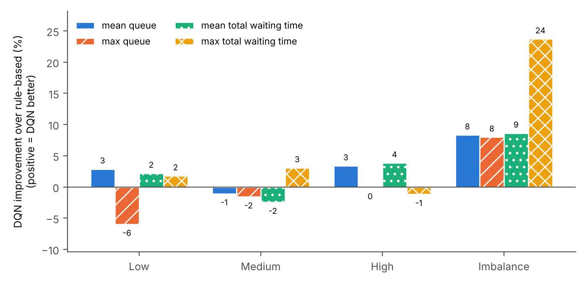

# Adaptive Traffic Signal Control System for Intersection Networks using Large Language Models (LLMs)

## 1. Introduction
### 1.1. Context and Motivation
In an urban traffic network, rush-hour traffic demand varies over time and across directions, making traffic light control challenging. Because conventional fixed-time traffic signal control follows predetermined schedules regardless of real-time traffic conditions, it leads to unnecessary waiting time and long vehicle queues. Therefore, this problem motivated us to investigate an Adaptive Traffic Signal Control System and explore a Large Language Model (LLM) as a decision-making agent. 

Adaptive traffic signal control controls the traffic lights based on the traffic state: traffic conditions and traffic light states at the decision point. The control system then decides whether to keep the current phase or switch to the next phase to control the green time. The purpose of this project is to reduce the vehicle queue length and waiting time, where the queue length is measured as the number of vehicles waiting for the traffic light on the observed incoming lanes. The study used SUMO simulation environment with TraCI through Python to observe and control traffic signals. The project initially focused on a simple 4-way intersection as the baseline, then extended to the O Cho Dua 6-way intersection and Thang Long Avenue (Go! Thang Long).

The project started with three baseline controllers: Fixed-time (FT), Rule-based (RB), and Deep Reinforcement Learning (DRL) in a simple 4-way intersection, followed by performance comparisons using simulation logs under different traffic scenarios with the same metrics. The next extension stage, in the two other complex maps, was repeated but adds the use of Large Language Model (LLM)-based control, which was used to make decisions after observing the traffic state. The LLM controller was also integrated into the DRL controller, and its performance was evaluated.

### 1.2. Objectives
The project aimed to achieve the following objectives:
- Set up the SUMO simulation environment on 3 maps and provide the vehicle density in 4 scenarios: low, medium, high, and imbalance.
- Deploy and integrate baselines on FT, RB, and DRL.
- Compare different controllers' performance in different scenarios.
- Evaluate the ability to expand to complex maps.
- Evaluate direct LLM + DRL from baseline to complex maps.

### 1.3. Expected outcomes
- A SUMO simulation environment with three maps across four scenarios.
- Logged data, traffic states, and actions.
- An adaptive traffic control prototype integrated with the SUMO simulation for complex real-world urban traffic scenarios.
- A fine-tuned lightweight local LLM capable of making real-time traffic signal control decisions.
- An experimental evaluation comparing the proposed LLM agent method with three baseline approaches using traffic performance metrics.

## 2. Proposed Methods
The project’s main goal is to build and evaluate the traffic signal control system in the simulation environment. Traffic volume varies over time, and demand can be uneven across different approaches to an intersection, making it difficult to allocate green time effectively. In addition, extending green time for one movement may increase the waiting time for others. At each decision point, the adaptive controller needs to determine whether to keep the current signal phase or switch to the next phase. Therefore, this decision is based on observed traffic conditions, the current signal phase, and the elapsed green time, subject to the timing and phase-transition constraints.

### 2.1. Related work
*summarize the research of conventional controller, DRL, LLM; then come up with this project's approach*

### 2.2. Simulation environment
The traffic networks were simulated in the SUMO environment, using OpenStreetMap data for their network representation of real-world intersections. They were built with lanes, directions, and a signal controller. The vehicles were introduced at different demand levels and were configured to reflect observed real-world traffic conditions, in that they did not always form straight, orderly queues. The simulation provided an environment for testing different traffic scenarios and evaluating the effects of control decisions. The three road networks were simulated in SUMO as follow:

*insert 3-map figures, including the TLS, dont need vehicles here, just road network only*

[caption] Road networks in SUMO simulation: (a) Simple four-way intersection, (b) O Cho Dua six-way intersection, (c) Thang Long Avenue

TraCI connected the control program to SUMO, allowing the program to retrieve traffic data and signal states and send control commands to the simulation. The Python program collected and processed data through TraCI, coordinated the simulation runs, and invoked the selected controller. It was also used to execute actions, maintain logs, and perform comparative evaluations. 

Before each simulation run, the required configuration inputs included the traffic network (the road network structure), the traffic demand and its movements, signal phases and configuration, and the run configuration, including the controller, scenario, seed, and simulation duration.

### 2.3. Problem Definition
#### 2.3.1. Terminology
In this project, the basis for defining traffic state, actions, and control problems were expressed as following:

| Terminology | Definition | Example in this project |
|---|---|---|
| Intersection | An area where two or more roads meet or cross each other, allowing vehicles to move between approaches | Simple four-way intersection   O Cho Dua six-way intersection |
| Approach | A road section that leads into the intersection from 1 direction and may include one or more incoming lanes | The Northern (N) approach of four-way intersection |
| Incoming - Outgoing lane | An incoming lane leads vehicles towards an intersection, while an outgoing lane carries vehicles away from it.   The incoming lanes were selected to observe traffic conditions. | `N_in_0`: an incoming lane from the Northern (N) approach   `S_out_0`: an outgoing lane on the Southern (S) side of the intersection |
| Traffic movement | Movement allowed from an incoming lane to an outgoing lane through the intersection | `N_in_0` → `S_out_0` represents a straight-through movement |
| Traffic Light System (TLS) | A signal system that controls a set of movements | TLS with ID $J$ controls the simple four-way intersection |

Let $\mathcal{J}$ denote the set of controlled TLS. For each TLS $j \in \mathcal{J}$, let $\mathcal L_j^{\mathrm{in}}$ and $\mathcal L_j^{\mathrm{out}}$ denote the sets of incoming and outgoing lanes associated with its controlled movements. A traffic movement is represented by an ordered pair: $$m = (\ell_{in}, \ell_{out}) \in \mathcal{M}_j$$ where $\ell_{in} \in \mathcal L_j^{\mathrm{in}}$, $\ell_{out} \in \mathcal L_j^{\mathrm{out}}$, and $\mathcal{M}_j$ is the set of permitted movements controlled by TLS $j$.

The following terms describe the signal phase and their organization. The corresponding examples refer to the simple four-way intersection:

| Terminology | Definition | Example in this project |
|---|---|---|
| Signal phase | A simultaneous signal configuration for movements controlled by a TLS | Phase 1 serves the NS group while the EW group remains red |
| Green group | A group of traffic movements served together during a green interval, which may span multiple consecutive signal phases | The NS group is served during phases 0 - 1, while the EW group is served during phases 4 - 5 |
| Yellow phase | A transition phase indicating the end of green for the currently served movements, before their signals turn red | Phases 2 and 6 provide 3-second yellow intervals after the NS and EW green intervals, respectively |
| All-red clearance | A transition interval during which all controlled movements receive red signals, allowing vehicles already in the intersection to clear before the next green group is served | Phases 3 and 7 provide 3-second all-red clearance intervals |
| Signal cycle | A complete sequence of signal phases, from the start of a particular phase until that phase starts again | The FT program repeats phases 0 - 7, with a total cycle duration of 114 seconds |

A green group does not necessarily correspond to a single signal phase (e.g. phases 0 and 1 both serve the nS group, although they are represented as separate phases in SUMO)

The all-red clearance is different from the total red time of an individual movement, which includes the time during which other groups are served.

#### 2.3.2. Input Metrics and State Representation

### 2.4. Overall Framework
*a workflow of controller*

### 2.5. Overview of Control Approaches

The project aims to compare different controllers’ performance across scenarios on 3 road networks with different levels of complexity. Therefore, we decided to investigate control approaches ranging from the fixed light calendar (Fixed-time) and manual rule design (Rule-based) to reinforcement learning methods, with the integration of LLM-based approaches for direct decision-making or expert feedback to DRL. The controller performance is evaluated and compared using the same queue length and total waiting time metrics.

The table below summarizes the main ideas and roles of the control approaches considered in this research.

[caption] Different control approaches’ main ideas and roles.

| Method | Main idea | Role |
|---|---|---|
| Fixed-time (FT) | Control signal using a predefined phase schedule and fixed phase duration | Provide a baseline to evaluate the benefits of adaptive control |
| Rule-based (RB) | Adjust signals based on traffic status conditions and manually designed rules | Provide an adaptive baseline to assess whether simple rules improve performance compared to FT |
| Deep Reinforcement Learning (DRL) | Learn a control policy through interaction with the simulation environment and reward signals | Evaluate the ability to learn how to control from experience |
| Direct LLM | Use traffic status information as input to an LLM to directly propose control actions | Investigate the decision-making ability of an LLM in traffic signal control problem |
| LLM - DRL | Combine DRL with LLM-generated feedback role to support the learning process | Investigate whether LLM feedback improves performance compared to independent DRL |

These approaches are compared to identify the most suitable controller for each traffic scenario and road network; therefore, it is not definitely concluded that DRL or LLM-DRL is the best controller; this must be tested and runned via experiments. Their control mechanisms and implementation details are presented in Section 3.

## 3. Methodology
### 3.1. Traffic State and Action Retrieval
*how to retrieve, collect state and action execution through TraCI*

### 3.2. Baseline Controllers
#### 3.2.1. Fixed-time Controller

The fixed-time controller utilized a static signal program that was loaded in SUMO, which means that the phase sequence and durations were predetermined and were not adjusted in response to traffic conditions. Before the evaluation, the program verified that each selected traffic light system (TLS) was operating under a static program. The fixed-time controller served as a baseline for comparison against the adaptive controllers. The static signal program for the simple four-way intersection was configured as follows:

[caption] Fixed-time signal phases at the simple four-way intersection
| Phase index | Signal stage | Duration (s) |
|---|---|---|
| 0 | NS initial green | 3 |
| 1 | NS green | 48 |
| 2 | NS yellow | 3 |
| 3 | All-red clearance | 3 |
| 4 | EW initial green | 3 |
| 5 | EW green | 48 |
| 6 | EW yellow | 3 |
| 7 | All-red clearance | 3 |
| **Total** | **Complete cycle** | **114** |

At a simple four-way intersection, the north-south (NS) and east-west (EW) groups were served in turn. Each phase has a fixed duration in SUMO, and the simulator automatically moved to the next phase when the current phase ended. Before the next group received a green signal, the current direction went through a 3-second yellow phase, followed by a 3-second all-red clearance phase. The signal program repeated the NS-EW sequence. For each group, the configuration included a 3-second green start phase, a 48-second green phase, a 3-second yellow phase, and a 3-second all-red clearance. In total, each group’s turn lasted 57 seconds, and the complete cycle lasted for 114 seconds.

For O Cho Dua and Thang Long Avenue, the fixed-time baseline used the static signal programs configured for the respective networks.

#### 3.2.2. Rule-based Controller

Unlike the fixed-time controller, which used predetermined phase durations, the rule-based controller used observed queue lengths calculated based on the number of halting vehicles on the incoming lanes via TraCI to decide whether to maintain the current green or move to the next phase. The rule-based controller was the simplest adaptive baseline, which utilized `if-else` rules based on the current traffic state, requiring no learning and training. The minimum and maximum green-time thresholds were set to 30 and 75 seconds, respectively. These limits were introduced to avoid overly frequent phase switches and to prevent one direction from holding the green light for too long. At each decision point, occurring every 5 seconds (i.e., `decision_interval` = 5), the controller read the current state through TraCI and selected one of two actions: KEEP or SWITCH. The rule-based controller served as an adaptive baseline for comparison with DRL and LLM controllers.

For the simple four-way intersection, the controller grouped the approaches into two main groups: North-South (NS) and East-West (EW). Each approach had two incoming lanes; the total number of halting vehicles was summed within each group. Then, the controller applied the following rules in order:

[caption] Rule-based decision logic for the simple four-way intersection
| Priority | Condition | Action |
|---|---|---|
| 1 | The signal was in a yellow or all-red transition. | KEEP |
| 2 | The elapsed green time was less than 30 seconds. | KEEP |
| 3 | The elapsed green time was greater than or equal to 75 seconds. | SWITCH |
| 4 | The opposite group had a strictly longer queue than the current group. | SWITCH |
| 5 | None of the above conditions was satisfied. | KEEP |

A SWITCH decision initiated a transition to the next green group through the configured yellow and all-red phases and was handled by the `SignalController`, which enforced the timing and phase-transition constraints: the controller was prevented from switching before the minimum green had elapsed, and it automatically transitioned through yellow and all-red into the next green when the maximum green was reached. The yellow and all-red intervals followed the signal program of the traffic light (3 seconds each in the simple intersection), ensuring a fair comparison with the fixed-time controller.

The same principle was extended to complex intersections (O Cho Dua and Thang Long Avenue) through `CyclicRuleBasedController`. In this version, the controller did not use only two opposing groups. Instead, a fixed cyclic order of green phases was defined for each traffic light. For example, O Cho Dua used phases [0,2,5,7], while each traffic light on Thang Long Avenue used phases [0,3]. The incoming lanes for each phase were taken automatically from the SUMO signal program, and the queue of a phase was the total number of halting vehicles on these lanes. At every decision point, the controller compared the queue of the current phase with the queue of the next phase in this fixed order. A SWITCH always moved to the next phase, did not choose the phase with the longest queue, or skip any phase. The minimum green (30s), maximum green (75s), and decision interval (5s) remained the same as in the simple four-way intersection, whereas the yellow and all-red durations were taken from the SUMO signal program of each traffic light rather than the 3-second values of the simple intersection. On Thang Long Avenue, which has four traffic lights, each light was controlled independently.

#### 3.2.3. Deep Reinforcement Learning (DRL) Controller

### 3.3. Direct LLM-based Controller

### 3.4. LLM-DRL Integration

## 4. Experiments and Results
### 4.1. Experimental Setup
#### 4.1.1. Traffic scenarios and Simulation Parameters
#### 4.1.2. Training and Evaluation Protocol

### 4.2. Evaluation Metrics and Log Processing

### 4.3. Baseline Comparison
#### 4.3.1. Simple Four-way Intersection
The performance of FT, RB, and DQN was compared at the simple four-way intersection underr four traffic scenarios. The results for the four evaluation metrics with lower values indicating better performance are displayed below:

[caption] Baseline results of Simple Four-way Intersection in different scenarios

(a) Low Traffic
| Controller | Mean queue (vehicles) | Max queue (vehicles) | Mean total waiting time (s) | Max total waiting time (s) |
|---|---|---|---|---|
| FT | 4.96 ± 0.04 | 18.00 ± 1.00 | 97.88 ± 1.07 | 567.63 ± 24.16 |
| RB | 3.62 ± 0.11 | 13.00 ± 1.00 | 51.50 ± 1.62 | 281.50 ± 49.75 |
| DQN v1 | 3.52 ± 0.16 | 13.78 ± 0.69 | 50.38 ± 2.89 | 276.58 ± 5.68 |

(b) Medium Traffic
| Controller | Mean queue (vehicles) | Max queue (vehicles) | Mean total waiting time (s) | Max total waiting time (s) |
|---|---|---|---|---|
| FT | 12.93 ± 0.39 | 35.67 ± 2.89 | 238.83 ± 8.04 | 1037.87 ± 74.52 |
| RB | 9.48 ± 0.18 | 28.00 ± 1.00 | 131.17 ± 2.95 | 586.27 ± 63.43 |
| DQN v1 | 9.58 ± 0.08 | 28.44 ± 0.51 | 134.39 ± 1.88 | 568.40 ± 34.33 |

(c) High Traffic
| Controller | Mean queue (vehicles) | Max queue (vehicles) | Mean total waiting time (s) | Max total waiting time (s) |
|---|---|---|---|---|
| FT | 45.58 ± 2.86 | 93.33 ± 3.21 | 939.12 ± 75.53 | 3160.43 ± 357.15 |
| RB | 42.07 ± 3.47 | 92.67 ± 2.08 | 693.94 ± 51.83 | 2471.07 ± 219.77 |
| DQN v1 | 40.66 ± 0.86 | 92.78 ± 5.00 | 667.41 ± 23.55 | 2500.31 ± 226.53 |

(d) Imbalance Traffic
| Controller | Mean queue (vehicles) | Max queue (vehicles) | Mean total waiting time (s) | Max total waiting time (s) |
|---|---|---|---|---|
| FT | 82.78 ± 6.97 | 259.67 ± 34.12 | 1850.26 ± 111.75 | 10014.07 ± 387.89 |
| RB | 38.56 ± 4.49 | 119.67 ± 3.79 | 692.27 ± 126.49 | 4879.00 ± 1033.06 |
| DQN v1 | 35.36 ± 1.58 | 110.13 ± 4.99 | 632.72 ± 43.51 | 3722.87 ± 397.30 |

For FT and RB, mean ± SD was calculated across three evaluation traffic seeds. For DQN, results were first averaged across the same three traffic seeds for each trained model, then aggregated across training seeds: three for Low, Medium and High, and five for Imbalance.

Figure .. shows the percentage reduction in each metric achieved by DQN relative to RB across the four scenarios.

[caption] Percentage reduction in evaluation metrics for DQN relative to RB. Positive values indicate lower queue or total waiting-time values for DQN, while negative values indicate higher values.

In the low-traffic scenario, DQN reduced mean queue and mean total waiting time compared with RB; however, the maximum queue was approximately $6\%$ higher. Meanwhile, in the medium-traffic scenario, DQN achieved 3 out of 4 metrics that were higher than RB, which only improved max total waiting time. Generally, DQN did not perform better than RB in these 2 scenarios. For the high traffic scenario, mean queue and mean total waiting time both decreased to around 3 and 4 percent, respectively, although the 2 other metrics were still higher than RB. In this scenario, DQN showed better performance compared to RB, but it was not a considerable improvement.

In the imbalance scenario, all four metrics illustrated a remarkable reduction compared to RB, with the largest reduction was in max total waiting time, which constituted approximately $24\%$. Therefore, DQN achieved its most consistent improvements over RB in the Imbalance scenario, while its advantages in the balanced scenarios were limited and varied across metrics.

#### 4.3.2. O Cho Dua Six-way Intersection
#### 4.3.3. Thang Long Avenue

### 4.4. Evaluation of LLM-based Control
#### 4.4.1. LLM-based
#### 4.4.2. LLM-DRL Integration

### 4.5. Discussion

## 5. Discussion and Conclusion
### 5.1. Findings and Contributions
### 5.2. Limitations
### 5.3. Future work

## 6. References