# Adaptive Traffic Signal Control in SUMO: Baseline Comparison of Fixed-Time, Rule-Based and DQN Controllers

Stage 1 report. Scenarios: Low, Medium, High (balanced demand) and Imbalance (NS : EW = 6 : 1) at a four-way intersection.

## 1. Summary

We compare three signal controllers in SUMO under four traffic scenarios: a fixed-time program, a rule-based queue controller, and a Deep Q-Network (DQN) agent. All controllers are evaluated with the same four metrics on the same three held-out traffic seeds (57, 367, 1024).

Main findings:

1. DQN is better than fixed-time in every scenario (mean queue lower by 7% to 59%, mean total waiting time lower by 25% to 67%).
2. Against the rule-based controller, DQN is **only clearly better in the Imbalance scenario**: about 12% lower mean queue and 11% lower mean total waiting time averaged over 5 DRL seeds. In Low, Medium and High the difference is within the spread across seeds.
3. A diagnostic with two constant policies shows why. In Low, Medium and High, an "always request SWITCH" policy (change phase as soon as the 30 s minimum green allows) performs about as well as both the rule-based controller and DQN; in High, the final DQN models of several runs are exactly this constant policy. In Imbalance, both constant policies are far worse than DQN, so DQN learns a state-dependent policy there.
4. Changing the observation scales and the reward (version v2) removed observation saturation in High but did not improve the mean metrics; only the worst-case metrics improved slightly. It did not help in Imbalance.

## 2. Setup

### 2.1 Simulation and control interface

- SUMO 1.27.1 [3] with a TraCI bridge. Simulation step 0.1 s; a control decision every 5 s; episode length 3600 s, hence 720 decisions per episode.
- Signal constraints: minimum green 30 s, maximum green 75 s (a phase change is forced at 75 s).
- Actions: `KEEP` the current phase or `SWITCH` to the other direction group. A `SWITCH` request made before the minimum green has elapsed is ignored.
- Two direction groups: north-south (NS) and east-west (EW).

### 2.2 Traffic scenarios

The route files `SUMO/Map_Nga_tu/Map_<scenario>/traffic.rou.xml` (branch `main`, commit d7c294b) define 36 flows per scenario (4 approaches × 3 turning movements × 3 vehicle types), generated for 0 to 3600 s. Arrival rates in vehicles per hour:

| Scenario | N | S | E | W | NS total | EW total | Total | NS : EW |
|---|---|---|---|---|---|---|---|---|
| Low | 300 | 300 | 300 | 300 | 600 | 600 | 1200 | 1 : 1 |
| Medium | 750 | 750 | 750 | 750 | 1500 | 1500 | 3000 | 1 : 1 |
| High | 1350 | 1350 | 1350 | 1350 | 2700 | 2700 | 5400 | 1 : 1 |
| Imbalance | 1800 | 1800 | 300 | 300 | 3600 | 600 | 4200 | 6 : 1 |

In every scenario the vehicle mix is 80% motorcycles, 17% cars and 3% buses. Low, Medium and High differ only in volume (ratio 1 : 2.5 : 4.5) and are perfectly balanced between the two direction groups. Imbalance keeps the EW demand of Low (300 veh/h per approach) and raises the NS demand to 1800 veh/h per approach.

### 2.3 DQN environment (Gymnasium wrapper [4])

- Observation (11 values, clipped to [0, 1]): queue, number of vehicles, waiting time and mean speed for NS and EW, whether NS has green, whether the signal is in transition, and elapsed green time. Default scales: queue 20, vehicles 30, waiting time 60 s.
- Reward (v1): $r = -\left(1.0\cdot\frac{\text{halting}}{2\cdot 20} + 0.5\cdot\frac{\text{mean wait per vehicle}}{60}\right)$ per decision step.
- Algorithm: DQN [1] from Stable-Baselines3 [2], MLP policy with two hidden layers of 64 units, learning rate 1e-3, replay buffer 100,000, learning starts 1,000, batch size 64, discount 0.99, target update every 500 steps, train frequency 4, epsilon decays over the first 30% of training to 0.05, 100,000 training steps (about 139 episodes).

### 2.4 Evaluation protocol

- Training traffic seeds: 0 to 9. Test traffic seeds: 57, 367, 1024 (never used for training or model selection). Validation seeds in v2: 100, 101, 102.
- Metrics, per episode, from 720 samples taken every 5 s (t = 0, 5, ..., 3595 s) over the 8 incoming lanes: `mean_queue` and `max_queue` (halting vehicles), `mean_total_waiting_time` and `max_total_waiting_time` (sum of lane waiting times, seconds).
- Tables show mean ± sample standard deviation (n−1). For fixed-time, rule-based and constant policies the deviation is over the 3 test seeds. For DQN, each DRL seed is first averaged over the 3 test seeds, and the deviation is over DRL seeds.
- Fixed-time and rule-based numbers come from the teammate branch `maianh` (`results/comparison_result/avg_baseline_result.md`). Fixed-time runs the real SUMO program. The rule-based controller switches when the other group's queue exceeds the current group's queue, within the 30 s / 75 s limits.

### 2.5 Versions

| Version | Change | Used for |
|---|---|---|
| v1 | reward above; default scales; final model saved | main results (Section 3) |
| v2 | reward on queue and total waiting time (same quantities as the metrics); observation scales set per scenario; best model chosen on validation seeds | experiment in Section 4 |

DRL seeds 0 and 1 were trained with the original v1 code; DRL seeds 2, 3 and 4 with the v2 code configured as v1 (`--reward avg_wait --eval-freq 0`, default scales). The configuration is equivalent, but we did not verify that both code versions give bit-identical results.

## 3. Results

### 3.1 Overview

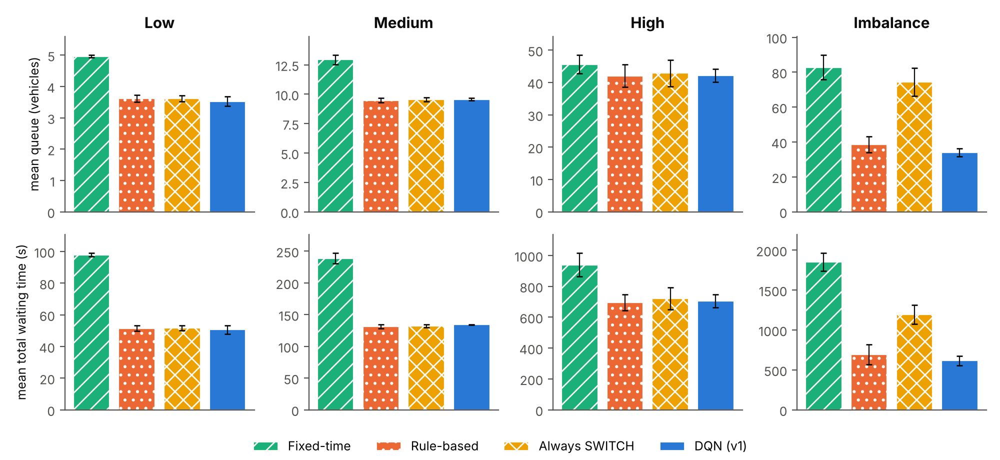

*Figure 1. Fixed-time, rule-based, "always SWITCH" constant policy and DQN (v1; 3 DRL seeds for Low, Medium, High and 5 for Imbalance). Error bars: SD over test seeds for the first three, SD over DRL seeds for DQN.*

### 3.2 Results per scenario

DQN rows are mean ± SD over DRL seeds (3 seeds for Low, Medium, High; 5 for Imbalance).

**Low**

| Controller | mean_queue | max_queue | mean_total_waiting_time | max_total_waiting_time |
|---|---|---|---|---|
| Fixed-time | 4.96 ± 0.04 | 18.00 ± 1.00 | 97.88 ± 1.07 | 567.63 ± 24.16 |
| Rule-based | 3.62 ± 0.11 | 13.00 ± 1.00 | 51.50 ± 1.62 | 281.50 ± 49.75 |
| Always SWITCH | 3.62 ± 0.10 | 13.33 ± 1.15 | 51.74 ± 1.68 | 285.57 ± 52.38 |
| DQN v1 | 3.53 ± 0.15 | 13.78 ± 0.69 | 50.65 ± 2.67 | 276.48 ± 5.81 |

**Medium**

| Controller | mean_queue | max_queue | mean_total_waiting_time | max_total_waiting_time |
|---|---|---|---|---|
| Fixed-time | 12.93 ± 0.39 | 35.67 ± 2.89 | 238.83 ± 8.04 | 1037.87 ± 74.52 |
| Rule-based | 9.48 ± 0.18 | 28.00 ± 1.00 | 131.17 ± 2.95 | 586.27 ± 63.43 |
| Always SWITCH | 9.57 ± 0.17 | 28.00 ± 1.00 | 132.25 ± 2.58 | 589.63 ± 61.16 |
| DQN v1 | 9.56 ± 0.10 | 27.78 ± 1.68 | 134.20 ± 0.57 | 580.01 ± 35.51 |

**High**

| Controller | mean_queue | max_queue | mean_total_waiting_time | max_total_waiting_time |
|---|---|---|---|---|
| Fixed-time | 45.58 ± 2.86 | 93.33 ± 3.21 | 939.12 ± 75.53 | 3160.43 ± 357.15 |
| Rule-based | 42.07 ± 3.47 | 92.67 ± 2.08 | 693.94 ± 51.83 | 2471.07 ± 219.77 |
| Always SWITCH | 42.86 ± 4.05 | 103.00 ± 12.77 | 720.76 ± 72.29 | 3031.43 ± 214.65 |
| DQN v1 | 42.19 ± 1.98 | 100.00 ± 7.63 | 704.83 ± 43.22 | 2940.73 ± 601.34 |

**Imbalance**

| Controller | mean_queue | max_queue | mean_total_waiting_time | max_total_waiting_time |
|---|---|---|---|---|
| Fixed-time | 82.78 ± 6.97 | 259.67 ± 34.12 | 1850.26 ± 111.75 | 10014.07 ± 387.89 |
| Rule-based | 38.56 ± 4.49 | 119.67 ± 3.79 | 692.27 ± 126.49 | 4879.00 ± 1033.06 |
| Always SWITCH | 74.41 ± 7.99 | 233.00 ± 23.52 | 1192.05 ± 119.00 | 6239.97 ± 431.32 |
| Always KEEP | 93.44 ± 11.93 | 257.00 ± 26.89 | 2912.17 ± 444.88 | 14723.93 ± 2789.57 |
| DQN v1 | 34.02 ± 2.31 | 104.40 ± 6.61 | 616.51 ± 58.48 | 3874.41 ± 519.19 |

### 3.3 DQN versus rule-based and fixed-time

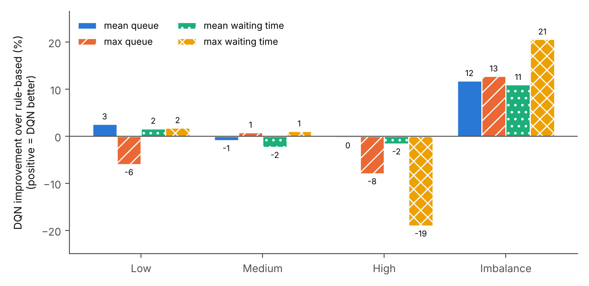

*Figure 2. Relative improvement of DQN over the rule-based controller (positive: DQN better).*

| Scenario | vs rule-based: queue / wait | vs fixed-time: queue / wait |
|---|---|---|
| Low | +2.6% / +1.6% | +28.8% / +48.3% |
| Medium | −0.9% / −2.3% | +26.1% / +43.8% |
| High | −0.3% / −1.6% | +7.4% / +24.9% |
| Imbalance | +11.8% / +10.9% | +58.9% / +66.7% |

"queue" is `mean_queue`, "wait" is `mean_total_waiting_time`. In Low, Medium and High the differences against the rule-based controller are smaller than the standard deviations, so we do not claim a difference. In High, DQN is worse on the worst-case metrics (`max_queue` −7.9%, `max_total_waiting_time` −19.0%).

### 3.4 Constant-policy diagnostic

We evaluated two constant policies: "always SWITCH" (changes phase as soon as the minimum green allows; the signal actually changes in 12.5% of decisions) and "always KEEP" (changes only when the 75 s maximum green forces it; 6.1% of decisions).

- Low, Medium: always SWITCH is practically identical to the rule-based controller and to DQN.
- High: the final models of DRL seed 1 (v1) and of both v2 runs give exactly the same numbers as always SWITCH on all test seeds (42.86 / 103.00 / 720.76 / 3031.43). A random-observation check confirmed that these networks choose SWITCH for 90% to 99% of inputs. DRL seed 2 matches the constant policy on test seed 1024 but differs on the other test seeds (its mean queue is 39.96).
- Imbalance: always SWITCH (queue 74.41) and always KEEP (93.44) are much worse than rule-based (38.56) and DQN (34.02). In simulation, DQN changes the phase in about 8.2% to 8.8% of decisions, less than always SWITCH (12.5%) but more than always KEEP (6.1%), consistent with choosing when to switch based on the traffic state.

### 3.5 Imbalance across DRL seeds

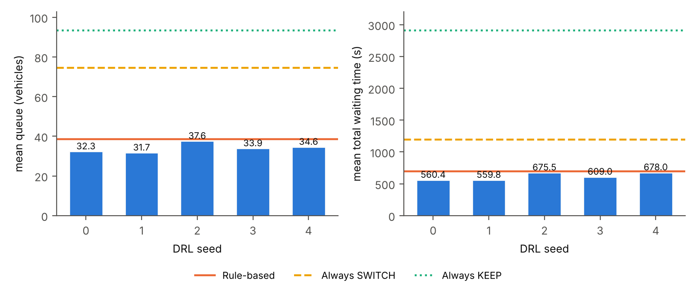

*Figure 3. Mean queue and mean total waiting time of each DRL seed in Imbalance, with the rule-based and constant-policy references.*

| DRL seed | mean_queue | max_queue | mean_total_waiting_time | max_total_waiting_time |
|---|---|---|---|---|
| 0 | 32.32 ± 1.88 | 99.67 ± 8.39 | 560.42 ± 52.89 | 3516.00 ± 937.91 |
| 1 | 31.70 ± 3.00 | 97.67 ± 8.39 | 559.75 ± 55.94 | 3488.00 ± 756.22 |
| 2 | 37.59 ± 8.18 | 114.67 ± 13.65 | 675.45 ± 150.32 | 3944.33 ± 387.54 |
| 3 | 33.87 ± 1.76 | 104.33 ± 10.41 | 608.95 ± 29.44 | 3679.03 ± 502.45 |
| 4 | 34.61 ± 3.07 | 105.67 ± 18.45 | 677.98 ± 58.72 | 4744.70 ± 574.66 |

Every seed has a lower mean queue than the rule-based controller (38.56), but the margin varies from 2.5% (seed 2, within the standard deviation) to 17.8%. Averaged over seeds, DQN is better than rule-based by 11.8% (`mean_queue`), 12.8% (`max_queue`), 10.9% (`mean_total_waiting_time`) and 20.6% (`max_total_waiting_time`).

### 3.6 Training curves

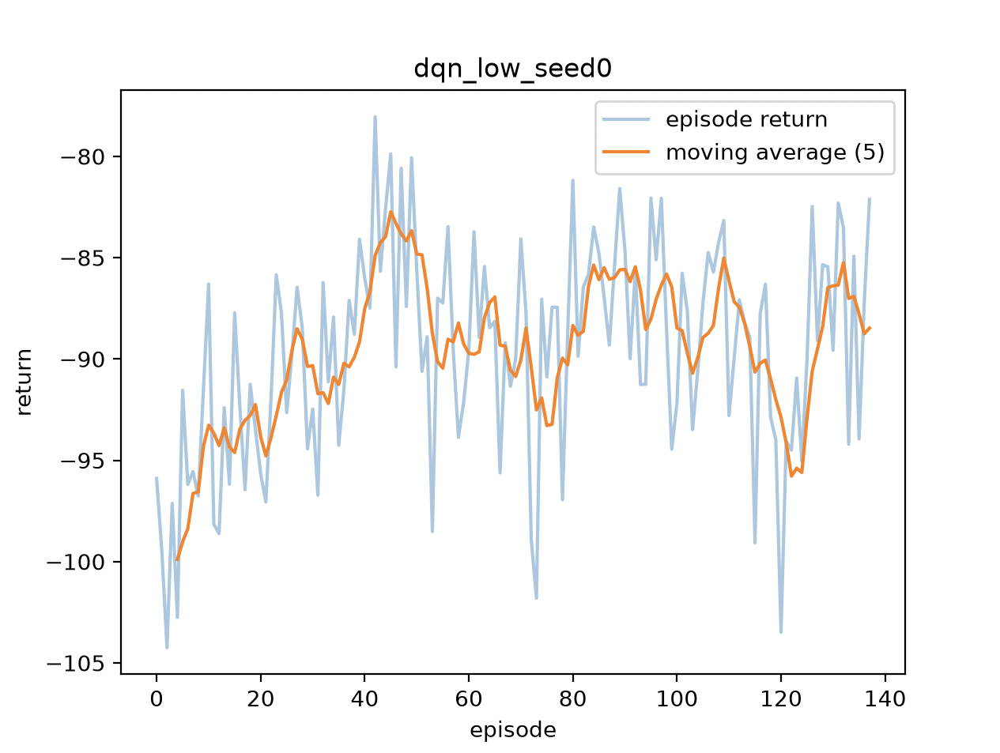

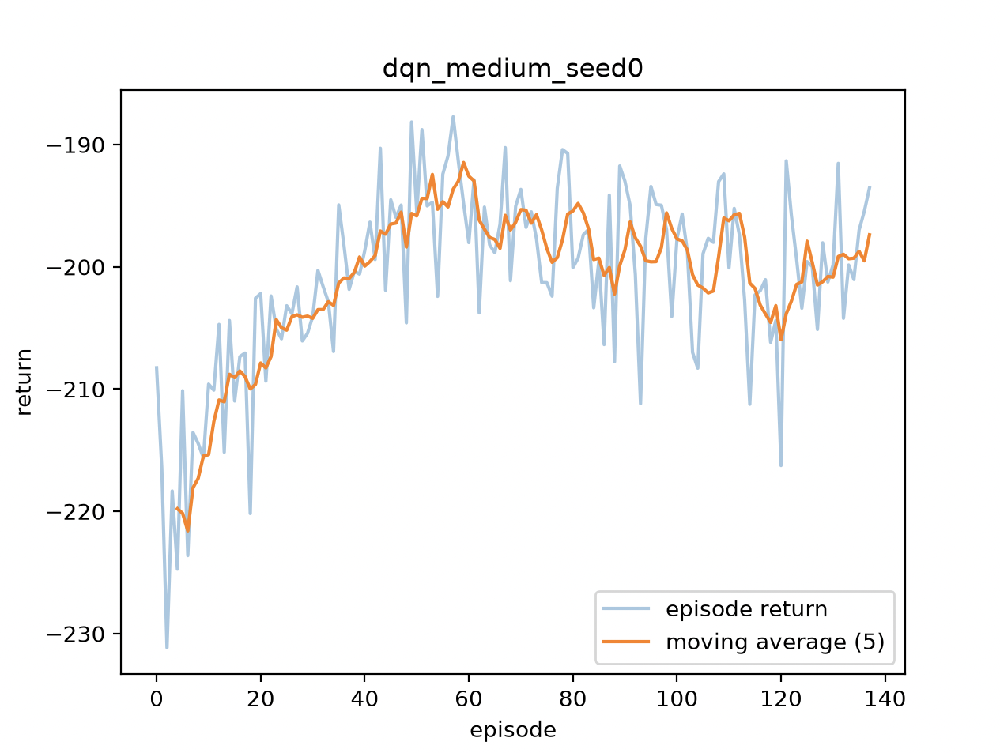

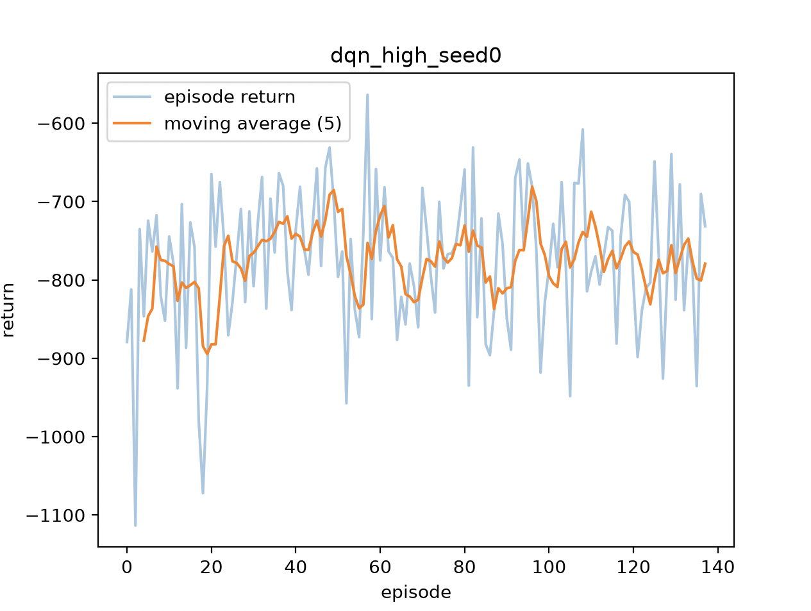

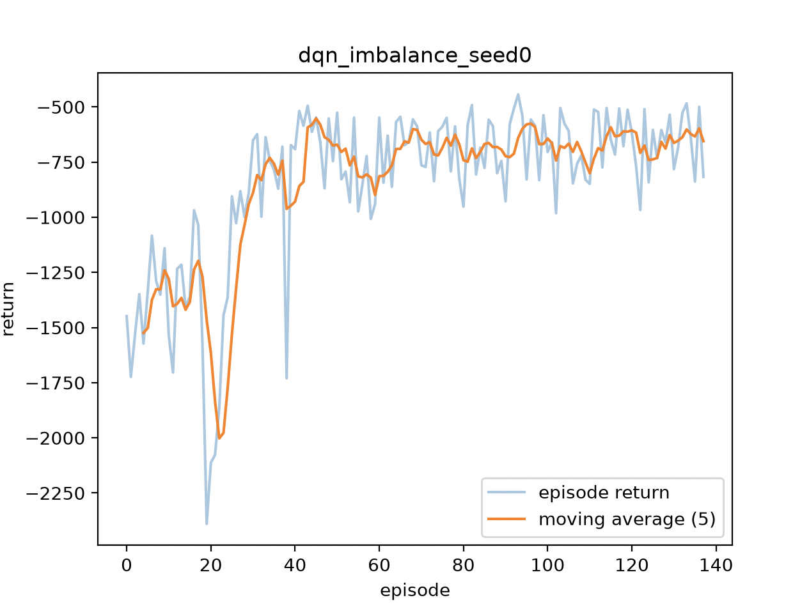

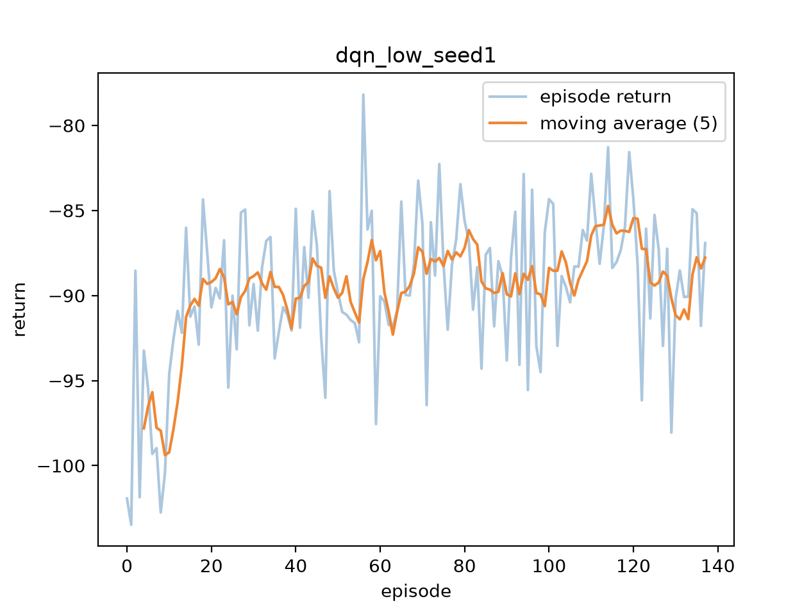

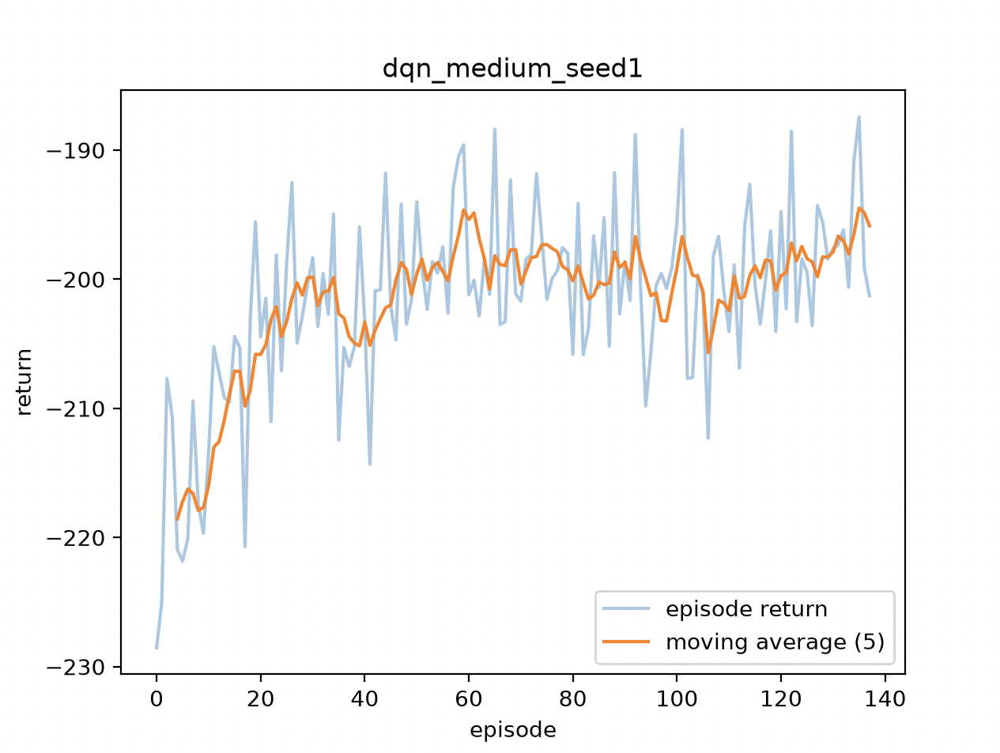

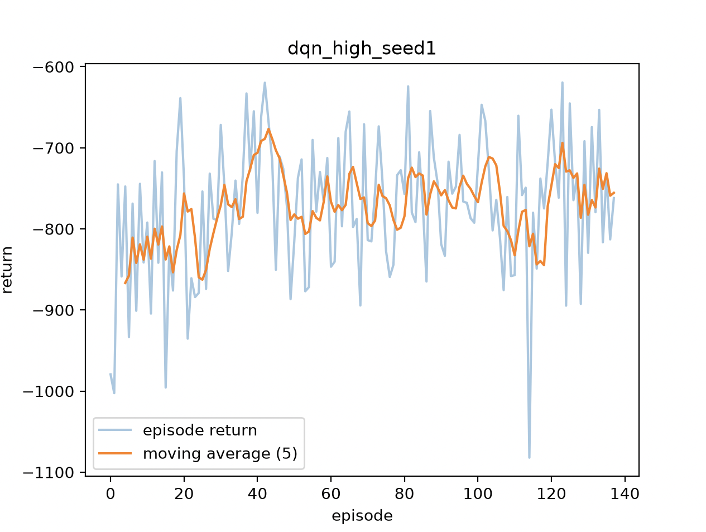

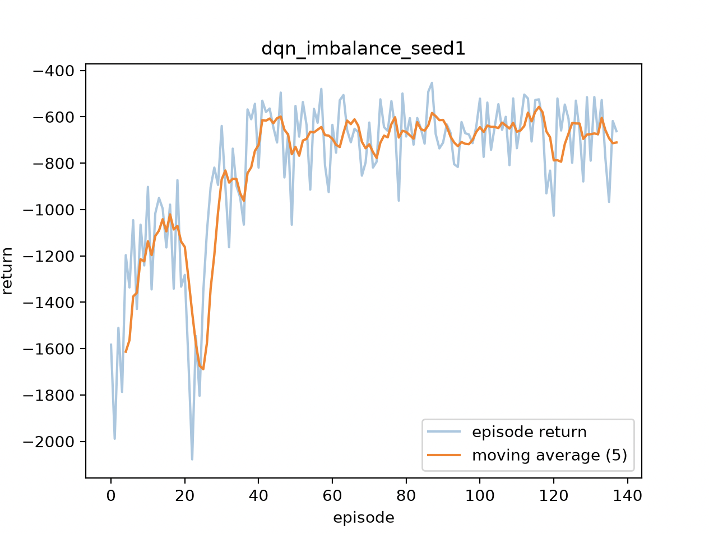

*Figure 4. Episode return during training (v1 configuration) for DRL seed 0 (first four panels) and seed 1 (last four): Low, Medium, High, Imbalance. Light line: return per episode; orange line: moving average over 5 episodes. Returns are negative; higher is better. Comparable across seeds of one scenario, not across scenarios. Curves for seeds 2–4 were not plotted.*

In Imbalance the return converges after about 40 episodes (around −600 to −700 per episode) for both seeds; in High the curve stays very noisy around −780 without clear convergence; in Low and Medium it improves early and then fluctuates (Low seed 0 peaks near episode 45 and then oscillates; Medium seed 0 peaks near episode 57 and then declines slightly, while seed 1 keeps rising slowly). The plots show the training return (with exploration), not the test performance.

## 4. Version v2: observation scales and reward (High and Imbalance)

In v1, the scale diagnostic showed that the observation saturates in the heavy scenarios: in High, queue is clipped at 1 in about 40% to 45% of steps and vehicle counts in about 84% to 88% of steps; in Imbalance, queue (NS) in 53% to 63% and vehicle count (NS) in 96% to 98%. We therefore trained v2 models with larger scales and tested the effect of the reward separately:

- v2a: High scales (queue 60, vehicles 90, waiting 30), reward unchanged.
- v2b: same scales, reward on queue and total waiting time.
- For both, the best checkpoint is chosen on validation seeds 100 to 102.

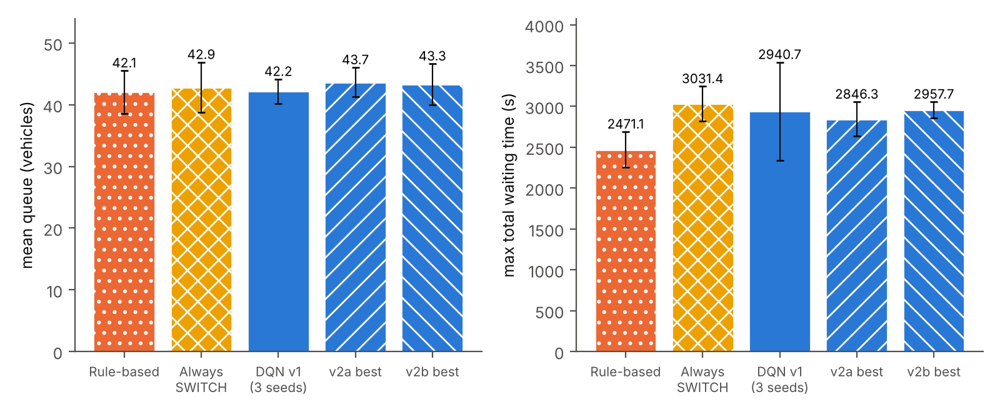

*Figure 5. High scenario: rule-based, always SWITCH, DQN v1 (3 seeds) and the best v2 checkpoints (one DRL seed each).*

| High | mean_queue | max_queue | mean_total_waiting_time | max_total_waiting_time |
|---|---|---|---|---|
| Rule-based | 42.07 ± 3.47 | 92.67 ± 2.08 | 693.94 ± 51.83 | 2471.07 ± 219.77 |
| DQN v1 (3 DRL seeds) | 42.19 ± 1.98 | 100.00 ± 7.63 | 704.83 ± 43.22 | 2940.73 ± 601.34 |
| DQN v2a, best checkpoint | 43.67 ± 2.39 | 97.00 ± 1.73 | 745.99 ± 46.27 | 2846.27 ± 210.72 |
| DQN v2b, best checkpoint | 43.34 ± 3.32 | 96.67 ± 8.62 | 720.19 ± 72.92 | 2957.73 ± 99.10 |

After the change, clipping fell to 0% to 6% of steps. The mean metrics did not improve over v1; the worst-case queue and waiting time improved slightly, but both v2 variants remain worse than rule-based on all four metrics. The two v2 runs differ from each other by less than their standard deviations, so the effect of the reward cannot be separated from noise with one seed. The final (last-step) models of both v2 runs collapsed to the always-SWITCH policy (Section 3.4).

In Imbalance, v2a with larger scales (queue 70, vehicles 110, waiting 30) gave mean queue 32.76 ± 0.83 and mean waiting time 583.09 ± 24.72 (best checkpoint), compared with 32.32 and 560.42 for the v1 model of the same DRL seed: no improvement.

## 5. Discussion

- **Why DQN does not beat rule-based in Low, Medium, High.** These three scenarios are perfectly balanced between NS and EW (Section 2.2), so the best policy is close to a symmetric, short alternation of the two phases, which is what the "always SWITCH" policy does and what the rule-based controller ends up doing. The three controllers therefore land within noise of each other, and DQN has little room to exploit state information. (That the optimum is a short symmetric cycle is our interpretation; we did not test it directly.)
- **Why DQN wins in Imbalance.** NS carries six times the traffic of EW (3600 versus 600 veh/h). A symmetric short cycle cannot serve this demand: it leaves the NS queue growing (queue 74 for always SWITCH), whereas DQN reaches queue 34, about 54% lower than always SWITCH and 12% lower than rule-based. This matches the saturation diagnostic, in which only the NS features saturate. We did not directly measure green durations per direction.
- **Training instability.** In High, the final network sometimes collapses to a constant action, and in Imbalance seed 2 is clearly weaker than seeds 0 and 1. Saving the best validation checkpoint (v2) and training several DRL seeds are needed before drawing conclusions.

## 6. Limitations

- Only 3 test traffic seeds; standard deviations from 3 values are rough.
- 3 DRL seeds for Low, Medium, High; 5 for Imbalance. The v2 experiments used one DRL seed.
- DRL seeds 2 to 4 were trained with the v2 code configured as v1; equivalence with the original v1 code was not verified bit by bit.
- Fixed-time and rule-based results were produced by a different team member on a different branch; we assumed the same settings and metric definitions and did not re-run them.
- Only 100,000 training steps and one hyperparameter setting were tried; no hyperparameter search was done.
- Traffic volumes in Section 2.2 were read from the route files on branch `main` (commit d7c294b, Nov 16); we did not check that they are identical to the files used in every local training run.
- Training curves are shown for DRL seeds 0 and 1 only; validation curves of the v2 runs are not shown.

## 7. Conclusion

Under identical evaluation, DQN clearly outperforms fixed-time control in all four scenarios, and outperforms the rule-based controller only in the Imbalance scenario (about 11% to 21% depending on the metric, with variation across seeds). In the other scenarios DQN matches rule-based and constant switching policies, so the data do not support a claim of benefit. Next steps: improve DQN training for the heavy balanced scenario (High), where the final policy collapses to constant switching, and verify the Imbalance result with more DRL and test seeds. After this baseline stage, the same comparison will be repeated on the new O Cho Dua map.

## 8. Reproducibility

**The default reward of `train_dqn.py` is now `total_wait` (v2).** The v1 models were trained with the original reward, so v1 runs must pass `--reward avg_wait` explicitly; the default observation scales (20/30/60) are the v1 scales.

**Run every command from the map folder** (`cd Map_Nga_Tu`), and call the code in `../DRL/`. `logs/` and `results/` below are `Map_Nga_Tu/logs/` and `Map_Nga_Tu/results/`; the code (`DRL/`) is shared between maps and sits next to `Map_Nga_Tu/` at the repository root.

```
# v1 (DRL seed 0, Imbalance); seeds 2-4 were trained with the extra flag --tag v1
python ../DRL/train_dqn.py --scenario imbalance --seed 0 --reward avg_wait --eval-freq 0

# v2a: larger scales, original reward (High)
python ../DRL/train_dqn.py --scenario high --seed 0 --q-scale 60 --v-scale 90 --w-scale 30 --reward avg_wait --tag v2a
# v2b: larger scales, new reward (High)
python ../DRL/train_dqn.py --scenario high --seed 0 --q-scale 60 --v-scale 90 --w-scale 30 --reward total_wait --tag v2b
# v2a on Imbalance
python ../DRL/train_dqn.py --scenario imbalance --seed 0 --q-scale 70 --v-scale 110 --w-scale 30 --reward avg_wait --tag v2a

# evaluate on test seeds 57, 367, 1024 (scales are read from <name>_config.json)
python ../DRL/evaluate.py --scenario imbalance --model logs/dqn_imbalance_seed0_model
python ../DRL/evaluate.py --scenario high --model logs/dqn_high_seed0_v2a_best_model

# constant policies
python ../DRL/evaluate.py --scenario high --constant switch
python ../DRL/evaluate.py --scenario high --constant keep

# training curve of one run (reads logs/<name>.monitor.csv)
python ../DRL/train_plot.py dqn_low_seed0
```

Result files: `results/drl/<model>_eval.jsonl` (per test seed) and `<model>_summary.json`. Each training run also writes `logs/<name>_config.json` with its arguments, observation scales and the installed package versions; use these versions when setting up another machine.

## References

1. V. Mnih et al., "Human-level control through deep reinforcement learning," *Nature*, vol. 518, pp. 529–533, 2015.
2. A. Raffin et al., "Stable-Baselines3: Reliable Reinforcement Learning Implementations," *Journal of Machine Learning Research*, vol. 22, no. 268, pp. 1–8, 2021.
3. P. A. Lopez et al., "Microscopic Traffic Simulation using SUMO," *IEEE International Conference on Intelligent Transportation Systems (ITSC)*, 2018.
4. M. Towers et al., "Gymnasium: A Standard Interface for Reinforcement Learning Environments," arXiv:2407.17032, 2024.
