# DRL V2 Seed 100: Comprehensive Technical Report

Retrospective analysis of existing source, TensorBoard, Monitor, NPZ and CSV artifacts. No SUMO simulation, training or model evaluation was executed for this analysis.

## 1. Model Development and Iterative Evolution: V1 to V2

### 1.0 Model Origin, Initial Architecture and Pre-V1 Foundations

**Model origin.** The inspected PPO trainers construct a new Stable-Baselines3 PPO with MlpPolicy and then call learn; they contain no pretrained-weight loading or checkpoint-resume branch. Thus the documented training starts from newly initialized PyTorch policy/value networks, rather than an externally pretrained model. The installed SB3 policy implementation initializes linear weights orthogonally and biases to zero; random initialization does not imply every parameter is random. V2 explicitly specifies separate actor/critic hidden layers [128,128] with Tanh and training seed 100. Sources: [trainer](../../DRL/train_multiscenario.py), [pinned dependencies](../../DRL/requirements.txt); historical PPO constructor at Git commit a6e8d5c, TraCI/train_multiscenario.py.

**Custom simulation interface.** TrafficSignalEnv subclasses gymnasium.Env and directly wraps the group's Environment, SignalController and StateExtractor through TraCI. This training path does not import sumo-rl; the inspected requirements do not declare it. Git commit 7f57874 records the rename of TraCI/gym_env.py and the core modules into DRL, preserving their contents. This is a repository-built Gymnasium interface, rather than evidence of an external pretrained traffic controller. Sources: [Gym environment](../../DRL/gym_env.py), [simulation environment](../../DRL/core/environment.py), [signal controller](../../DRL/core/signal_controller.py), [state extractor](../../DRL/core/state_extractor.py).

**Shared measurement, with distinct control paths.** PPO and Rule-Based use the same Environment/SignalController and current 15–75 s green bounds. Fixed-Time instead leaves SUMO's static program in control and uses the FixedSignals snapshot adapter; it does not execute through SignalController. Its 51 s green per axis lies within that envelope, with the same 3 s yellow and 3 s all-red stages. All three V2 paths share StateExtractor and the five metric definitions: queue_length, waiting_time, average_speed, arrived_count and vehicles_in_network; arrivals are episode sums and the other four are snapshot means. This separation supports fair physical and measurement comparisons without claiming identical controller implementations or retroactively correcting V1. Sources: [Fixed-Time entry point](../../FixedTime/run_fixed_time.py), [Rule-Based entry point](../../RuleBased/run_rule_based.py), [baseline implementations](../../DRL/baselines.py), [metrics](../../DRL/metrics.py), [static phases](../../SUMO/Map_Nga_tu/config/traffic_light.add.xml).

**Pre-V1 to V1.** Git records the TraCI bridge (73113aa), then baseline infrastructure (9513f91). Historical TraCI/train_baseline.py at 91566a2 implements single-scenario PPO training/evaluation; its presence establishes the prototype workflow, not proof that every trial succeeded. At a6e8d5c, the four-scenario trainer and Gym wrapper expose six raw inputs (queue, waiting, speed, vehicle count, phase ID and elapsed green), Discrete(2) actions (0=KEEP, 1=SWITCH), and reward -(Q + 0.1W). That revision configures a 0.1 s simulation step and 5 s decisions on the four-arm SUMO/Map_Nga_tu scenarios low, medium, high and imbalance. Earlier bridge/prototype YAML used 1 s steps, so 0.1 s must not be attributed to the entire pre-V1 history. V1 training budgets are evidenced by the seed-107 trainer defaults (800,000 steps, a6e8d5c) and seed-710 pipeline defaults (600,000 steps, 0b8f4f1). The later V2 changes are documented below; no new execution was needed to establish this source-level lineage.

### 1.1 Experimental motivation and evidence boundaries

V1 used six aggregate raw observations, reward -(Q + 0.1W), 30 s minimum green and final-checkpoint evaluation without independent validation selection. Seed 710 waiting exceeded its recorded Rule-Based reference by 37.273946% on High and 52.334583% on Imbalance. Seed 107 was different: its High waiting was 14.565797% lower than its historical Rule-Based reference. Both V1 runs struggled on Imbalance; the claim that both failed on High is unsupported.

A 500k seed-107 checkpoint exists, but no checkpoint-specific evaluation table was found. A claimed 28.7% deterioration from 500k to 800k cannot be verified and is not reported as a measured finding. Likewise, unmatched traffic seeds are demonstrated for V1, whereas actual overlap of training and test traffic seeds is not demonstrated.

### 1.2 Root-cause audit and architectural changes

Four engineering weaknesses motivated V2: unscaled value targets and raw features; loss of NS/EW information; lack of independently ranked checkpoints; and inconsistent seed, arrival, speed and sampling definitions. These are plausible mechanisms and measured protocol defects, not separate causal effects established by ablation.

| Component | V1: seeds 107 / 710 | V2: seed 100 |
| --- | --- | --- |
| Observation | 6D aggregate raw state | 12D NS/EW directional state; float32, clipped [0,1] |
| Reward | -(Q + 0.1W) | clip(-(Q_NS+Q_EW+0.05(W_NS+W_EW)+0.02(Q_NS-Q_EW)^2)/100,-10,0) |
| Adaptive min / max green | 30 / 75 s for both PPO and Rule-Based | 15 / 75 s for both PPO and Rule-Based |
| Yellow / all-red | 3 / 3 s effective; all-red YAML threshold was 0 | 3 / 3 s configured and effective |
| Simulation / decision / horizon | 0.1 / 5 / 3600 s | 0.1 / 5 / 3600 s; 720 decisions per episode |
| Actor / critic hidden layers | [64,64] each; Tanh | [128,128] each; Tanh |
| Rollout / batch / epochs | 2048 / 64 / 10 | 2880 / 96 / 5 |
| Learning rate | Fixed 0.0003 | Linear 0.0003 to 0.00001 |
| Gamma / GAE / clip | 0.99 / 0.95 / 0.2 | 0.99 / 0.95 / 0.2 |
| Entropy / value / max gradient | 0 / 0.5 / 0.5 | 0.01 / 0.5 / 0.5 |
| KL / normalized advantages | No target KL; enabled advantages | target_kl=0.02; enabled advantages |
| Scenario sampling | Independent random episode draws | Shuffled balanced four-episode cycles |
| Train / validation / test seeds | Policy 107/710; traffic evaluation seed remapped | Policy 100; train 1000..999999; validation 999; test 101,102,103 |
| Checkpoint selection | Final; periodic saves without independent ranking | Four-scenario validation every 28800 steps; best and final tested |
| Arrivals | Intermediate substeps omitted by RB/PPO; PPO averaged cumulative snapshots | All 0.1 s arrivals accumulated; interval counts summed per episode |
| Speed / sampling | FT whole network; adaptive incoming; sampling mismatch | Vehicle-weighted eight incoming lanes; post-step 5..3600 s |

The archived audit says both V1 adaptive methods used min_green=30 s. Thus 30 versus 15 s is an inter-version timing change, not a demonstrated V1 Rule-Based/PPO mismatch. All-red must be interpreted using the actual SUMO phase program rather than the former YAML value alone.

| Run | Mean explained variance | Last explained variance | Mean value loss | Last value loss |
| --- | --- | --- | --- | --- |
| 107 | 0.063883 | 0.392334 | 3466996.937689 | 742015.125000 |
| 710 | 0.049510 | 0.028571 | 3522991.364395 | 3473017.500000 |
| 100 | 0.954770 | 0.970996 | 22.312521 | 12.266729 |

V2 ends at explained_variance=0.970996, versus low V1 average explained variance. Mean-to-final is not an identical endpoint comparison, so the table provides both. The reward-scale change makes absolute value-loss ratios unsuitable as a direct measure of algorithmic improvement.

The selected V2 checkpoint improves all five Imbalance means against contemporary Rule-Based. Validation selection limits exposure to late drift on that scenario; it does not eliminate over-adaptation or guarantee the strongest checkpoint on every test scenario.

## 2. Methodology, Technology and Data Preprocessing

### 2.1 Execution stack and signal constraints

The experiment uses SUMO 1.28.0 and TraCI, a Gymnasium wrapper, Stable-Baselines3 PPO and PyTorch CUDA. Recorded GPU: NVIDIA Quadro RTX 3000. Package versions below come from the saved run manifest, not assumptions about the current installation.

| Package | Recorded version |
| --- | --- |
| torch | 2.5.1+cu121 |
| stable-baselines3 | 2.9.2 |
| gymnasium | 1.4.0 |
| numpy | 2.2.6 |
| PyYAML | 6.0.3 |
| tensorboard | 2.21.0 |
| matplotlib | 3.10.9 |

| Configuration | Value |
| --- | --- |
| simulation_step | 0.1 |
| decision_interval | 5 |
| min_green | 15 |
| max_green | 75 |
| yellow_time | 3 |
| all_red_time | 3 |
| gui | False |

Discrete(2) actions encode KEEP=0 and SWITCH=1. SignalController blocks premature switches and enforces maximum green at 0.1 s boundaries; transitions execute yellow and all-red. Requests during transitions are NOOP, and startup-phase requests can be held. Green elapsed is simulation seconds. The phase mask, startup stage and transition guards matter beyond the binary action. Fixed-Time keeps 51 s green per axis in a 114 s cycle, inside the same 15–75 s envelope; its 5 s cadence is measurement, not adaptive control.

### 2.2 Directional 12D representation

NS lanes: N_in_0, N_in_1, S_in_0, S_in_1. EW lanes: E_in_0, E_in_1, W_in_0, W_in_1. Queue, vehicle count and current waiting are summed per axis. Weighted speed uses lane vehicle counts. Every output is clipped to [0,1] and stored as float32.

| Index | Feature | Preprocessing before final clipping |
| --- | --- | --- |
| 0 | queue_ns_norm | Q_NS / 60 |
| 1 | queue_ew_norm | Q_EW / 60 |
| 2 | veh_ns_norm | N_NS / 80 |
| 3 | veh_ew_norm | N_EW / 80 |
| 4 | wait_ns_norm | W_NS / 1500; missing lane waiting contributes 0 |
| 5 | wait_ew_norm | W_EW / 1500; missing lane waiting contributes 0 |
| 6 | speed_ns_norm | sum(n_i v_i)/(13.9 sum(n_i)); empty axis = 1 |
| 7 | speed_ew_norm | sum(n_i v_i)/(13.9 sum(n_i)); empty axis = 1 |
| 8 | is_ns_green | 1 when phase_id is 0 or 1; otherwise 0 |
| 9 | is_ew_green | 1 when phase_id is 4 or 5; otherwise 0 |
| 10 | green_elapsed_norm | green_elapsed / 75 |
| 11 | can_switch | 1 if outside transition and green_elapsed >= 15 s; otherwise 0 |

At queue>60, vehicles>80 or waiting>1500 s per axis the corresponding feature saturates; larger overloads become indistinguishable in that dimension. Empty-axis observation speed is 1, while an entirely empty incoming region contributes a reported traffic speed of 0. Feature normalization and traffic-metric definitions serve different purposes.

### 2.3 Reward shaping and PPO settings

$$r_t=\operatorname{clip}\left(-\frac{Q_{NS}+Q_{EW}+0.05(W_{NS}+W_{EW})+0.02(Q_{NS}-Q_{EW})^2}{100},-10,0\right).$$

The queue term penalizes halted vehicles; weighted current waiting emphasizes prolonged stops; the squared NS/EW difference discourages unequal queues. Division by 100 reduces target scale and clipping bounds severe penalties. Equal queues are not always demand-proportional service, so the balance term is a design trade-off. Reward is a post-interval snapshot, with no explicit collision, arrival or switching term.

| PPO setting | Actual implementation |
| --- | --- |
| policy / device / seed | MlpPolicy / cuda / 100 |
| learning_rate | 1e-5 + (3e-4 - 1e-5) * clip(progress_remaining,0,1) |
| n_steps / batch_size / n_epochs | 2880 / 96 / 5 |
| gamma / gae_lambda | 0.99 / 0.95 |
| clip_range / value clipping | 0.2 / disabled |
| ent_coef / vf_coef / max_grad_norm | 0.01 / 0.5 / 0.5 |
| target_kl / normalize_advantage | 0.02 / enabled |
| net_arch / activation | pi=[128,128], vf=[128,128] / Tanh |
| use_sde / sde_sample_freq | disabled / -1 |
| stats_window_size | 100 episodes |
| rollout buffer | Default implementation; no custom kwargs |
| checkpoint / validation period | 28800 decision steps; four deterministic validation episodes |
| requested / actual total_timesteps | 600000 / 601920 |

### 2.4 Seed isolation and measurement protocol

Training uses NumPy default_rng(100), shuffling each four-scenario cycle and drawing traffic seeds in [1000,999999]. The 836 completed episodes confirm 209 occurrences of every scenario and four-scenario coverage in each rollout. Training traffic seeds can repeat within that range, but cannot equal 101/102/103/999. Validation reuses 999 on each scenario, and selects by maximum four-scenario mean reward; held-out 101–103 never select the checkpoint.

Every evaluated episode contains 720 post-step samples at t=5,10,...,3600 s. Queue, summed lane waiting, vehicle-weighted speed on the same eight incoming lanes, and network occupancy are time means. Arrivals accumulate all 50 substeps per decision and are summed over the episode. Waiting is not mean per-vehicle trip delay; network occupancy is a mean, not terminal backlog. Matching traffic seeds and route inputs aligns the stochastic setup, while controller-dependent insertion and trajectories can still differ.

## 3. Training Process and Convergence Diagnostics: Seed 100

The requested 600,000 steps expanded to 601,920 complete rollout steps: 209 rollouts and 836 completed 720-decision episodes. A rollout is exactly one balanced four-scenario cycle. Preflight separately completed 5760 steps; those trials are excluded from production results.

### 3.1 Learning trajectory and validation selection

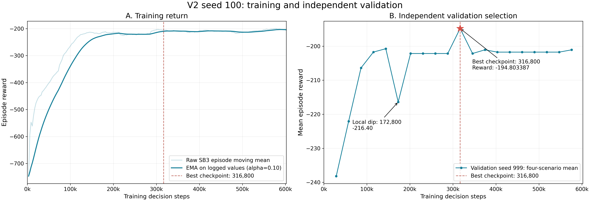

The first logged training return is -746.923645 at step 2,880, and the last is -206.924393 at 601,920. Raw rollout return is already SB3’s moving episode mean; the additional EMA (alpha=0.10) is display-only and is never used for checkpoint selection.

| Validation step | Four-scenario mean return | Scenario population Std |
| --- | --- | --- |
| 28800 | -238.182487 | 182.220993 |
| 57600 | -222.076287 | 181.084759 |
| 86400 | -206.378925 | 157.372703 |
| 115200 | -201.736925 | 155.055035 |
| 144000 | -200.748175 | 154.610903 |
| 172800 | -216.395463 | 176.294315 |
| 201600 | -202.159550 | 155.228980 |
| 230400 | -202.159550 | 155.228980 |
| 259200 | -202.159550 | 155.228980 |
| 288000 | -202.159550 | 155.228980 |
| 316800 | -194.803387 | 152.300576 |
| 345600 | -202.159550 | 155.228980 |
| 374400 | -201.078450 | 154.736330 |
| 403200 | -201.750288 | 155.040006 |
| 432000 | -201.750288 | 155.040006 |
| 460800 | -201.750288 | 155.040006 |
| 489600 | -201.750288 | 155.040006 |
| 518400 | -201.750288 | 155.040006 |
| 547200 | -201.750288 | 155.040006 |
| 576000 | -201.078450 | 154.736330 |

Best validation is -194.803387 at **316,800 steps**, independently confirmed from best_model.zip. The last scheduled validation occurs at 576,000, with return -201.078450; there is no validation checkpoint at 601,920. Validation Std above is between four different scenarios, not held-out-seed uncertainty. The final model is separately tested on 101–103.

| Requested milestone | Nearest rollout step | Training reward | Explained variance | Value loss | Approx KL | Clip fraction |
| --- | --- | --- | --- | --- | --- | --- |
| 150000 | 149760 | -214.176010 | 0.975784 | 11.301619 | 0.000811 | 0.016319 |
| 218000 | 218880 | -223.570175 | 0.705051 | 318.135162 | 0.001284 | 0.009306 |
| 316800 | 316800 | -204.030319 | 0.974247 | 12.115253 | 0.000953 | 0.011944 |
| 601920 | 601920 | -206.924393 | 0.970996 | 12.266729 | 0.000036 | 0.000000 |

The series improves rapidly toward 150k, then spends most later training near a plateau. At a requested milestone each column uses that tag’s nearest available event; early train/* and rollout/* logging can differ by one rollout. Higher rolling training reward does not necessarily imply higher validation reward because demand composition and evaluation traffic differ.

### 3.2 Critic quality and PPO update diagnostics

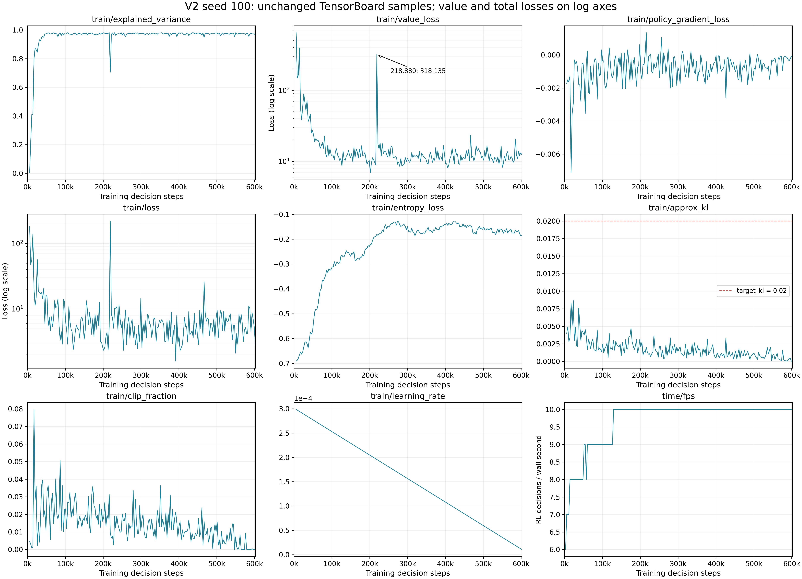

| Scalar | First step:value | Min step:value | Max step:value | Mean | Last step:value |
| --- | --- | --- | --- | --- | --- |
| rollout/ep_len_mean | 2880:720 | 2880:720 | 2880:720 | 720 | 601920:720 |
| eval/mean_ep_length | 28800:720 | 28800:720 | 28800:720 | 720 | 576000:720 |
| train/policy_gradient_loss | 5760:-0.00171678618 | 17280:-0.00712858327 | 216000:0.00135364966 | -0.000806499155 | 601920:-5.49578072e-05 |
| train/loss | 5760:180.390244 | 391680:1.59540498 | 218880:219.95871 | 9.79950247 | 601920:2.82637787 |
| rollout/ep_rew_mean | 2880:-746.923645 | 2880:-746.923645 | 576000:-199.47612 | -245.387843 | 601920:-206.924393 |
| eval/mean_reward | 28800:-238.182495 | 28800:-238.182495 | 316800:-194.803391 | -205.188901 | 576000:-201.078445 |
| time/fps | 2880:6 | 2880:6 | 129600:10 | 9.67942584 | 601920:10 |
| train/explained_variance | 5760:0.00337582827 | 5760:0.00337582827 | 216000:0.981551886 | 0.954770082 | 601920:0.970995843 |
| train/approx_kl | 5760:0.00398464641 | 599040:3.55349257e-05 | 23040:0.00871576555 | 0.00172678313 | 601920:3.61091079e-05 |
| train/clip_fraction | 5760:0.00472222222 | 547200:0 | 17280:0.0796527788 | 0.0144701526 | 601920:0 |
| train/entropy_loss | 5760:-0.690861166 | 5760:-0.690861166 | 273600:-0.126918286 | -0.234441885 | 601920:-0.184609354 |
| train/value_loss | 5760:645.143127 | 201600:6.92201757 | 5760:645.143127 | 22.3125206 | 601920:12.2667294 |
| train/learning_rate | 5760:0.000298608007 | 601920:1.04640003e-05 | 5760:0.000298608007 | 0.000154536 | 601920:1.04640003e-05 |

The local value-loss spike is at 218,880: loss=318.135162, explained_variance=0.705051, approx_kl=0.001284 and clip_fraction=0.009306. The initial value loss 645.143127 is the global maximum, so the 218k event is a local spike. Return composition and bootstrapping are plausible contributors; logs do not establish its exact cause or traffic scenario.

Explained variance recovers and ends at 0.970996. Logged approximate KL stays below the 0.02 reference; late clip fractions approach zero. These show small measured updates, not proof of optimal control. Entropy loss is negative entropy: movement toward zero indicates a more concentrated policy. The schedule specifies 0.0003 to 0.00001, while the final logged learning rate is 0.000010464000; rollout logging can expose the preceding optimization value.

FPS starts at 6, first reaches 8 at step 14,400, and ends at 10. Thus “8 to 10 FPS” omits the initial 6-FPS record. FPS here means cumulative RL decision interactions per wall-clock second, not 0.1 s SUMO substeps or rendered frames. The 720-step rollout/eval episode lengths agree with archived Monitor data.

### 3.3 Decision behavior: measured deterministic replay audit

Supplement added after the original archived-data analysis: the existing CSVs did not store behavioral fields, so the saved best_model.zip was replayed, without training, for exactly 12 episodes (seeds 101,102,103 × low,medium,high,imbalance). New files are isolated in [action_audit](../../evaluation/seed100/action_audit/action_audit_summary.md). All 60 episode traffic values match the original best/episodes.csv with exact float equality, and all 51,840 per-step metric/time comparisons also match. The original evaluation files and scorecards are unchanged.

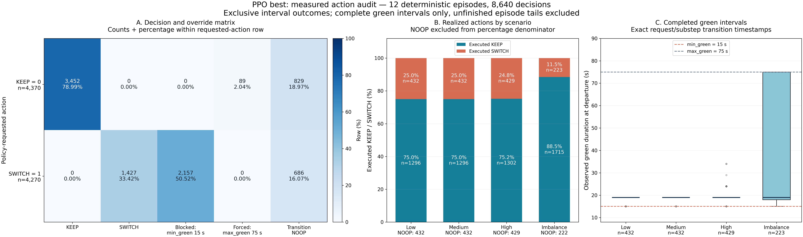

The audit contains 8,640 decisions and 1,516 completed green intervals. Panel A assigns one exclusive outcome per decision interval, with counts and percentages within each requested-action row. Priority is max-green override, min-green block, transition NOOP, then plain KEEP/SWITCH. Startup-phase request overrides: 0; these remain executed KEEP and are not relabelled as min-green blocks.

| Requested action | KEEP | SWITCH | Blocked min-green | Forced max-green | Transition NOOP | Total |
| --- | --- | --- | --- | --- | --- | --- |
| KEEP = 0 | 3452 | 0 | 0 | 89 | 829 | 4370 |
| SWITCH = 1 | 0 | 1427 | 2157 | 0 | 686 | 4270 |

| Scenario | KEEP | SWITCH | NOOP excluded | KEEP / SWITCH denominator | KEEP (%) | SWITCH (%) | Completed greens | Green min / median / max (s) |
| --- | --- | --- | --- | --- | --- | --- | --- | --- |
| low | 1296 | 432 | 432 | 1728 | 75.000000 | 25.000000 | 432 | 15.000000 / 19.000000 / 19.000000 |
| medium | 1296 | 432 | 432 | 1728 | 75.000000 | 25.000000 | 432 | 15.000000 / 19.000000 / 19.000000 |
| high | 1302 | 429 | 429 | 1731 | 75.216638 | 24.783362 | 429 | 15.000000 / 19.000000 / 34.000000 |
| imbalance | 1715 | 223 | 222 | 1938 | 88.493292 | 11.506708 | 223 | 15.000000 / 19.000000 / 75.000000 |

Panel B normalizes KEEP/SWITCH only over executed non-NOOP decisions; transition NOOP remains visible in panel A and the table. Panel C uses green_elapsed immediately before the actual green-departure call, recorded by read-only runtime wrappers delegating to the original controller. Automatic max-green boundaries are captured at 0.1 s substeps. No duration is inferred from five-second phase runs. The still-active final green in an episode is right-censored and excluded. Observed completed durations span 15.000000–75.000000 s, satisfying the configured bounds within simulator floating-point precision.

Pre/post state, request-time execution, final interval outcomes and timestamped events are in [action_steps.csv](../../evaluation/seed100/action_audit/action_steps.csv); exact completed durations are in [action_switches.csv](../../evaluation/seed100/action_audit/action_switches.csv). [action_episodes.csv](../../evaluation/seed100/action_audit/action_episodes.csv) retains episode means for four metrics and the episode sum for arrivals, following the original definition. [reproducibility_check.json](../../evaluation/seed100/action_audit/reproducibility_check.json) records the exact comparisons. This is a supplementary behavioral replay, not a replacement performance evaluation or a safety certification.

## 4. Evaluation Scorecards and Scenario Analysis

### 4.1 Table 1: multi-seed mean ± sample Std

Each cell aggregates three episode-level results with ddof=1. Queue, waiting and mean network occupancy are lower-is-better; speed and episode arrivals are higher-is-better. Winners are descriptive means, with exact ties retained. Units: queue/network vehicles, waiting seconds, speed m/s, arrivals vehicles per episode.

| Scenario | Metric | Fixed-Time | Rule-Based | PPO best | PPO final | Best mean |
| --- | --- | --- | --- | --- | --- | --- |
| low | queue_length | 4.710648 ± 0.106875 | 2.419444 ± 0.060715 | 2.490278 ± 0.051389 | 2.490278 ± 0.051389 | Rule-Based |
| low | waiting_time | 91.949722 ± 2.547021 | 22.712407 ± 0.659577 | 23.343889 ± 0.316301 | 23.343889 ± 0.316301 | Rule-Based |
| low | average_speed | 6.790355 ± 0.119523 | 8.223877 ± 0.093479 | 8.148309 ± 0.074183 | 8.148309 ± 0.074183 | Rule-Based |
| low | arrived_count | 1170.333333 ± 28.041636 | 1173.333333 ± 26.764404 | 1175.000000 ± 24.269322 | 1175.000000 ± 24.269322 | PPO best, PPO final |
| low | vehicles_in_network | 19.734259 ± 0.408027 | 17.014352 ± 0.489434 | 17.108333 ± 0.426484 | 17.108333 ± 0.426484 | Rule-Based |
| medium | queue_length | 12.589815 ± 0.603492 | 6.980556 ± 0.249134 | 7.282870 ± 0.297405 | 7.282870 ± 0.297405 | Rule-Based |
| medium | waiting_time | 231.658472 ± 14.960646 | 67.168889 ± 2.717528 | 71.679120 ± 4.301115 | 71.679120 ± 4.301115 | Rule-Based |
| medium | average_speed | 6.156980 ± 0.129398 | 7.580487 ± 0.109359 | 7.472785 ± 0.078063 | 7.472785 ± 0.078063 | Rule-Based |
| medium | arrived_count | 2972.333333 ± 27.209067 | 2982.333333 ± 23.692474 | 2984.000000 ± 20.880613 | 2984.000000 ± 20.880613 | PPO best, PPO final |
| medium | vehicles_in_network | 53.146296 ± 0.252153 | 46.080093 ± 0.799441 | 46.444444 ± 0.804251 | 46.444444 ± 0.804251 | Rule-Based |
| high | queue_length | 46.409259 ± 2.754802 | 32.069444 ± 0.225467 | 33.303704 ± 3.600241 | 32.295370 ± 1.893948 | Rule-Based |
| high | waiting_time | 977.854583 ± 71.610296 | 385.135417 ± 9.479563 | 395.157037 ± 44.472238 | 386.548426 ± 29.624104 | Rule-Based |
| high | average_speed | 3.796897 ± 0.144123 | 4.592359 ± 0.031117 | 4.491825 ± 0.287019 | 4.565691 ± 0.164862 | Rule-Based |
| high | arrived_count | 5250.333333 ± 69.284438 | 5280.000000 ± 83.719771 | 5268.333333 ± 80.599835 | 5273.000000 ± 80.018748 | Rule-Based |
| high | vehicles_in_network | 135.775926 ± 3.584958 | 118.144444 ± 1.317390 | 120.594444 ± 6.433096 | 118.712037 ± 3.778978 | Rule-Based |
| imbalance | queue_length | 88.527315 ± 13.570427 | 27.790741 ± 3.278642 | 21.188889 ± 0.525766 | 22.474074 ± 6.877118 | PPO best |
| imbalance | waiting_time | 1984.071806 ± 243.313376 | 418.275463 ± 41.749567 | 350.303009 ± 23.177922 | 387.294722 ± 131.940310 | PPO best |
| imbalance | average_speed | 2.090909 ± 0.258941 | 4.230946 ± 0.319827 | 5.062290 ± 0.032016 | 4.968307 ± 0.818675 | PPO best |
| imbalance | arrived_count | 3886.000000 ± 61.049161 | 4086.666667 ± 54.500765 | 4095.000000 ± 68.505474 | 4093.333333 ± 59.919390 | PPO best |
| imbalance | vehicles_in_network | 200.164352 ± 29.335675 | 99.181019 ± 6.884709 | 86.757870 ± 1.055316 | 89.491204 ± 12.896088 | PPO best |

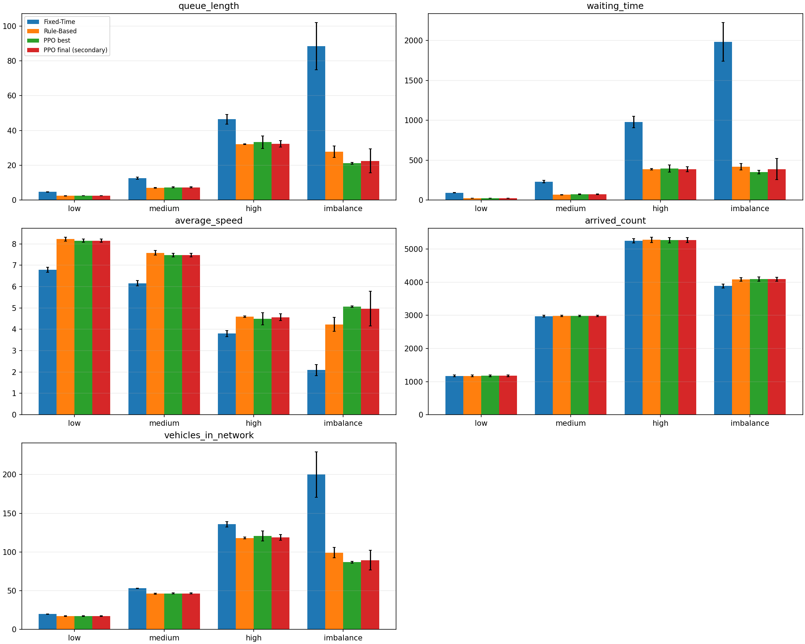

### 4.2 Table 2: improvement percentages

For queue/wait/network: improvement=100(B-P)/B. For speed/arrivals: improvement=100(P-B)/B. P is PPO best and B the named baseline. Positive means favorable; negative means worse. Percentages are calculated from unrounded means.

| Scenario | Metric | PPO best vs Fixed-Time (%) | PPO best vs Rule-Based (%) |
| --- | --- | --- | --- |
| low | queue_length | 47.135135 | -2.927669 |
| low | waiting_time | 74.612333 | -2.780337 |
| low | average_speed | 19.998277 | -0.918880 |
| low | arrived_count | 0.398747 | 0.142045 |
| low | vehicles_in_network | 13.306433 | -0.552366 |
| medium | queue_length | 42.152681 | -4.330813 |
| medium | waiting_time | 69.058278 | -6.714763 |
| medium | average_speed | 21.370947 | -1.420786 |
| medium | arrived_count | 0.392509 | 0.055885 |
| medium | vehicles_in_network | 12.610195 | -0.790693 |
| high | queue_length | 28.239097 | -3.848708 |
| high | waiting_time | 59.589386 | -2.602103 |
| high | average_speed | 18.302519 | -2.189155 |
| high | arrived_count | 0.342835 | -0.220960 |
| high | vehicles_in_network | 11.181276 | -2.073733 |
| imbalance | queue_length | 76.065140 | 23.755581 |
| imbalance | waiting_time | 82.344237 | 16.250643 |
| imbalance | average_speed | 142.109493 | 19.649130 |
| imbalance | arrived_count | 5.378281 | 0.203915 |
| imbalance | vehicles_in_network | 56.656683 | 12.525732 |

### 4.3 Table 3: every held-out seed and episode

#### Seed 101

| Scenario | Method | Queue | Waiting (s) | Speed (m/s) | Arrivals | Network vehicles |
| --- | --- | --- | --- | --- | --- | --- |
| low | Fixed-Time | 4.587500 | 89.014444 | 6.921966 | 1164.000000 | 19.543056 |
| low | Rule-Based | 2.393056 | 22.517917 | 8.242868 | 1166.000000 | 16.948611 |
| low | PPO best | 2.444444 | 23.061528 | 8.220467 | 1168.000000 | 17.038889 |
| low | PPO final | 2.444444 | 23.061528 | 8.220467 | 1168.000000 | 17.038889 |
| medium | Fixed-Time | 12.173611 | 221.071528 | 6.230690 | 2990.000000 | 52.915278 |
| medium | Rule-Based | 7.252778 | 70.033333 | 7.486001 | 2997.000000 | 46.700000 |
| medium | PPO best | 7.137500 | 69.841806 | 7.506357 | 2998.000000 | 46.612500 |
| medium | PPO final | 7.137500 | 69.841806 | 7.506357 | 2998.000000 | 46.612500 |
| high | Fixed-Time | 46.143056 | 954.296111 | 3.866541 | 5326.000000 | 136.201389 |
| high | Rule-Based | 32.280556 | 392.668472 | 4.580507 | 5360.000000 | 119.416667 |
| high | PPO best | 31.805556 | 372.869583 | 4.588899 | 5354.000000 | 120.063889 |
| high | PPO final | 31.805556 | 372.869583 | 4.588899 | 5354.000000 | 120.063889 |
| imbalance | Fixed-Time | 89.973611 | 1899.593611 | 1.928822 | 3955.000000 | 205.812500 |
| imbalance | Rule-Based | 28.336111 | 432.587222 | 4.202835 | 4141.000000 | 100.377778 |
| imbalance | PPO best | 21.361111 | 362.181944 | 5.025330 | 4152.000000 | 87.968056 |
| imbalance | PPO final | 20.218056 | 352.688889 | 5.157291 | 4161.000000 | 85.863889 |

#### Seed 102

| Scenario | Method | Queue | Waiting (s) | Speed (m/s) | Arrivals | Network vehicles |
| --- | --- | --- | --- | --- | --- | --- |
| low | Fixed-Time | 4.779167 | 93.257917 | 6.688569 | 1146.000000 | 19.456944 |
| low | Rule-Based | 2.376389 | 22.171944 | 8.306402 | 1151.000000 | 16.561111 |
| low | PPO best | 2.480556 | 23.284444 | 8.152206 | 1155.000000 | 16.720833 |
| low | PPO final | 2.480556 | 23.284444 | 8.152206 | 1155.000000 | 16.720833 |
| medium | Fixed-Time | 13.281944 | 248.773889 | 6.007569 | 2941.000000 | 53.415278 |
| medium | Rule-Based | 6.763889 | 64.627083 | 7.700282 | 2955.000000 | 45.177778 |
| medium | PPO best | 7.086111 | 68.601806 | 7.528445 | 2960.000000 | 45.569444 |
| medium | PPO final | 7.086111 | 68.601806 | 7.528445 | 2960.000000 | 45.569444 |
| high | Fixed-Time | 49.287500 | 1058.276250 | 3.631179 | 5235.000000 | 139.129167 |
| high | Rule-Based | 32.095833 | 374.491250 | 4.568910 | 5287.000000 | 118.230556 |
| high | PPO best | 37.411111 | 446.366111 | 4.168857 | 5257.000000 | 127.276389 |
| high | PPO final | 34.386111 | 420.540278 | 4.390454 | 5271.000000 | 121.629167 |
| imbalance | Fixed-Time | 101.316667 | 2258.364722 | 1.954361 | 3839.000000 | 226.265278 |
| imbalance | Rule-Based | 30.762500 | 450.986944 | 3.926102 | 4087.000000 | 105.388889 |
| imbalance | PPO best | 20.598611 | 323.593750 | 5.081507 | 4114.000000 | 86.029167 |
| imbalance | PPO final | 30.195833 | 533.089167 | 4.071666 | 4072.000000 | 103.812500 |

#### Seed 103

| Scenario | Method | Queue | Waiting (s) | Speed (m/s) | Arrivals | Network vehicles |
| --- | --- | --- | --- | --- | --- | --- |
| low | Fixed-Time | 4.765278 | 93.576806 | 6.760530 | 1201.000000 | 20.202778 |
| low | Rule-Based | 2.488889 | 23.447361 | 8.122360 | 1203.000000 | 17.533333 |
| low | PPO best | 2.545833 | 23.685694 | 8.072254 | 1202.000000 | 17.565278 |
| low | PPO final | 2.545833 | 23.685694 | 8.072254 | 1202.000000 | 17.565278 |
| medium | Fixed-Time | 12.313889 | 225.130000 | 6.232680 | 2986.000000 | 53.108333 |
| medium | Rule-Based | 6.925000 | 66.846250 | 7.555179 | 2995.000000 | 46.362500 |
| medium | PPO best | 7.625000 | 76.593750 | 7.383552 | 2994.000000 | 47.151389 |
| medium | PPO final | 7.625000 | 76.593750 | 7.383552 | 2994.000000 | 47.151389 |
| high | Fixed-Time | 43.797222 | 920.991389 | 3.892971 | 5190.000000 | 131.997222 |
| high | Rule-Based | 31.831944 | 388.246528 | 4.627660 | 5193.000000 | 116.786111 |
| high | PPO best | 30.694444 | 366.235417 | 4.717719 | 5194.000000 | 114.443056 |
| high | PPO final | 30.694444 | 366.235417 | 4.717719 | 5194.000000 | 114.443056 |
| imbalance | Fixed-Time | 74.291667 | 1794.257083 | 2.389545 | 3864.000000 | 168.415278 |
| imbalance | Rule-Based | 24.273611 | 371.252222 | 4.563900 | 4032.000000 | 91.776389 |
| imbalance | PPO best | 21.606944 | 365.133333 | 5.080031 | 4019.000000 | 86.276389 |
| imbalance | PPO final | 17.008333 | 276.106111 | 5.675964 | 4047.000000 | 78.797222 |

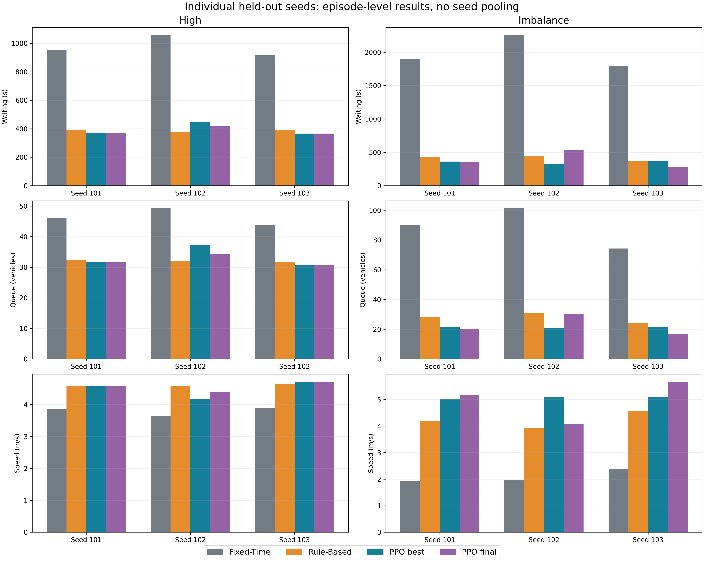

Difficulty must be conditioned on traffic scenario and controller. The waiting-based rankings below directly test the proposed 102 > 101 > 103 ordering instead of assuming it universally. They describe realized congestion, not independently measured offered demand.

| Scenario | Method | Descending waiting: seed:value |
| --- | --- | --- |
| low | Fixed-Time | 103:93.576806; 102:93.257917; 101:89.014444 |
| low | Rule-Based | 103:23.447361; 101:22.517917; 102:22.171944 |
| low | PPO best | 103:23.685694; 102:23.284444; 101:23.061528 |
| low | PPO final | 103:23.685694; 102:23.284444; 101:23.061528 |
| medium | Fixed-Time | 102:248.773889; 103:225.130000; 101:221.071528 |
| medium | Rule-Based | 101:70.033333; 103:66.846250; 102:64.627083 |
| medium | PPO best | 103:76.593750; 101:69.841806; 102:68.601806 |
| medium | PPO final | 103:76.593750; 101:69.841806; 102:68.601806 |
| high | Fixed-Time | 102:1058.276250; 101:954.296111; 103:920.991389 |
| high | Rule-Based | 101:392.668472; 103:388.246528; 102:374.491250 |
| high | PPO best | 102:446.366111; 101:372.869583; 103:366.235417 |
| high | PPO final | 102:420.540278; 101:372.869583; 103:366.235417 |
| imbalance | Fixed-Time | 102:2258.364722; 101:1899.593611; 103:1794.257083 |
| imbalance | Rule-Based | 102:450.986944; 101:432.587222; 103:371.252222 |
| imbalance | PPO best | 103:365.133333; 101:362.181944; 102:323.593750 |
| imbalance | PPO final | 102:533.089167; 101:352.688889; 103:276.106111 |

### 4.4 Table 4: runtime, throughput and inference evidence

| Stage | Wall seconds | Wall hours | Scope |
| --- | --- | --- | --- |
| Fixed-Time | 1234.917013 | 0.343033 | 12 episodes |
| Rule-Based | 709.147402 | 0.196985 | 12 episodes |
| drl_training | 57655.590464 | 16.015442 | GPU training + validation |
| drl_evaluation_best | 798.165308 | 0.221713 | 12 episodes |
| drl_evaluation_final | 813.890690 | 0.226081 | 12 episodes |
| total_pipeline | 61215.132396 | 17.004203 | All stages and overhead |

| Timing indicator | Value | Interpretation |
| --- | --- | --- |
| time/fps first / mean / last | 6 / 9.679426 / 10 | Cumulative decision-step throughput |
| Best evaluation wall ms / decision | 92.380244 | Includes SUMO, TraCI, reset and startup; 8640 decisions |
| Final evaluation wall ms / decision | 94.200311 | Includes SUMO, TraCI, reset and startup; 8640 decisions |
| Pure policy-inference latency | Not instrumented | No per-predict CUDA-synchronized timer in archived evaluator |
| Decision interval | 5 s simulated | Not a measured real-world latency guarantee |

The wall-time-per-decision proxy is not neural-network inference time. Startup, SUMO stepping, TraCI communication and file output are included. It cannot establish a hard real-time deployment deadline; deployment needs isolated synchronized prediction timing and tail-latency measurement.

### 4.5 Temporal dynamics, stability and scenario mechanisms

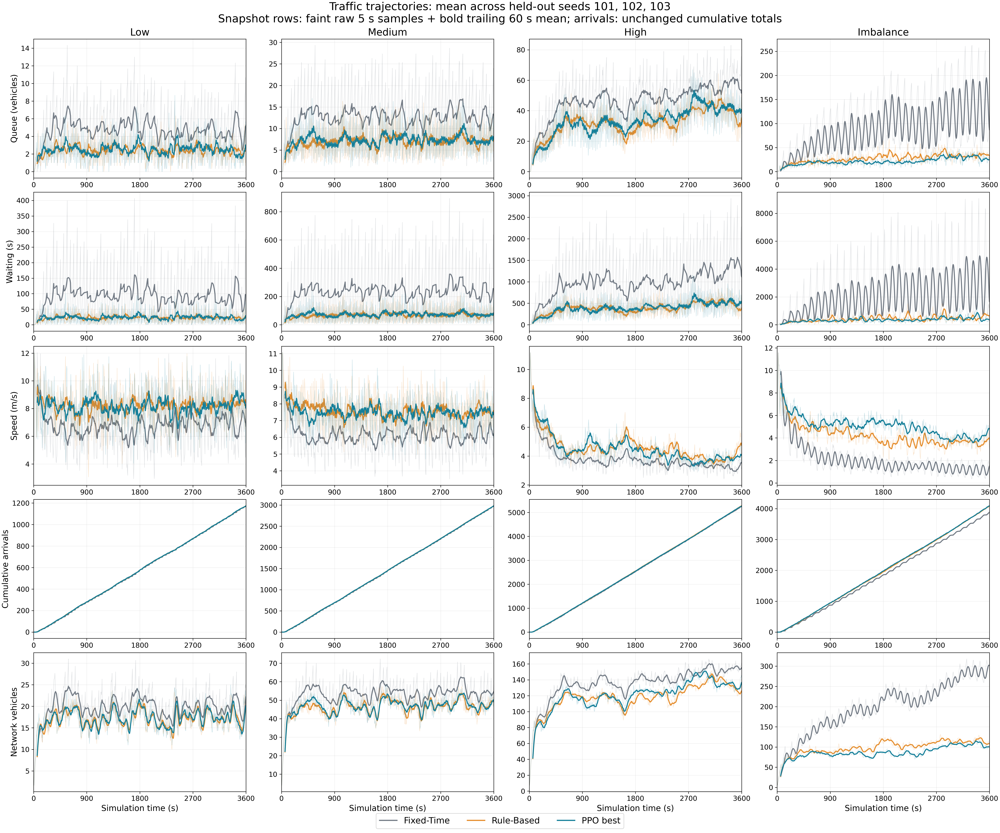

Figure 04 averages aligned post-step samples at each timestamp; no t=0 observation is invented. Its arrivals row is the cumulative sum of interval arrivals, averaged across seeds. The other rows retain snapshot meanings. Cumulative arrivals are a plotting transformation, not a change to the verified episode metric.

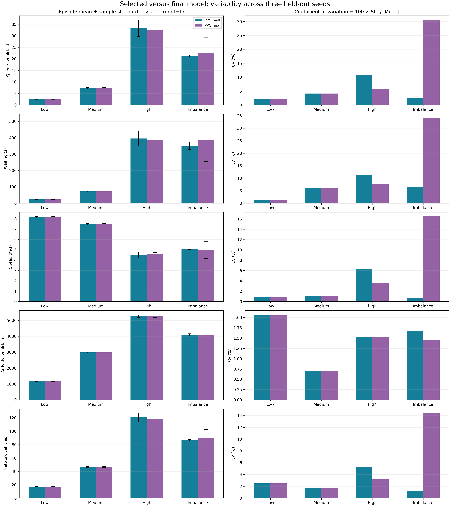

| Scenario | Metric | Best mean ± Std | Final mean ± Std | Best CV (%) | Final CV (%) |
| --- | --- | --- | --- | --- | --- |
| low | queue_length | 2.490278 ± 0.051389 | 2.490278 ± 0.051389 | 2.063581 | 2.063581 |
| low | waiting_time | 23.343889 ± 0.316301 | 23.343889 ± 0.316301 | 1.354962 | 1.354962 |
| low | average_speed | 8.148309 ± 0.074183 | 8.148309 ± 0.074183 | 0.910413 | 0.910413 |
| low | arrived_count | 1175.000000 ± 24.269322 | 1175.000000 ± 24.269322 | 2.065474 | 2.065474 |
| low | vehicles_in_network | 17.108333 ± 0.426484 | 17.108333 ± 0.426484 | 2.492843 | 2.492843 |
| medium | queue_length | 7.282870 ± 0.297405 | 7.282870 ± 0.297405 | 4.083623 | 4.083623 |
| medium | waiting_time | 71.679120 ± 4.301115 | 71.679120 ± 4.301115 | 6.000513 | 6.000513 |
| medium | average_speed | 7.472785 ± 0.078063 | 7.472785 ± 0.078063 | 1.044627 | 1.044627 |
| medium | arrived_count | 2984.000000 ± 20.880613 | 2984.000000 ± 20.880613 | 0.699752 | 0.699752 |
| medium | vehicles_in_network | 46.444444 ± 0.804251 | 46.444444 ± 0.804251 | 1.731640 | 1.731640 |
| high | queue_length | 33.303704 ± 3.600241 | 32.295370 ± 1.893948 | 10.810334 | 5.864457 |
| high | waiting_time | 395.157037 ± 44.472238 | 386.548426 ± 29.624104 | 11.254320 | 7.663750 |
| high | average_speed | 4.491825 ± 0.287019 | 4.565691 ± 0.164862 | 6.389807 | 3.610891 |
| high | arrived_count | 5268.333333 ± 80.599835 | 5273.000000 ± 80.018748 | 1.529892 | 1.517518 |
| high | vehicles_in_network | 120.594444 ± 6.433096 | 118.712037 ± 3.778978 | 5.334488 | 3.183315 |
| imbalance | queue_length | 21.188889 ± 0.525766 | 22.474074 ± 6.877118 | 2.481327 | 30.600229 |
| imbalance | waiting_time | 350.303009 ± 23.177922 | 387.294722 ± 131.940310 | 6.616535 | 34.067159 |
| imbalance | average_speed | 5.062290 ± 0.032016 | 4.968307 ± 0.818675 | 0.632444 | 16.477952 |
| imbalance | arrived_count | 4095.000000 ± 68.505474 | 4093.333333 ± 59.919390 | 1.672905 | 1.463829 |
| imbalance | vehicles_in_network | 86.757870 ± 1.055316 | 89.491204 ± 12.896088 | 1.216392 | 14.410453 |

Low and Medium produce identical best/final episode summaries. Imbalance selected waiting is 350.303009 ± 23.177922 s, versus final 387.294722 ± 131.940310 s: validation selection helps both mean and dispersion there. High reverses that comparison: final 386.548426 ± 29.624104 s is better than selected 395.157037 ± 44.472238 s. Independent selection is useful, but the single-seed validation objective does not rank all test outcomes optimally.

**Low:** PPO best versus Rule-Based improvement: queue -2.927669%; waiting -2.780337%.

**Medium:** PPO best versus Rule-Based improvement: queue -4.330813%; waiting -6.714763%.

**High:** PPO best versus Rule-Based improvement: queue -3.848708%; waiting -2.602103%.

**Imbalance:** PPO best versus Rule-Based improvement: queue 23.755581%; waiting 16.250643%.

On Low/Medium, a responsive queue heuristic already performs strongly, leaving limited headroom; PPO is slightly worse on queue, waiting and speed means, but slightly higher on arrivals. On High, Rule-Based beats PPO best on all five means. “Comparable” denotes proximity of observed values, not an equivalence test.

Imbalance is the main success: directional features reveal which axis is underserved, and the squared queue difference rewards balancing that aggregate V1 features could not represent directly. This mechanism is consistent with all five favorable Imbalance means, but is not causally isolated. The small arrival gain and three paired test seeds do not establish statistical significance or superiority on every seed. The 12-episode replay audit in Section 3.3 and Figure 03 now documents realized action allocation: on Imbalance, PPO executes KEEP on 88.49% of valid decisions (KEEP/SWITCH only, excluding NOOP).

## 5. Cross-Version Comparison: V2 Seed 100 versus V1 Seeds 107 and 710

The table retains historical values as recorded. V1 columns represent single scenario runs, whereas V2 columns are three-seed mean ± sample Std. V1-107 “800k” actually saved 800,768 steps and V1-710 “600k” saved 600,064 steps. The 500k column is explicitly unavailable, not a zero or inferred result.

| Scenario | Metric | V1 107 / 500k | V1 107 / 800k | V1 710 / 600k | V2 100 / best | V2 100 / final |
| --- | --- | --- | --- | --- | --- | --- |
| low | queue_length | Not evaluated | 3.223611 | 3.551389 | 2.490278 ± 0.051389 | 2.490278 ± 0.051389 |
| low | waiting_time | Not evaluated | 45.257639 | 50.044028 | 23.343889 ± 0.316301 | 23.343889 ± 0.316301 |
| low | average_speed | Not evaluated | 7.500153 | 7.421042 | 8.148309 ± 0.074183 | 8.148309 ± 0.074183 |
| low | arrived_count | Not evaluated | 17.852778 | 13.225000 | 1175.000000 ± 24.269322 | 1175.000000 ± 24.269322 |
| low | vehicles_in_network | Not evaluated | 17.068056 | 18.312500 | 17.108333 ± 0.426484 | 17.108333 ± 0.426484 |
| medium | queue_length | Not evaluated | 9.011111 | 9.634722 | 7.282870 ± 0.297405 | 7.282870 ± 0.297405 |
| medium | waiting_time | Not evaluated | 125.342917 | 135.171667 | 71.679120 ± 4.301115 | 71.679120 ± 4.301115 |
| medium | average_speed | Not evaluated | 6.918249 | 6.801408 | 7.472785 ± 0.078063 | 7.472785 ± 0.078063 |
| medium | arrived_count | Not evaluated | 36.220833 | 35.859722 | 2984.000000 ± 20.880613 | 2984.000000 ± 20.880613 |
| medium | vehicles_in_network | Not evaluated | 46.923611 | 49.323611 | 46.444444 ± 0.804251 | 46.444444 ± 0.804251 |
| high | queue_length | Not evaluated | 33.986111 | 54.969444 | 33.303704 ± 3.600241 | 32.295370 ± 1.893948 |
| high | waiting_time | Not evaluated | 555.049167 | 962.119722 | 395.157037 ± 44.472238 | 386.548426 ± 29.624104 |
| high | average_speed | Not evaluated | 4.601976 | 3.395433 | 4.491825 ± 0.287019 | 4.565691 ± 0.164862 |
| high | arrived_count | Not evaluated | 72.934722 | 52.661111 | 5268.333333 ± 80.599835 | 5273.000000 ± 80.018748 |
| high | vehicles_in_network | Not evaluated | 116.127778 | 153.679167 | 120.594444 ± 6.433096 | 118.712037 ± 3.778978 |
| imbalance | queue_length | Not evaluated | 46.344444 | 65.468056 | 21.188889 ± 0.525766 | 22.474074 ± 6.877118 |
| imbalance | waiting_time | Not evaluated | 815.191667 | 1117.528194 | 350.303009 ± 23.177922 | 387.294722 ± 131.940310 |
| imbalance | average_speed | Not evaluated | 2.886562 | 2.318848 | 5.062290 ± 0.032016 | 4.968307 ± 0.818675 |
| imbalance | arrived_count | Not evaluated | 44.347222 | 46.444444 | 4095.000000 ± 68.505474 | 4093.333333 ± 59.919390 |
| imbalance | vehicles_in_network | Not evaluated | 128.204167 | 166.145833 | 86.757870 ± 1.055316 | 89.491204 ± 12.896088 |

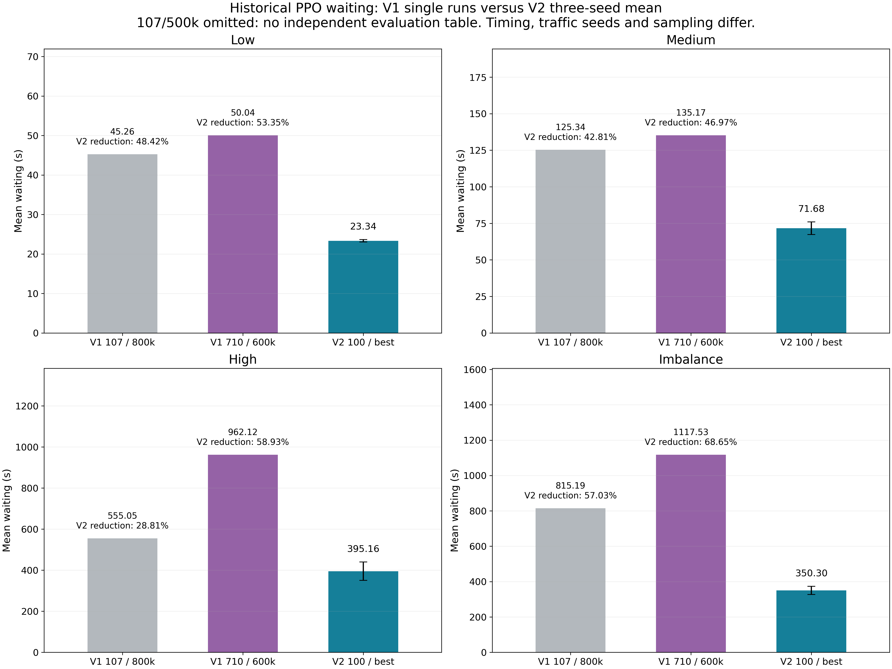

| Scenario | V2 best waiting reduction vs 107/800k (%) | V2 best waiting reduction vs 710/600k (%) |
| --- | --- | --- |
| low | 48.420003 | 53.353297 |
| medium | 42.813585 | 46.971786 |
| high | 28.806841 | 58.928496 |
| imbalance | 57.028142 | 68.653765 |

These percentages describe recorded waiting changes, not a controlled estimate of architectural benefit. Minimum green changed from 30 to 15 s; scenario exposures, seeds, rollout structure and sampling changed together. V1 arrivals have incompatible accumulation/aggregation, and V1 Fixed-Time speed was network-wide. Do not interpret V1-to-V2 arrival ratios as throughput improvements.

The three decisive engineering changes are: directional normalized inputs that retain NS/EW demand; scaled/shaped rewards plus balanced rollouts and controlled PPO updates; and corrected multi-seed evaluation with independent checkpoint selection. Their combined association with better historical PPO High/Imbalance waiting is supported. Separate causal contributions require controlled ablations under identical timing and traffic seeds.

The supported reversal against a contemporary baseline occurs on Imbalance. V2 does not reverse Rule-Based superiority on High, and V1 seed 107 already had favorable recorded High waiting. Neither universal V1 failure nor universal V2 dominance follows from the evidence.

## 6. Limitations, Conclusions and Future Work

### 6.1 Limitations

**Safety:** the existing combined subprocess log contains junction-collision and emergency-braking warnings. These are not a PPO-specific collision rate and cannot establish relative safety without stage-attributed event exposure. Signal timing guards do not demonstrate collision-free behavior, legal compliance or field readiness. The reward includes no explicit collision penalty.

**Representation and horizon:** queue, vehicles and waiting saturate above 60, 80 and 1500 per axis; reward saturates at -10. Saturation incidence cannot be reconstructed from aggregate traffic CSVs. A 3600 s horizon leaves incomplete trips, terminal vehicles and possibly delayed insertions. No clearance period or trip-completion distribution is evaluated here.

**Statistical scope:** one V2 training seed and three held-out traffic seeds provide descriptive paired evidence, not broad robustness or statistical significance. Test-seed Std is not training-seed uncertainty. Repeated selection on validation seed 999 can itself adapt to that validation traffic. Historical V1 data are confounded by timing and metric changes.

**Remaining instrumentation limits:** the supplementary 12-episode action audit now supplies the measured data in Figure 03, with exact reproduction of the original traffic metrics. It excludes unfinished green intervals and does not instrument pure policy-inference latency. No independently evaluated seed-107 500k table exists; Figure 07 omits that unevaluated model. The 218880 critic spike still has no proven causal diagnosis.

### 6.2 Conclusion and next experiments

V2 improves state observability, optimization scale and experimental auditability. Its selected checkpoint improves all five Imbalance mean metrics versus Rule-Based and reduces Imbalance variability relative to final. Rule-Based remains stronger on the High mean scorecard, and final is stronger than selected on High. Retain validation selection while recognizing its scenario trade-off.

Next: train independent seeds 200 and 300 with unchanged held-out rules; expand validation traffic seeds; run ablations for directionality, scaling, imbalance penalty and min-green timing; record controller events and synchronized policy latency; report paired uncertainty, trip metrics and clearance backlog; add safety constraints/penalties and stage-attributed collision rates; then extend to coordinated multiple intersections.

### 6.3 Provenance and verification

Primary artifacts: [training metadata](../../models/seed100/training_metadata.json), [pipeline timings](../seed100/pipeline_timings.json), [preflight](../seed100/preflight_check.json), [V2 summary](../seed100/summary_final.csv), [original V2 report](drl_seed100_v2_report.md), [V1 summary](v1_baseline_drl_summary_107_710.md).

Source read directly: DRL/gym_env.py, DRL/core/environment.py, DRL/train_multiscenario.py, DRL/evaluate.py, DRL/metrics.py, run_pipeline_seed100.py, DRL/configs/traci.yaml, DRL/requirements.txt. Historical reports: results/comparison_result/v1_baseline_drl_summary_107_710.md, results/comparison_result/drl_seed107_report.md, results/comparison_result/drl_seed710_report.md. Detailed evaluation data: evaluation/seed100/{best,final}/{episodes,metrics}.csv and all baseline CSVs for 101/102/103. Training/validation Monitor, reset JSONL, validation NPZ and all 13 requested TensorBoard scalars were read. V1 TensorBoard files and per-seed summary CSVs were also checked.

All 48 evaluated episodes were independently reconstructed from 720 samples each; 400 numerical equalities against episode/summary CSVs were checked. Mean/Std, percentage improvement and CV use unrounded source values; tables display six decimals except the 9-significant-digit scalar summary. All 80 validation episodes, saved checkpoint step identities, 836 training episodes and balanced seed cycles were verified. Seven PNGs are checked for positive size and 300-DPI metadata. Both reports are checked for valid Markdown table widths, six main sections, eight image links and absence of missing numeric values. Existing source/data/report hashes are checked before and after generation.

Section 1.0 was added through direct architectural-source and Git-history verification; the pre-existing report text, Markdown tables, image links and original-data SHA-256 hashes were checked unchanged.

## Appendix — Additional traffic-seed evaluation: 57, 367, 1024

<!-- APPENDIX-NEW-TRAFFIC-SEEDS-57-367-1024 -->

This appendix evaluates the same PPO best checkpoint from training seed 100 (models/seed100/best_model/best_model.zip), with deterministic=True and no retraining. It is a separate 36-episode / 25,920-sample comparison against newly executed Fixed-Time and Rule-Based baselines; the earlier 101/102/103 results and all preceding text remain unchanged.

V2 settings: simulation step 0.1 s, decision interval 5 s, min/max green 15/75 s, yellow/all-red 3/3 s, 3600 s per episode. PPO/Rule-Based share adaptive signal constraints; Fixed-Time retains its static 51 s green per axis inside the same bounds. Shared post-step metrics use episode means, except arrived_count, which sums all 0.1 s substeps. Waiting is summed current lane waiting, not completed-trip delay; speed is vehicle-weighted on eight incoming lanes. These corrected V2 measurements and 15 s minimum green must not be conflated with older 30 s baseline logs.

### A. Multi-seed mean ± sample Std (ddof=1)

Units: queue/network in vehicles, waiting in seconds, speed in m/s, arrivals in vehicles per episode. Lower queue/wait/network and higher speed/arrivals are favorable.

| Scenario | Metric | Fixed-Time | Rule-Based | PPO best |
| --- | --- | --- | --- | --- |
| low | queue_length | 4.963426 ± 0.046592 | 2.576852 ± 0.073524 | 2.664352 ± 0.084086 |
| low | waiting_time | 97.892639 ± 1.082200 | 24.263981 ± 0.170608 | 25.635046 ± 1.137117 |
| low | average_speed | 6.609051 ± 0.070891 | 8.132315 ± 0.031724 | 8.019519 ± 0.152761 |
| low | arrived_count | 1192.333333 ± 27.061658 | 1198.666667 ± 24.440404 | 1199.000000 ± 24.879711 |
| low | vehicles_in_network | 20.278704 ± 0.273665 | 17.456481 ± 0.390350 | 17.556481 ± 0.195663 |
| medium | queue_length | 12.939352 ± 0.387060 | 7.058796 ± 0.249325 | 6.962500 ± 0.079434 |
| medium | waiting_time | 238.878333 ± 8.043524 | 68.476759 ± 2.932450 | 67.211019 ± 1.347887 |
| medium | average_speed | 6.023025 ± 0.077788 | 7.510455 ± 0.102917 | 7.554743 ± 0.015656 |
| medium | arrived_count | 2951.000000 ± 61.506097 | 2957.333333 ± 62.228075 | 2961.000000 ± 58.129167 |
| medium | vehicles_in_network | 53.402778 ± 1.320360 | 45.870370 ± 1.223669 | 45.724537 ± 0.801415 |
| high | queue_length | 45.629630 ± 2.859215 | 33.485185 ± 0.908272 | 33.249074 ± 1.292734 |
| high | waiting_time | 939.661713 ± 75.381490 | 401.980278 ± 12.695573 | 392.615880 ± 17.328119 |
| high | average_speed | 3.843322 ± 0.136998 | 4.459157 ± 0.136015 | 4.456669 ± 0.123420 |
| high | arrived_count | 5304.333333 ± 56.571489 | 5314.333333 ± 37.819748 | 5319.000000 ± 49.507575 |
| high | vehicles_in_network | 135.045833 ± 4.598682 | 121.367593 ± 2.762906 | 121.167593 ± 2.940572 |
| imbalance | queue_length | 82.909722 ± 6.982146 | 24.559259 ± 1.768458 | 19.606019 ± 0.435051 |
| imbalance | waiting_time | 1851.894537 ± 112.696974 | 333.737361 ± 9.596070 | 311.851944 ± 13.395462 |
| imbalance | average_speed | 2.123738 ± 0.079933 | 4.428855 ± 0.213498 | 5.222944 ± 0.033861 |
| imbalance | arrived_count | 3931.666667 ± 33.291641 | 4111.666667 ± 53.050291 | 4123.000000 ± 65.642974 |
| imbalance | vehicles_in_network | 188.637963 ± 17.549400 | 94.475463 ± 4.036181 | 84.681019 ± 0.841126 |

### B. PPO best improvement (%)

Positive is favorable: 100(B-P)/B for queue/wait/network; 100(P-B)/B for speed/arrivals. Calculated before rounding.

| Scenario | Metric | vs Fixed-Time (%) | vs Rule-Based (%) |
| --- | --- | --- | --- |
| low | queue_length | 46.320306 | -3.395616 |
| low | waiting_time | 73.813101 | -5.650618 |
| low | average_speed | 21.341461 | -1.387010 |
| low | arrived_count | 0.559128 | 0.027809 |
| low | vehicles_in_network | 13.424045 | -0.572853 |
| medium | queue_length | 46.191277 | 1.364203 |
| medium | waiting_time | 71.863912 | 1.848424 |
| medium | average_speed | 25.431038 | 0.589693 |
| medium | arrived_count | 0.338868 | 0.123986 |
| medium | vehicles_in_network | 14.377980 | 0.317925 |
| high | queue_length | 27.132711 | 0.705121 |
| high | waiting_time | 58.217316 | 2.329567 |
| high | average_speed | 15.958772 | -0.055805 |
| high | arrived_count | 0.276503 | 0.087813 |
| high | vehicles_in_network | 10.276689 | 0.164789 |
| imbalance | queue_length | 76.352570 | 20.168527 |
| imbalance | waiting_time | 83.160383 | 6.557677 |
| imbalance | average_speed | 145.931595 | 17.929880 |
| imbalance | arrived_count | 4.866469 | 0.275638 |
| imbalance | vehicles_in_network | 55.109238 | 10.367183 |

### C. Individual traffic seeds

#### Seed 57

| Scenario | Method | Queue | Waiting (s) | Speed (m/s) | Arrivals | Network vehicles |
| --- | --- | --- | --- | --- | --- | --- |
| low | Fixed-Time | 4.987500 | 96.723194 | 6.539893 | 1162.000000 | 19.990278 |
| low | Rule-Based | 2.519444 | 24.256528 | 8.129235 | 1172.000000 | 17.052778 |
| low | PPO best | 2.754167 | 26.947500 | 7.881923 | 1172.000000 | 17.330556 |
| medium | Fixed-Time | 12.544444 | 229.664167 | 6.110740 | 2917.000000 | 52.369444 |
| medium | Rule-Based | 6.856944 | 66.322778 | 7.595975 | 2926.000000 | 45.168056 |
| medium | PPO best | 7.005556 | 67.248333 | 7.537362 | 2931.000000 | 45.447222 |
| high | Fixed-Time | 42.329167 | 858.467500 | 3.990629 | 5280.000000 | 130.208333 |
| high | Rule-Based | 33.251389 | 401.499722 | 4.514158 | 5292.000000 | 120.147222 |
| high | PPO best | 34.300000 | 403.516806 | 4.392335 | 5305.000000 | 122.888889 |
| imbalance | Fixed-Time | 75.863889 | 1725.039444 | 2.211614 | 3895.000000 | 170.958333 |
| imbalance | Rule-Based | 22.538889 | 324.116389 | 4.674703 | 4060.000000 | 89.887500 |
| imbalance | PPO best | 19.837500 | 307.307361 | 5.203657 | 4060.000000 | 84.622222 |

#### Seed 367

| Scenario | Method | Queue | Waiting (s) | Speed (m/s) | Arrivals | Network vehicles |
| --- | --- | --- | --- | --- | --- | --- |
| low | Fixed-Time | 4.909722 | 98.095972 | 6.605703 | 1201.000000 | 20.311111 |
| low | Rule-Based | 2.551389 | 24.097222 | 8.165467 | 1204.000000 | 17.484722 |
| low | PPO best | 2.651389 | 24.945139 | 7.992733 | 1204.000000 | 17.668056 |
| medium | Fixed-Time | 12.955556 | 242.474167 | 5.995919 | 2914.000000 | 52.948611 |
| medium | Rule-Based | 6.981944 | 67.291111 | 7.539155 | 2917.000000 | 45.159722 |
| medium | PPO best | 6.870833 | 65.844861 | 7.567738 | 2924.000000 | 45.098611 |
| high | Fixed-Time | 47.206944 | 1007.424861 | 3.819605 | 5264.000000 | 135.568056 |
| high | Rule-Based | 32.716667 | 389.531806 | 4.559058 | 5293.000000 | 119.425000 |
| high | PPO best | 31.805556 | 372.634722 | 4.598964 | 5278.000000 | 117.772222 |
| imbalance | Fixed-Time | 83.038889 | 1890.193472 | 2.104249 | 3960.000000 | 188.901389 |
| imbalance | Rule-Based | 25.826389 | 343.308333 | 4.290100 | 4109.000000 | 96.059722 |
| imbalance | PPO best | 19.876389 | 326.928472 | 5.203132 | 4118.000000 | 83.870833 |

#### Seed 1024

| Scenario | Method | Queue | Waiting (s) | Speed (m/s) | Arrivals | Network vehicles |
| --- | --- | --- | --- | --- | --- | --- |
| low | Fixed-Time | 4.993056 | 98.858750 | 6.681557 | 1214.000000 | 20.534722 |
| low | Rule-Based | 2.659722 | 24.438194 | 8.102243 | 1220.000000 | 17.831944 |
| low | PPO best | 2.587500 | 25.012500 | 8.183901 | 1221.000000 | 17.670833 |
| medium | Fixed-Time | 13.318056 | 244.496667 | 5.962418 | 3022.000000 | 54.890278 |
| medium | Rule-Based | 7.337500 | 71.816389 | 7.396234 | 3029.000000 | 47.283333 |
| medium | PPO best | 7.011111 | 68.539861 | 7.559129 | 3028.000000 | 46.627778 |
| high | Fixed-Time | 47.352778 | 953.092778 | 3.719730 | 5369.000000 | 139.361111 |
| high | Rule-Based | 34.487500 | 414.909306 | 4.304254 | 5358.000000 | 124.530556 |
| high | PPO best | 33.641667 | 401.696111 | 4.378707 | 5374.000000 | 122.841667 |
| imbalance | Fixed-Time | 89.826389 | 1940.450694 | 2.055352 | 3940.000000 | 206.054167 |
| imbalance | Rule-Based | 25.312500 | 333.787361 | 4.321764 | 4166.000000 | 97.479167 |
| imbalance | PPO best | 19.104167 | 301.320000 | 5.262042 | 4191.000000 | 85.550000 |

### D. Measured runtime

Methods ran concurrently; episode wall time includes SUMO startup/close and inference but excludes the one-time model load. These shared-resource measurements are not isolated algorithm-speed benchmarks or pure inference latency.

| Method | Scenario | Seed | Wall seconds |
| --- | --- | --- | --- |
| Fixed-Time | low | 57 | 27.412971 |
| Fixed-Time | medium | 57 | 48.665407 |
| Fixed-Time | high | 57 | 114.948974 |
| Fixed-Time | imbalance | 57 | 189.996121 |
| Fixed-Time | low | 367 | 26.447514 |
| Fixed-Time | medium | 367 | 47.901318 |
| Fixed-Time | high | 367 | 117.285099 |
| Fixed-Time | imbalance | 367 | 236.250245 |
| Fixed-Time | low | 1024 | 23.974755 |
| Fixed-Time | medium | 1024 | 45.367533 |
| Fixed-Time | high | 1024 | 118.791654 |
| Fixed-Time | imbalance | 1024 | 248.552804 |
| Rule-Based | low | 57 | 25.692336 |
| Rule-Based | medium | 57 | 43.117105 |
| Rule-Based | high | 57 | 106.176726 |
| Rule-Based | imbalance | 57 | 83.468672 |
| Rule-Based | low | 367 | 24.898275 |
| Rule-Based | medium | 367 | 42.728806 |
| Rule-Based | high | 367 | 103.647567 |
| Rule-Based | imbalance | 367 | 87.550631 |
| Rule-Based | low | 1024 | 25.128441 |
| Rule-Based | medium | 1024 | 44.260788 |
| Rule-Based | high | 1024 | 108.475190 |
| Rule-Based | imbalance | 1024 | 96.523713 |
| PPO best | low | 57 | 28.094195 |
| PPO best | medium | 57 | 46.198486 |
| PPO best | high | 57 | 111.632526 |
| PPO best | imbalance | 57 | 80.428272 |
| PPO best | low | 367 | 27.107650 |
| PPO best | medium | 367 | 45.142903 |
| PPO best | high | 367 | 104.455256 |
| PPO best | imbalance | 367 | 77.382197 |
| PPO best | low | 1024 | 27.186475 |
| PPO best | medium | 1024 | 46.089228 |
| PPO best | high | 1024 | 111.266785 |
| PPO best | imbalance | 1024 | 85.260607 |

### E. Figures and source provenance

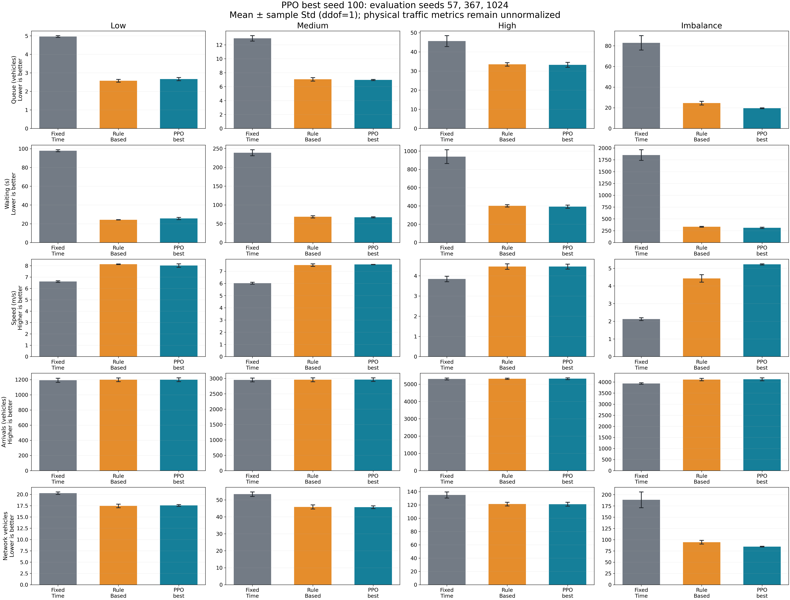

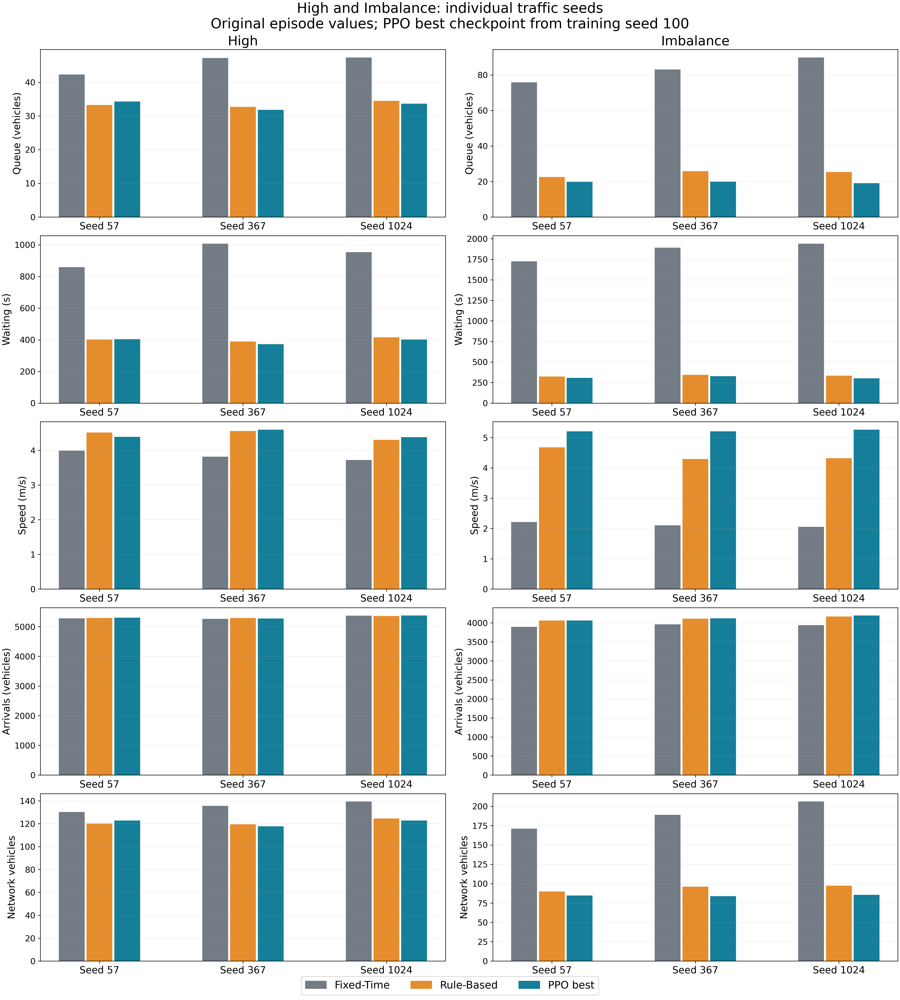

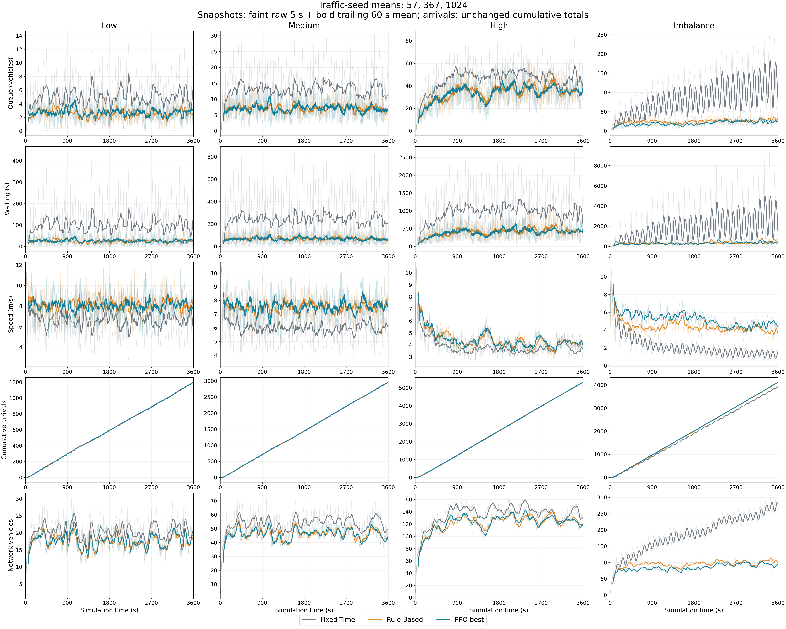

Figure 03 retains raw 5 s snapshot samples beneath trailing 60 s means (12 full samples, starting at t=60 s); cumulative arrivals are unchanged. This is a display transformation only. Three traffic seeds describe test variability, not training-seed uncertainty or statistical significance.

Sources: [episodes](../../evaluation/seed100_eval_57_367_1024/episodes.csv), [raw metrics](../../evaluation/seed100_eval_57_367_1024/metrics.csv), [mean/std](../seed100_eval_57_367_1024/summary_final.csv), [improvement](../seed100_eval_57_367_1024/improvement.csv), [runtime](../seed100_eval_57_367_1024/runtime.csv), [separate comparison report](drl_seed100_eval_57_367_1024_comparison.md).

