# DRL V2 Seed 100: Báo cáo kỹ thuật tổng hợp chuyên sâu

Phân tích hồi cứu từ mã nguồn, TensorBoard, Monitor, NPZ và CSV có sẵn. Không chạy mô phỏng SUMO, huấn luyện hoặc đánh giá mô hình mới trong quá trình lập báo cáo.

## 1. Quá trình phát triển và tiến hóa mô hình: V1 đến V2

### 1.0 Nguồn gốc mô hình, kiến trúc khởi tạo và tiền thân trước V1

**Nguồn gốc mô hình.** Các trainer PPO đã kiểm tra tạo mới PPO với MlpPolicy của Stable-Baselines3 rồi gọi learn; không có nhánh nạp trọng số pretrained hoặc tiếp tục từ checkpoint. Vì vậy, quy trình được ghi nhận huấn luyện từ đầu các mạng policy/value trên PyTorch, không sử dụng mô hình huấn luyện sẵn từ bên ngoài. Mã policy SB3 đang cài khởi tạo trọng số tuyến tính theo phép khởi tạo trực giao và bias bằng 0; khởi tạo ngẫu nhiên không có nghĩa mọi tham số đều ngẫu nhiên. V2 khai báo tường minh hai nhánh actor/critic, mỗi nhánh có lớp ẩn [128,128], Tanh và seed huấn luyện 100. Nguồn: [trainer](../../DRL/train_multiscenario.py), [thư viện ghim phiên bản](../../DRL/requirements.txt); hàm khởi tạo PPO lịch sử tại commit Git a6e8d5c, TraCI/train_multiscenario.py.

**Giao diện mô phỏng tự xây dựng.** TrafficSignalEnv kế thừa gymnasium.Env, bọc trực tiếp Environment, SignalController và StateExtractor nội bộ qua TraCI. Luồng huấn luyện này không import sumo-rl; requirements đã kiểm tra cũng không khai báo thư viện đó. Commit Git 7f57874 ghi nhận đổi tên TraCI/gym_env.py và các module lõi sang DRL, giữ nguyên nội dung. Đây là giao diện Gymnasium do dự án xây dựng, không phải bằng chứng sử dụng bộ điều khiển giao thông pretrained bên ngoài. Nguồn: [môi trường Gym](../../DRL/gym_env.py), [môi trường mô phỏng](../../DRL/core/environment.py), [điều khiển tín hiệu](../../DRL/core/signal_controller.py), [trích xuất trạng thái](../../DRL/core/state_extractor.py).

**Chung phép đo, phân biệt luồng điều khiển.** PPO và Rule-Based dùng chung Environment/SignalController với giới hạn xanh hiện tại 15–75 s. Fixed-Time giữ chương trình SUMO tĩnh và dùng bộ thích nghi snapshot FixedSignals, không thực thi qua SignalController. Xanh 51 s mỗi trục của Fixed-Time nằm trong khoảng trên, cùng pha vàng 3 s và toàn đỏ 3 s. Ba luồng V2 dùng chung StateExtractor và định nghĩa năm metric: queue_length, waiting_time, average_speed, arrived_count, vehicles_in_network; arrivals cộng toàn episode, bốn chỉ số còn lại lấy trung bình snapshot. Thiết kế này hỗ trợ đối chiếu công bằng về vật lý và phép đo, không đồng nghĩa ba controller có cùng cách thực thi hoặc các sai lệch V1 đã được hiệu chỉnh hồi tố. Nguồn: [đầu vào Fixed-Time](../../FixedTime/run_fixed_time.py), [đầu vào Rule-Based](../../RuleBased/run_rule_based.py), [triển khai baseline](../../DRL/baselines.py), [metric](../../DRL/metrics.py), [pha đèn tĩnh](../../SUMO/Map_Nga_tu/config/traffic_light.add.xml).

**Từ tiền thân đến V1.** Git ghi nhận cầu nối TraCI (73113aa), sau đó hạ tầng baseline (9513f91). TraCI/train_baseline.py tại 91566a2 triển khai huấn luyện/đánh giá PPO đơn kịch bản; sự tồn tại của mã xác nhận luồng nguyên mẫu, không chứng minh mọi lần thử đều thành công. Tại a6e8d5c, trainer đa kịch bản và Gym wrapper có sáu đầu vào thô (queue, waiting, speed, số xe, phase ID, thời gian xanh), action Discrete(2) (0=KEEP, 1=SWITCH) và reward -(Q + 0.1W). Phiên bản này cấu hình bước mô phỏng 0,1 s và quyết định mỗi 5 s trên bản đồ bốn hướng SUMO/Map_Nga_tu với low, medium, high, imbalance. YAML của cầu nối/nguyên mẫu trước đó dùng bước 1 s, nên không gán 0,1 s cho toàn bộ lịch sử tiền V1. Ngân sách V1 được đối chiếu từ mặc định trainer seed 107 (800.000 bước, a6e8d5c) và pipeline seed 710 (600.000 bước, 0b8f4f1). Các thay đổi V2 tiếp theo được trình bày bên dưới; việc xác lập lịch sử mã nguồn này không cần chạy thực nghiệm mới.

### 1.1 Động cơ nâng cấp và giới hạn bằng chứng

V1 sử dụng sáu đặc trưng quan sát gộp chưa chuẩn hóa, reward -(Q + 0.1W), thời gian xanh tối thiểu 30 s và đánh giá checkpoint cuối, chưa chọn mô hình qua validation độc lập. Waiting của seed 710 cao hơn Rule-Based lịch sử 37.273946% ở High và 52.334583% ở Imbalance. Seed 107 khác biệt: waiting ở High thấp hơn Rule-Based lịch sử 14.565797%. Cả hai lần chạy V1 đều yếu ở Imbalance; nhận định cả hai đều thua ở High không được dữ liệu ủng hộ.

Có checkpoint seed 107 tại 500k, nhưng không tìm thấy bảng đánh giá tương ứng. Không thể kiểm chứng nhận định hiệu năng giảm 28,7% từ 500k lên 800k, nên không trình bày như kết quả đo được. V1 đã được xác nhận lệch seed lưu lượng giữa các phương pháp; chưa có bằng chứng trực tiếp về trùng seed giữa tập huấn luyện và kiểm thử.

### 1.2 Kiểm toán nguyên nhân và thay đổi kiến trúc

Bốn điểm yếu kỹ thuật thúc đẩy V2: value target và đặc trưng thô có thang đo lớn; mất thông tin NS/EW; chưa xếp hạng checkpoint bằng validation độc lập; và bất đồng nhất seed, arrivals, phạm vi speed, thời điểm lấy mẫu. Đây là cơ chế có cơ sở và lỗi giao thức đã xác nhận, chưa phải tác động nhân quả riêng lẻ được chứng minh qua ablation.

| Thành phần | V1: seed 107 / 710 | V2: seed 100 |
| --- | --- | --- |
| Quan sát | Trạng thái gộp 6D chưa chuẩn hóa | Trạng thái định hướng NS/EW 12D; float32, cắt [0,1] |
| Hàm thưởng | -(Q + 0.1W) | clip(-(Q_NS+Q_EW+0.05(W_NS+W_EW)+0.02(Q_NS-Q_EW)^2)/100,-10,0) |
| Xanh tối thiểu / tối đa của bộ điều khiển thích nghi | 30 / 75 s cho cả PPO và Rule-Based | 15 / 75 s cho cả PPO và Rule-Based |
| Vàng / toàn đỏ | Thực tế 3 / 3 s; ngưỡng toàn đỏ YAML cũ bằng 0 | 3 / 3 s trong cấu hình và khi thực thi |
| Bước mô phỏng / quyết định / chân trời | 0.1 / 5 / 3600 s | 0.1 / 5 / 3600 s; 720 quyết định mỗi episode |
| Lớp ẩn actor / critic | Mỗi nhánh [64,64]; Tanh | Mỗi nhánh [128,128]; Tanh |
| Rollout / minibatch / số epoch | 2048 / 64 / 10 | 2880 / 96 / 5 |
| Tốc độ học | Cố định 0.0003 | Giảm tuyến tính 0.0003 đến 0.00001 |
| Gamma / GAE / hệ số clip | 0.99 / 0.95 / 0.2 | 0.99 / 0.95 / 0.2 |
| Hệ số entropy / value / gradient tối đa | 0 / 0.5 / 0.5 | 0.01 / 0.5 / 0.5 |
| KL / chuẩn hóa advantage | Không đặt ngưỡng KL; có chuẩn hóa advantage | target_kl=0.02; có chuẩn hóa advantage |
| Lấy mẫu kịch bản | Chọn ngẫu nhiên độc lập từng episode | Chu kỳ bốn episode cân bằng, được xáo trộn |
| Seed train / validation / test | Policy 107/710; seed lưu lượng đánh giá bị sinh lại | Policy 100; train 1000..999999; validation 999; test 101,102,103 |
| Chọn checkpoint | Dùng bản cuối; lưu định kỳ nhưng chưa xếp hạng độc lập | Validation bốn kịch bản mỗi 28800 bước; kiểm thử best và final |
| Số xe hoàn thành hành trình | RB/PPO bỏ sót substep trung gian; PPO lấy trung bình snapshot tích lũy | Cộng đủ arrivals mỗi 0.1 s; cộng các khoảng trong toàn episode |
| Tốc độ / lấy mẫu | FT đo toàn mạng; bộ thích nghi đo làn vào; lệch thời điểm lấy mẫu | Tám làn vào có trọng số số xe; sau bước tại 5..3600 s |

Audit lịch sử ghi nhận cả hai phương pháp thích nghi V1 cùng dùng min_green=30 s. Vì vậy, 30 so với 15 s là thay đổi giữa hai phiên bản, không phải bằng chứng Rule-Based/PPO V1 dùng ngưỡng khác nhau. Thời gian toàn đỏ cần đối chiếu chương trình pha SUMO thực tế, không chỉ giá trị YAML cũ.

| Lần chạy | Explained variance trung bình | Explained variance cuối | Value loss trung bình | Value loss cuối |
| --- | --- | --- | --- | --- |
| 107 | 0.063883 | 0.392334 | 3466996.937689 | 742015.125000 |
| 710 | 0.049510 | 0.028571 | 3522991.364395 | 3473017.500000 |
| 100 | 0.954770 | 0.970996 | 22.312521 | 12.266729 |

V2 kết thúc ở explained_variance=0.970996, trong khi explained variance trung bình của V1 thấp. So sánh trung bình với giá trị cuối không tương đương cùng mốc; bảng cung cấp cả hai. Do reward đã đổi thang đo, không dùng tỷ số value loss tuyệt đối để định lượng mức tiến bộ thuật toán.

Checkpoint V2 được chọn cải thiện cả năm chỉ số trung bình Imbalance so với Rule-Based cùng giao thức. Chọn bằng validation giúp hạn chế ảnh hưởng dao động cuối kỳ ở kịch bản này; không loại bỏ hoàn toàn over-adaptation và không bảo đảm checkpoint tốt nhất trên mọi kịch bản kiểm thử.

## 2. Phương pháp luận, công nghệ và tiền xử lý dữ liệu

### 2.1 Nền tảng thực thi và ràng buộc tín hiệu

Thực nghiệm sử dụng SUMO 1.28.0 và TraCI, môi trường Gymnasium, PPO của Stable-Baselines3 và PyTorch CUDA. GPU được ghi nhận: NVIDIA Quadro RTX 3000. Phiên bản thư viện dưới đây lấy từ manifest của lần chạy, không suy ra từ môi trường hiện tại.

| Thư viện | Phiên bản đã ghi nhận |
| --- | --- |
| torch | 2.5.1+cu121 |
| stable-baselines3 | 2.9.2 |
| gymnasium | 1.4.0 |
| numpy | 2.2.6 |
| PyYAML | 6.0.3 |
| tensorboard | 2.21.0 |
| matplotlib | 3.10.9 |

| Cấu hình | Giá trị |
| --- | --- |
| simulation_step | 0.1 |
| decision_interval | 5 |
| min_green | 15 |
| max_green | 75 |
| yellow_time | 3 |
| all_red_time | 3 |
| gui | False |

Không gian Discrete(2) mã hóa KEEP=0 và SWITCH=1. SignalController chặn chuyển sớm, ép chuyển khi đạt xanh tối đa tại biên 0,1 s; quá trình chuyển giữ pha vàng và toàn đỏ. Yêu cầu trong pha chuyển là NOOP; yêu cầu tại pha khởi động có thể bị giữ lại. Green elapsed tính bằng giây mô phỏng. Mặt nạ tín hiệu, pha khởi động và khóa chuyển tiếp bổ sung ràng buộc cho action nhị phân. Fixed-Time giữ xanh 51 s mỗi trục trong chu kỳ 114 s, thuộc khoảng 15–75 s; nhịp 5 s chỉ để đo lường.

### 2.2 Biểu diễn 12D theo hướng

Làn NS: N_in_0, N_in_1, S_in_0, S_in_1. Làn EW: E_in_0, E_in_1, W_in_0, W_in_1. Hàng chờ, số xe và current waiting cộng theo trục. Tốc độ dùng trọng số số xe trên làn. Toàn bộ đầu ra được cắt về [0,1] và lưu float32.

| Vị trí | Đặc trưng | Tiền xử lý trước phép cắt cuối |
| --- | --- | --- |
| 0 | queue_ns_norm | Q_NS / 60 |
| 1 | queue_ew_norm | Q_EW / 60 |
| 2 | veh_ns_norm | N_NS / 80 |
| 3 | veh_ew_norm | N_EW / 80 |
| 4 | wait_ns_norm | W_NS / 1500; waiting làn bị thiếu đóng góp 0 |
| 5 | wait_ew_norm | W_EW / 1500; waiting làn bị thiếu đóng góp 0 |
| 6 | speed_ns_norm | sum(n_i v_i)/(13.9 sum(n_i)); trục trống = 1 |
| 7 | speed_ew_norm | sum(n_i v_i)/(13.9 sum(n_i)); trục trống = 1 |
| 8 | is_ns_green | 1 nếu phase_id thuộc 0,1; trường hợp khác 0 |
| 9 | is_ew_green | 1 nếu phase_id thuộc 4,5; trường hợp khác 0 |
| 10 | green_elapsed_norm | green_elapsed / 75 |
| 11 | can_switch | 1 nếu ngoài pha chuyển và green_elapsed >= 15 s; trường hợp khác 0 |

Khi queue>60, vehicles>80 hoặc waiting>1500 s mỗi trục, đặc trưng tương ứng bão hòa; mức quá tải lớn hơn không còn phân biệt được ở chiều đó. Tốc độ quan sát của trục trống bằng 1, nhưng chỉ số tốc độ giao thông của vùng incoming hoàn toàn trống bằng 0. Chuẩn hóa đặc trưng và định nghĩa metric có vai trò khác nhau.

### 2.3 Thiết kế hàm thưởng và cấu hình PPO

$$r_t=\operatorname{clip}\left(-\frac{Q_{NS}+Q_{EW}+0.05(W_{NS}+W_{EW})+0.02(Q_{NS}-Q_{EW})^2}{100},-10,0\right).$$

Thành phần queue phạt số xe dừng; current waiting có trọng số nhấn mạnh các lần dừng kéo dài; chênh lệch NS/EW bình phương phạt lệch hàng chờ. Chia 100 giảm thang đo value target, cắt ngưỡng giới hạn hình phạt cực đoan. Hàng chờ bằng nhau không luôn đồng nghĩa phân bổ xanh theo nhu cầu; hệ số cân bằng là một đánh đổi thiết kế. Reward lấy snapshot cuối khoảng, chưa có thành phần phạt va chạm, thưởng arrivals hoặc phạt chuyển pha riêng.

| Tham số PPO | Cấu hình thực tế |
| --- | --- |
| policy / device / seed | MlpPolicy / cuda / 100 |
| learning_rate | 1e-5 + (3e-4 - 1e-5) * clip(progress_remaining,0,1) |
| n_steps / batch_size / n_epochs | 2880 / 96 / 5 |
| gamma / gae_lambda | 0.99 / 0.95 |
| clip_range / value clipping | 0.2 / disabled |
| ent_coef / vf_coef / max_grad_norm | 0.01 / 0.5 / 0.5 |
| target_kl / normalize_advantage | 0.02 / bật |
| net_arch / activation | pi=[128,128], vf=[128,128] / Tanh |
| use_sde / sde_sample_freq | Tắt / -1 |
| stats_window_size | 100 episode |
| Bộ đệm rollout | Bộ đệm mặc định; không có kwargs tùy biến |
| Chu kỳ checkpoint / validation | 28800 bước quyết định; bốn episode validation tất định |
| total_timesteps yêu cầu / thực tế | 600000 / 601920 |

### 2.4 Tách biệt seed và giao thức đo lường

Huấn luyện dùng NumPy default_rng(100), xáo trộn từng chu kỳ bốn kịch bản và sinh seed lưu lượng trong [1000,999999]. Có 836 episode hoàn tất, xác nhận mỗi kịch bản xuất hiện 209 lần và mỗi rollout phủ đủ bốn kịch bản. Seed huấn luyện có thể lặp trong dải đó nhưng không thể trùng 101/102/103/999. Validation dùng lại 999 cho từng kịch bản, chọn theo reward trung bình bốn kịch bản lớn nhất; seed kiểm thử 101–103 không tham gia chọn checkpoint.

Mỗi episode đánh giá có 720 mẫu sau bước tại t=5,10,...,3600 s. Queue, tổng waiting theo làn, tốc độ có trọng số trên cùng tám làn vào và số xe toàn mạng được lấy trung bình theo thời gian. Arrivals cộng đủ 50 substep mỗi quyết định và cộng tiếp toàn episode. Waiting không phải delay hành trình trung bình mỗi xe; occupancy là trung bình, không phải xe tồn đọng cuối kỳ. Cùng seed và đầu vào route đồng bộ thiết lập ngẫu nhiên, nhưng controller vẫn có thể làm khác thời điểm chèn xe và quỹ đạo.

## 3. Quá trình huấn luyện và phân tích hội tụ: Seed 100

Ngân sách yêu cầu 600,000 bước được thu trọn rollout thành 601,920 bước: 209 rollout và 836 episode hoàn tất, mỗi episode 720 quyết định. Một rollout tương ứng đúng một chu kỳ cân bằng bốn kịch bản. Preflight riêng hoàn tất 5760 bước; kết quả thử đó không được gộp vào thực nghiệm chính.

### 3.1 Diễn biến học và chọn mô hình qua validation

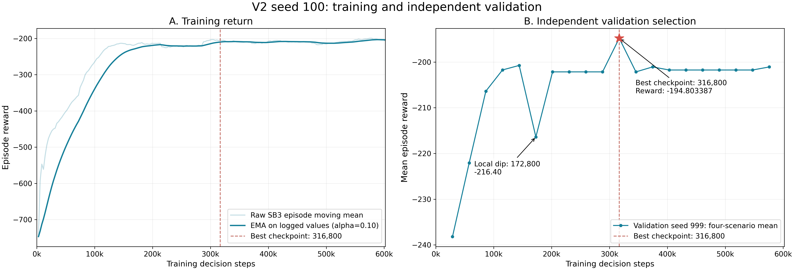

Return huấn luyện đầu tiên được log là -746.923645 tại bước 2,880; giá trị cuối là -206.924393 tại 601,920. Rollout return gốc đã là trung bình episode theo cửa sổ của SB3; EMA bổ sung (alpha=0,10) chỉ phục vụ hiển thị, không dùng chọn checkpoint.

| Bước validation | Return trung bình bốn kịch bản | Std tổng thể giữa bốn kịch bản |
| --- | --- | --- |
| 28800 | -238.182487 | 182.220993 |
| 57600 | -222.076287 | 181.084759 |
| 86400 | -206.378925 | 157.372703 |
| 115200 | -201.736925 | 155.055035 |
| 144000 | -200.748175 | 154.610903 |
| 172800 | -216.395463 | 176.294315 |
| 201600 | -202.159550 | 155.228980 |
| 230400 | -202.159550 | 155.228980 |
| 259200 | -202.159550 | 155.228980 |
| 288000 | -202.159550 | 155.228980 |
| 316800 | -194.803387 | 152.300576 |
| 345600 | -202.159550 | 155.228980 |
| 374400 | -201.078450 | 154.736330 |
| 403200 | -201.750288 | 155.040006 |
| 432000 | -201.750288 | 155.040006 |
| 460800 | -201.750288 | 155.040006 |
| 489600 | -201.750288 | 155.040006 |
| 518400 | -201.750288 | 155.040006 |
| 547200 | -201.750288 | 155.040006 |
| 576000 | -201.078450 | 154.736330 |

Validation tốt nhất đạt -194.803387 tại **316,800 bước**, được đối chiếu độc lập với best_model.zip. Validation theo lịch cuối diễn ra tại 576,000, return -201.078450; không có lượt validation tại 601.920 bước. Std ở bảng trên phản ánh khác biệt giữa bốn kịch bản, không phải bất định giữa seed kiểm thử. Mô hình cuối được kiểm thử riêng trên 101–103.

| Mốc yêu cầu | Bước rollout gần nhất | Reward huấn luyện | Explained variance | Value loss | Approx KL | Clip fraction |
| --- | --- | --- | --- | --- | --- | --- |
| 150000 | 149760 | -214.176010 | 0.975784 | 11.301619 | 0.000811 | 0.016319 |
| 218000 | 218880 | -223.570175 | 0.705051 | 318.135162 | 0.001284 | 0.009306 |
| 316800 | 316800 | -204.030319 | 0.974247 | 12.115253 | 0.000953 | 0.011944 |
| 601920 | 601920 | -206.924393 | 0.970996 | 12.266729 | 0.000036 | 0.000000 |

Chuỗi cải thiện nhanh trước khoảng 150k, sau đó phần lớn giai đoạn cuối dao động quanh vùng ổn định. Với mỗi mốc yêu cầu, từng cột dùng event gần nhất của tag tương ứng; thời điểm log train/* và rollout/* đầu kỳ có thể lệch một rollout. Reward trung bình huấn luyện cao hơn không tất yếu cho reward validation cao hơn vì thành phần lưu lượng và episode khác nhau.

### 3.2 Chất lượng Critic và độ ổn định cập nhật PPO

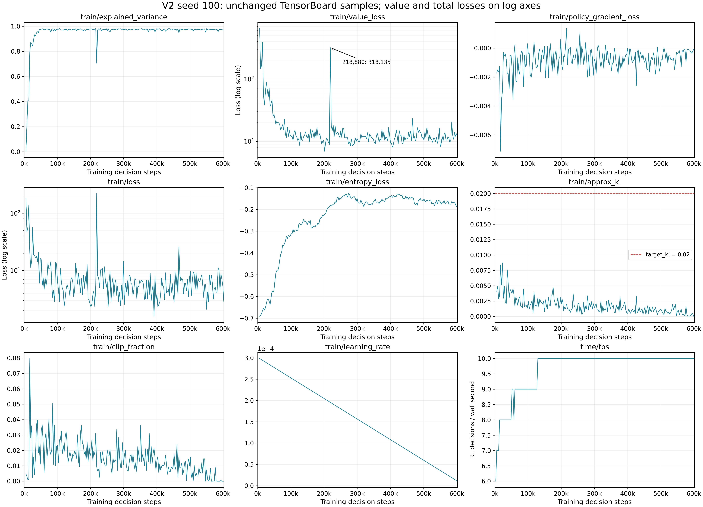

| Scalar | Đầu step:value | Min step:value | Max step:value | Trung bình | Cuối step:value |
| --- | --- | --- | --- | --- | --- |
| rollout/ep_len_mean | 2880:720 | 2880:720 | 2880:720 | 720 | 601920:720 |
| eval/mean_ep_length | 28800:720 | 28800:720 | 28800:720 | 720 | 576000:720 |
| train/policy_gradient_loss | 5760:-0.00171678618 | 17280:-0.00712858327 | 216000:0.00135364966 | -0.000806499155 | 601920:-5.49578072e-05 |
| train/loss | 5760:180.390244 | 391680:1.59540498 | 218880:219.95871 | 9.79950247 | 601920:2.82637787 |
| rollout/ep_rew_mean | 2880:-746.923645 | 2880:-746.923645 | 576000:-199.47612 | -245.387843 | 601920:-206.924393 |
| eval/mean_reward | 28800:-238.182495 | 28800:-238.182495 | 316800:-194.803391 | -205.188901 | 576000:-201.078445 |
| time/fps | 2880:6 | 2880:6 | 129600:10 | 9.67942584 | 601920:10 |
| train/explained_variance | 5760:0.00337582827 | 5760:0.00337582827 | 216000:0.981551886 | 0.954770082 | 601920:0.970995843 |
| train/approx_kl | 5760:0.00398464641 | 599040:3.55349257e-05 | 23040:0.00871576555 | 0.00172678313 | 601920:3.61091079e-05 |
| train/clip_fraction | 5760:0.00472222222 | 547200:0 | 17280:0.0796527788 | 0.0144701526 | 601920:0 |
| train/entropy_loss | 5760:-0.690861166 | 5760:-0.690861166 | 273600:-0.126918286 | -0.234441885 | 601920:-0.184609354 |
| train/value_loss | 5760:645.143127 | 201600:6.92201757 | 5760:645.143127 | 22.3125206 | 601920:12.2667294 |
| train/learning_rate | 5760:0.000298608007 | 601920:1.04640003e-05 | 5760:0.000298608007 | 0.000154536 | 601920:1.04640003e-05 |

Gai value loss cục bộ xuất hiện tại 218,880: loss=318.135162, explained_variance=0.705051, approx_kl=0.001284 và clip_fraction=0.009306. Value loss đầu kỳ 645.143127 mới là cực đại toàn chuỗi, nên sự kiện 218k là gai cục bộ. Thành phần return và bootstrapping có thể góp phần; log không xác định được nguyên nhân hoặc kịch bản cụ thể.

Explained variance phục hồi và kết thúc ở 0.970996. Approximate KL đã log nằm dưới ngưỡng tham chiếu 0,02; clip fraction cuối tiến gần 0. Điều này cho thấy cập nhật đo được nhỏ, không chứng minh điều khiển tối ưu. Entropy loss là âm entropy: tiến gần 0 nghĩa là policy tập trung hơn. Schedule đặt từ 0,0003 đến 0,00001, nhưng learning rate cuối được log là 0.000010464000; cơ chế log theo rollout có thể phản ánh giá trị của lượt tối ưu trước.

FPS bắt đầu ở 6, lần đầu đạt 8 tại bước 14,400 và kết thúc ở 10. Vì vậy, mô tả “8 lên 10 FPS” bỏ qua bản ghi đầu 6 FPS. FPS ở đây là tốc độ tương tác quyết định RL tích lũy theo giây thực, không phải substep SUMO 0,1 s hoặc khung hình. Độ dài episode rollout/eval 720 bước khớp Monitor đã lưu.

### 3.3 Hành vi ra quyết định: audit replay tất định đã đo

Phần bổ sung sau phân tích dữ liệu lưu trữ ban đầu: CSV cũ không lưu các trường hành vi, vì vậy đã replay best_model.zip có sẵn, không huấn luyện, đúng 12 episode (seed 101,102,103 × low,medium,high,imbalance). File mới được cách ly tại [action_audit](../../evaluation/seed100/action_audit/action_audit_summary.md). Cả 60 giá trị giao thông theo episode khớp CSV best/episodes.csv bằng so sánh float chính xác; đồng thời 51.840 phép đối chiếu metric/thời gian từng bước cũng khớp. File đánh giá gốc và các bảng kết quả được giữ nguyên.

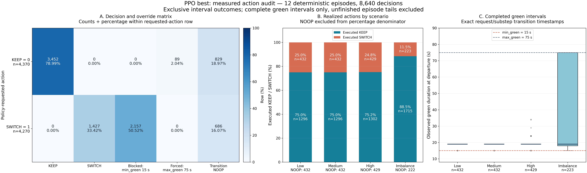

Audit ghi 8,640 quyết định và 1,516 khoảng xanh đã kết thúc. Khung A phân mỗi khoảng quyết định vào đúng một kết quả, hiển thị số lượt và tỷ lệ phần trăm trong từng hàng action yêu cầu. Thứ tự ưu tiên là ép chuyển max-green, chặn min-green, NOOP chuyển tiếp, rồi KEEP/SWITCH thông thường. Có 0 override tại pha khởi động; các trường hợp này vẫn là KEEP thực thi, không đổi nhãn thành chặn min-green.

| Action yêu cầu | KEEP | SWITCH | Chặn min-green | Ép max-green | NOOP chuyển tiếp | Tổng |
| --- | --- | --- | --- | --- | --- | --- |
| KEEP = 0 | 3452 | 0 | 0 | 89 | 829 | 4370 |
| SWITCH = 1 | 0 | 1427 | 2157 | 0 | 686 | 4270 |

| Kịch bản | KEEP | SWITCH | NOOP loại khỏi mẫu số | Mẫu số KEEP / SWITCH | KEEP (%) | SWITCH (%) | Khoảng xanh hoàn tất | Xanh min / trung vị / max (s) |
| --- | --- | --- | --- | --- | --- | --- | --- | --- |
| low | 1296 | 432 | 432 | 1728 | 75.000000 | 25.000000 | 432 | 15.000000 / 19.000000 / 19.000000 |
| medium | 1296 | 432 | 432 | 1728 | 75.000000 | 25.000000 | 432 | 15.000000 / 19.000000 / 19.000000 |
| high | 1302 | 429 | 429 | 1731 | 75.216638 | 24.783362 | 429 | 15.000000 / 19.000000 / 34.000000 |
| imbalance | 1715 | 223 | 222 | 1938 | 88.493292 | 11.506708 | 223 | 15.000000 / 19.000000 / 75.000000 |

Khung B chỉ chuẩn hóa KEEP/SWITCH trên các quyết định thực thi khác NOOP; NOOP chuyển tiếp vẫn được thể hiện ở khung A và trong bảng. Khung C dùng green_elapsed ngay trước lệnh rời pha xanh thực tế, được ghi bằng wrapper quan sát lúc chạy và chuyển nguyên lời gọi cho controller gốc. Biên ép chuyển max-green được ghi ở substep 0,1 s. Không suy thời lượng từ chuỗi pha 5 giây. Pha xanh còn hoạt động cuối episode bị cắt phải nên không đưa vào phân bố. Thời lượng hoàn tất quan sát được nằm trong 15.000000–75.000000 s, phù hợp ràng buộc cấu hình trong sai số biểu diễn số thực của bộ mô phỏng.

State trước/sau, kết quả ngay lúc yêu cầu, kết quả toàn khoảng và sự kiện có timestamp nằm trong [action_steps.csv](../../evaluation/seed100/action_audit/action_steps.csv); thời lượng hoàn tất chính xác nằm trong [action_switches.csv](../../evaluation/seed100/action_audit/action_switches.csv). [action_episodes.csv](../../evaluation/seed100/action_audit/action_episodes.csv) giữ trung bình episode cho bốn metric và tổng episode cho arrivals, đúng định nghĩa gốc. [reproducibility_check.json](../../evaluation/seed100/action_audit/reproducibility_check.json) lưu các phép so sánh chính xác. Đây là replay bổ sung để phân tích hành vi, không thay thế đánh giá hiệu năng hoặc chứng nhận an toàn.

## 4. Hệ thống bảng đánh giá và phân tích theo kịch bản

### 4.1 Bảng 1: trung bình đa seed ± độ lệch chuẩn mẫu

Mỗi ô tổng hợp ba kết quả theo episode với ddof=1. Queue, waiting và occupancy trung bình càng thấp càng tốt; tốc độ và tổng arrivals càng cao càng tốt. Phương pháp tốt nhất dựa trên trung bình mô tả, giữ các trường hợp bằng nhau. Đơn vị: queue/network là xe, waiting là giây, tốc độ m/s, arrivals là xe/episode.

| Kịch bản | Chỉ số | Fixed-Time | Rule-Based | PPO best | PPO final | Trung bình tốt nhất |
| --- | --- | --- | --- | --- | --- | --- |
| low | queue_length | 4.710648 ± 0.106875 | 2.419444 ± 0.060715 | 2.490278 ± 0.051389 | 2.490278 ± 0.051389 | Rule-Based |
| low | waiting_time | 91.949722 ± 2.547021 | 22.712407 ± 0.659577 | 23.343889 ± 0.316301 | 23.343889 ± 0.316301 | Rule-Based |
| low | average_speed | 6.790355 ± 0.119523 | 8.223877 ± 0.093479 | 8.148309 ± 0.074183 | 8.148309 ± 0.074183 | Rule-Based |
| low | arrived_count | 1170.333333 ± 28.041636 | 1173.333333 ± 26.764404 | 1175.000000 ± 24.269322 | 1175.000000 ± 24.269322 | PPO best, PPO final |
| low | vehicles_in_network | 19.734259 ± 0.408027 | 17.014352 ± 0.489434 | 17.108333 ± 0.426484 | 17.108333 ± 0.426484 | Rule-Based |
| medium | queue_length | 12.589815 ± 0.603492 | 6.980556 ± 0.249134 | 7.282870 ± 0.297405 | 7.282870 ± 0.297405 | Rule-Based |
| medium | waiting_time | 231.658472 ± 14.960646 | 67.168889 ± 2.717528 | 71.679120 ± 4.301115 | 71.679120 ± 4.301115 | Rule-Based |
| medium | average_speed | 6.156980 ± 0.129398 | 7.580487 ± 0.109359 | 7.472785 ± 0.078063 | 7.472785 ± 0.078063 | Rule-Based |
| medium | arrived_count | 2972.333333 ± 27.209067 | 2982.333333 ± 23.692474 | 2984.000000 ± 20.880613 | 2984.000000 ± 20.880613 | PPO best, PPO final |
| medium | vehicles_in_network | 53.146296 ± 0.252153 | 46.080093 ± 0.799441 | 46.444444 ± 0.804251 | 46.444444 ± 0.804251 | Rule-Based |
| high | queue_length | 46.409259 ± 2.754802 | 32.069444 ± 0.225467 | 33.303704 ± 3.600241 | 32.295370 ± 1.893948 | Rule-Based |
| high | waiting_time | 977.854583 ± 71.610296 | 385.135417 ± 9.479563 | 395.157037 ± 44.472238 | 386.548426 ± 29.624104 | Rule-Based |
| high | average_speed | 3.796897 ± 0.144123 | 4.592359 ± 0.031117 | 4.491825 ± 0.287019 | 4.565691 ± 0.164862 | Rule-Based |
| high | arrived_count | 5250.333333 ± 69.284438 | 5280.000000 ± 83.719771 | 5268.333333 ± 80.599835 | 5273.000000 ± 80.018748 | Rule-Based |
| high | vehicles_in_network | 135.775926 ± 3.584958 | 118.144444 ± 1.317390 | 120.594444 ± 6.433096 | 118.712037 ± 3.778978 | Rule-Based |
| imbalance | queue_length | 88.527315 ± 13.570427 | 27.790741 ± 3.278642 | 21.188889 ± 0.525766 | 22.474074 ± 6.877118 | PPO best |
| imbalance | waiting_time | 1984.071806 ± 243.313376 | 418.275463 ± 41.749567 | 350.303009 ± 23.177922 | 387.294722 ± 131.940310 | PPO best |
| imbalance | average_speed | 2.090909 ± 0.258941 | 4.230946 ± 0.319827 | 5.062290 ± 0.032016 | 4.968307 ± 0.818675 | PPO best |
| imbalance | arrived_count | 3886.000000 ± 61.049161 | 4086.666667 ± 54.500765 | 4095.000000 ± 68.505474 | 4093.333333 ± 59.919390 | PPO best |
| imbalance | vehicles_in_network | 200.164352 ± 29.335675 | 99.181019 ± 6.884709 | 86.757870 ± 1.055316 | 89.491204 ± 12.896088 | PPO best |

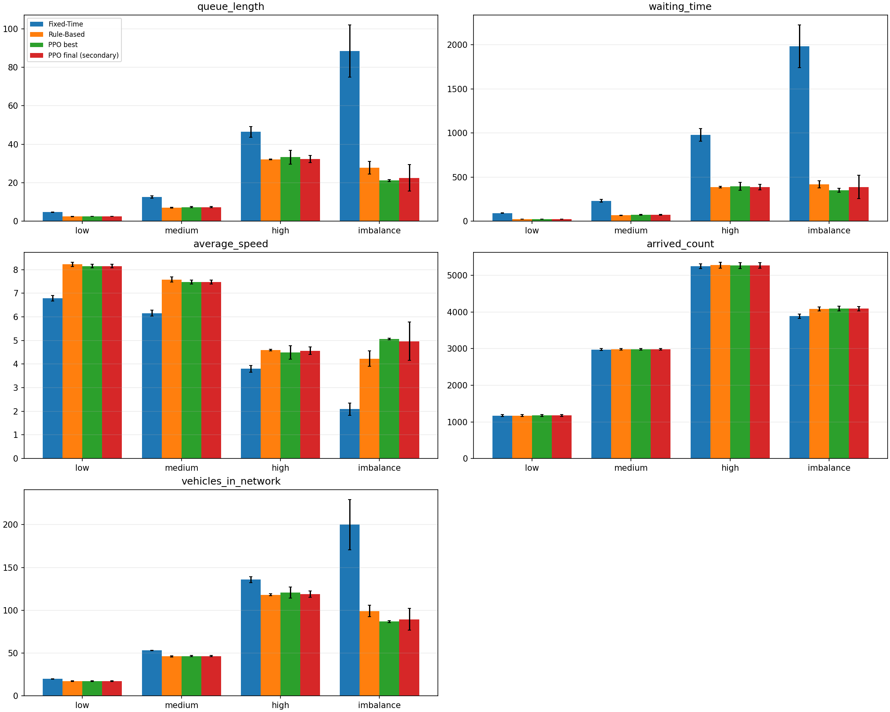

### 4.2 Bảng 2: tỷ lệ cải thiện

Với queue/wait/network: cải thiện=100(B-P)/B. Với tốc độ/arrivals: cải thiện=100(P-B)/B. P là PPO best, B là baseline tương ứng. Dấu dương nghĩa là tốt hơn; dấu âm là kém hơn. Tỷ lệ tính từ trung bình chưa làm tròn.

| Kịch bản | Chỉ số | PPO best so với Fixed-Time (%) | PPO best so với Rule-Based (%) |
| --- | --- | --- | --- |
| low | queue_length | 47.135135 | -2.927669 |
| low | waiting_time | 74.612333 | -2.780337 |
| low | average_speed | 19.998277 | -0.918880 |
| low | arrived_count | 0.398747 | 0.142045 |
| low | vehicles_in_network | 13.306433 | -0.552366 |
| medium | queue_length | 42.152681 | -4.330813 |
| medium | waiting_time | 69.058278 | -6.714763 |
| medium | average_speed | 21.370947 | -1.420786 |
| medium | arrived_count | 0.392509 | 0.055885 |
| medium | vehicles_in_network | 12.610195 | -0.790693 |
| high | queue_length | 28.239097 | -3.848708 |
| high | waiting_time | 59.589386 | -2.602103 |
| high | average_speed | 18.302519 | -2.189155 |
| high | arrived_count | 0.342835 | -0.220960 |
| high | vehicles_in_network | 11.181276 | -2.073733 |
| imbalance | queue_length | 76.065140 | 23.755581 |
| imbalance | waiting_time | 82.344237 | 16.250643 |
| imbalance | average_speed | 142.109493 | 19.649130 |
| imbalance | arrived_count | 5.378281 | 0.203915 |
| imbalance | vehicles_in_network | 56.656683 | 12.525732 |

### 4.3 Bảng 3: từng seed kiểm thử và từng episode

#### Seed 101

| Kịch bản | Phương pháp | Hàng chờ | Waiting (s) | Tốc độ (m/s) | Arrivals | Xe toàn mạng |
| --- | --- | --- | --- | --- | --- | --- |
| low | Fixed-Time | 4.587500 | 89.014444 | 6.921966 | 1164.000000 | 19.543056 |
| low | Rule-Based | 2.393056 | 22.517917 | 8.242868 | 1166.000000 | 16.948611 |
| low | PPO best | 2.444444 | 23.061528 | 8.220467 | 1168.000000 | 17.038889 |
| low | PPO final | 2.444444 | 23.061528 | 8.220467 | 1168.000000 | 17.038889 |
| medium | Fixed-Time | 12.173611 | 221.071528 | 6.230690 | 2990.000000 | 52.915278 |
| medium | Rule-Based | 7.252778 | 70.033333 | 7.486001 | 2997.000000 | 46.700000 |
| medium | PPO best | 7.137500 | 69.841806 | 7.506357 | 2998.000000 | 46.612500 |
| medium | PPO final | 7.137500 | 69.841806 | 7.506357 | 2998.000000 | 46.612500 |
| high | Fixed-Time | 46.143056 | 954.296111 | 3.866541 | 5326.000000 | 136.201389 |
| high | Rule-Based | 32.280556 | 392.668472 | 4.580507 | 5360.000000 | 119.416667 |
| high | PPO best | 31.805556 | 372.869583 | 4.588899 | 5354.000000 | 120.063889 |
| high | PPO final | 31.805556 | 372.869583 | 4.588899 | 5354.000000 | 120.063889 |
| imbalance | Fixed-Time | 89.973611 | 1899.593611 | 1.928822 | 3955.000000 | 205.812500 |
| imbalance | Rule-Based | 28.336111 | 432.587222 | 4.202835 | 4141.000000 | 100.377778 |
| imbalance | PPO best | 21.361111 | 362.181944 | 5.025330 | 4152.000000 | 87.968056 |
| imbalance | PPO final | 20.218056 | 352.688889 | 5.157291 | 4161.000000 | 85.863889 |

#### Seed 102

| Kịch bản | Phương pháp | Hàng chờ | Waiting (s) | Tốc độ (m/s) | Arrivals | Xe toàn mạng |
| --- | --- | --- | --- | --- | --- | --- |
| low | Fixed-Time | 4.779167 | 93.257917 | 6.688569 | 1146.000000 | 19.456944 |
| low | Rule-Based | 2.376389 | 22.171944 | 8.306402 | 1151.000000 | 16.561111 |
| low | PPO best | 2.480556 | 23.284444 | 8.152206 | 1155.000000 | 16.720833 |
| low | PPO final | 2.480556 | 23.284444 | 8.152206 | 1155.000000 | 16.720833 |
| medium | Fixed-Time | 13.281944 | 248.773889 | 6.007569 | 2941.000000 | 53.415278 |
| medium | Rule-Based | 6.763889 | 64.627083 | 7.700282 | 2955.000000 | 45.177778 |
| medium | PPO best | 7.086111 | 68.601806 | 7.528445 | 2960.000000 | 45.569444 |
| medium | PPO final | 7.086111 | 68.601806 | 7.528445 | 2960.000000 | 45.569444 |
| high | Fixed-Time | 49.287500 | 1058.276250 | 3.631179 | 5235.000000 | 139.129167 |
| high | Rule-Based | 32.095833 | 374.491250 | 4.568910 | 5287.000000 | 118.230556 |
| high | PPO best | 37.411111 | 446.366111 | 4.168857 | 5257.000000 | 127.276389 |
| high | PPO final | 34.386111 | 420.540278 | 4.390454 | 5271.000000 | 121.629167 |
| imbalance | Fixed-Time | 101.316667 | 2258.364722 | 1.954361 | 3839.000000 | 226.265278 |
| imbalance | Rule-Based | 30.762500 | 450.986944 | 3.926102 | 4087.000000 | 105.388889 |
| imbalance | PPO best | 20.598611 | 323.593750 | 5.081507 | 4114.000000 | 86.029167 |
| imbalance | PPO final | 30.195833 | 533.089167 | 4.071666 | 4072.000000 | 103.812500 |

#### Seed 103

| Kịch bản | Phương pháp | Hàng chờ | Waiting (s) | Tốc độ (m/s) | Arrivals | Xe toàn mạng |
| --- | --- | --- | --- | --- | --- | --- |
| low | Fixed-Time | 4.765278 | 93.576806 | 6.760530 | 1201.000000 | 20.202778 |
| low | Rule-Based | 2.488889 | 23.447361 | 8.122360 | 1203.000000 | 17.533333 |
| low | PPO best | 2.545833 | 23.685694 | 8.072254 | 1202.000000 | 17.565278 |
| low | PPO final | 2.545833 | 23.685694 | 8.072254 | 1202.000000 | 17.565278 |
| medium | Fixed-Time | 12.313889 | 225.130000 | 6.232680 | 2986.000000 | 53.108333 |
| medium | Rule-Based | 6.925000 | 66.846250 | 7.555179 | 2995.000000 | 46.362500 |
| medium | PPO best | 7.625000 | 76.593750 | 7.383552 | 2994.000000 | 47.151389 |
| medium | PPO final | 7.625000 | 76.593750 | 7.383552 | 2994.000000 | 47.151389 |
| high | Fixed-Time | 43.797222 | 920.991389 | 3.892971 | 5190.000000 | 131.997222 |
| high | Rule-Based | 31.831944 | 388.246528 | 4.627660 | 5193.000000 | 116.786111 |
| high | PPO best | 30.694444 | 366.235417 | 4.717719 | 5194.000000 | 114.443056 |
| high | PPO final | 30.694444 | 366.235417 | 4.717719 | 5194.000000 | 114.443056 |
| imbalance | Fixed-Time | 74.291667 | 1794.257083 | 2.389545 | 3864.000000 | 168.415278 |
| imbalance | Rule-Based | 24.273611 | 371.252222 | 4.563900 | 4032.000000 | 91.776389 |
| imbalance | PPO best | 21.606944 | 365.133333 | 5.080031 | 4019.000000 | 86.276389 |
| imbalance | PPO final | 17.008333 | 276.106111 | 5.675964 | 4047.000000 | 78.797222 |

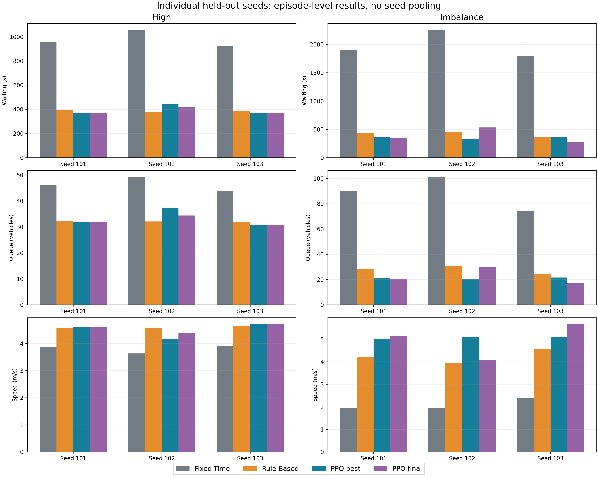

Độ khó cần gắn với kịch bản và controller. Thứ tự theo waiting dưới đây trực tiếp kiểm tra giả thuyết 102 > 101 > 103, không mặc định đúng với mọi trường hợp. Đây là xếp hạng ùn tắc thực tế, không phải phép đo độc lập về nhu cầu đầu vào.

| Kịch bản | Phương pháp | Waiting giảm dần: seed:giá trị |
| --- | --- | --- |
| low | Fixed-Time | 103:93.576806; 102:93.257917; 101:89.014444 |
| low | Rule-Based | 103:23.447361; 101:22.517917; 102:22.171944 |
| low | PPO best | 103:23.685694; 102:23.284444; 101:23.061528 |
| low | PPO final | 103:23.685694; 102:23.284444; 101:23.061528 |
| medium | Fixed-Time | 102:248.773889; 103:225.130000; 101:221.071528 |
| medium | Rule-Based | 101:70.033333; 103:66.846250; 102:64.627083 |
| medium | PPO best | 103:76.593750; 101:69.841806; 102:68.601806 |
| medium | PPO final | 103:76.593750; 101:69.841806; 102:68.601806 |
| high | Fixed-Time | 102:1058.276250; 101:954.296111; 103:920.991389 |
| high | Rule-Based | 101:392.668472; 103:388.246528; 102:374.491250 |
| high | PPO best | 102:446.366111; 101:372.869583; 103:366.235417 |
| high | PPO final | 102:420.540278; 101:372.869583; 103:366.235417 |
| imbalance | Fixed-Time | 102:2258.364722; 101:1899.593611; 103:1794.257083 |
| imbalance | Rule-Based | 102:450.986944; 101:432.587222; 103:371.252222 |
| imbalance | PPO best | 103:365.133333; 101:362.181944; 102:323.593750 |
| imbalance | PPO final | 102:533.089167; 101:352.688889; 103:276.106111 |

### 4.4 Bảng 4: thời gian chạy, thông lượng và bằng chứng độ trễ suy luận

| Giai đoạn | Thời gian thực (s) | Thời gian thực (giờ) | Phạm vi |
| --- | --- | --- | --- |
| Fixed-Time | 1234.917013 | 0.343033 | 12 episode |
| Rule-Based | 709.147402 | 0.196985 | 12 episode |
| drl_training | 57655.590464 | 16.015442 | Huấn luyện GPU và validation |
| drl_evaluation_best | 798.165308 | 0.221713 | 12 episode |
| drl_evaluation_final | 813.890690 | 0.226081 | 12 episode |
| total_pipeline | 61215.132396 | 17.004203 | Tất cả giai đoạn và chi phí phụ |

| Chỉ số thời gian | Giá trị | Diễn giải |
| --- | --- | --- |
| time/fps đầu / trung bình / cuối | 6 / 9.679426 / 10 | Thông lượng bước quyết định tích lũy |
| Đánh giá best: ms thực / quyết định | 92.380244 | Gồm SUMO, TraCI, reset và khởi động; 8640 quyết định |
| Đánh giá final: ms thực / quyết định | 94.200311 | Gồm SUMO, TraCI, reset và khởi động; 8640 quyết định |
| Độ trễ suy luận policy thuần | Chưa có phép đo | Evaluator đã lưu chưa đo riêng predict có đồng bộ CUDA |
| Khoảng quyết định | 5 s mô phỏng | Chưa phải bảo đảm độ trễ thực địa đã đo |

Thời gian thực chia cho số quyết định không phải thời gian suy luận mạng. Chỉ số này bao gồm khởi động, stepping SUMO, trao đổi TraCI và ghi file. Không thể dùng để bảo đảm hạn chót thời gian thực; triển khai cần đo predict riêng có đồng bộ và đo độ trễ đuôi phân bố.

### 4.5 Diễn biến theo thời gian, độ ổn định và cơ chế theo kịch bản

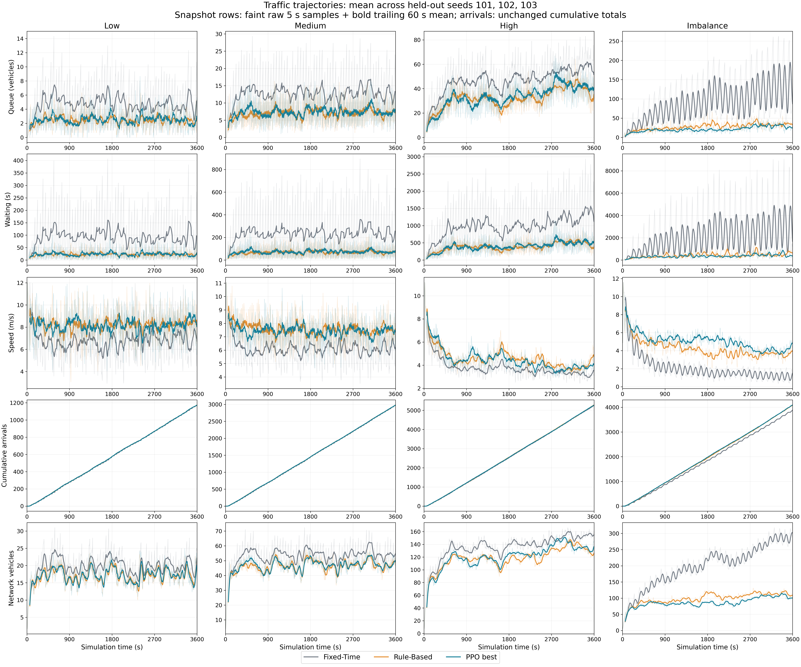

Hình 04 lấy trung bình mẫu sau bước đã căn cùng timestamp; không tạo mẫu giả tại t=0. Hàng arrivals là tổng tích lũy arrivals theo khoảng, sau đó trung bình giữa seed. Các hàng khác giữ ý nghĩa snapshot. Tích lũy arrivals chỉ là phép biến đổi để vẽ, không thay định nghĩa metric episode đã kiểm chứng.

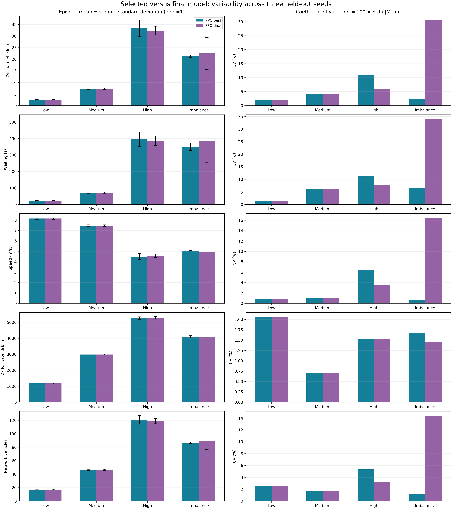

| Kịch bản | Chỉ số | Best TB ± Std | Final TB ± Std | CV best (%) | CV final (%) |
| --- | --- | --- | --- | --- | --- |
| low | queue_length | 2.490278 ± 0.051389 | 2.490278 ± 0.051389 | 2.063581 | 2.063581 |
| low | waiting_time | 23.343889 ± 0.316301 | 23.343889 ± 0.316301 | 1.354962 | 1.354962 |
| low | average_speed | 8.148309 ± 0.074183 | 8.148309 ± 0.074183 | 0.910413 | 0.910413 |
| low | arrived_count | 1175.000000 ± 24.269322 | 1175.000000 ± 24.269322 | 2.065474 | 2.065474 |
| low | vehicles_in_network | 17.108333 ± 0.426484 | 17.108333 ± 0.426484 | 2.492843 | 2.492843 |
| medium | queue_length | 7.282870 ± 0.297405 | 7.282870 ± 0.297405 | 4.083623 | 4.083623 |
| medium | waiting_time | 71.679120 ± 4.301115 | 71.679120 ± 4.301115 | 6.000513 | 6.000513 |
| medium | average_speed | 7.472785 ± 0.078063 | 7.472785 ± 0.078063 | 1.044627 | 1.044627 |
| medium | arrived_count | 2984.000000 ± 20.880613 | 2984.000000 ± 20.880613 | 0.699752 | 0.699752 |
| medium | vehicles_in_network | 46.444444 ± 0.804251 | 46.444444 ± 0.804251 | 1.731640 | 1.731640 |
| high | queue_length | 33.303704 ± 3.600241 | 32.295370 ± 1.893948 | 10.810334 | 5.864457 |
| high | waiting_time | 395.157037 ± 44.472238 | 386.548426 ± 29.624104 | 11.254320 | 7.663750 |
| high | average_speed | 4.491825 ± 0.287019 | 4.565691 ± 0.164862 | 6.389807 | 3.610891 |
| high | arrived_count | 5268.333333 ± 80.599835 | 5273.000000 ± 80.018748 | 1.529892 | 1.517518 |
| high | vehicles_in_network | 120.594444 ± 6.433096 | 118.712037 ± 3.778978 | 5.334488 | 3.183315 |
| imbalance | queue_length | 21.188889 ± 0.525766 | 22.474074 ± 6.877118 | 2.481327 | 30.600229 |
| imbalance | waiting_time | 350.303009 ± 23.177922 | 387.294722 ± 131.940310 | 6.616535 | 34.067159 |
| imbalance | average_speed | 5.062290 ± 0.032016 | 4.968307 ± 0.818675 | 0.632444 | 16.477952 |
| imbalance | arrived_count | 4095.000000 ± 68.505474 | 4093.333333 ± 59.919390 | 1.672905 | 1.463829 |
| imbalance | vehicles_in_network | 86.757870 ± 1.055316 | 89.491204 ± 12.896088 | 1.216392 | 14.410453 |

Low và Medium cho bảng episode best/final giống nhau. Waiting Imbalance của best là 350.303009 ± 23.177922 s, so với final 387.294722 ± 131.940310 s: chọn bằng validation cải thiện cả trung bình và độ phân tán tại đây. High có chiều ngược lại: final 386.548426 ± 29.624104 s tốt hơn best 395.157037 ± 44.472238 s. Chọn độc lập có giá trị, nhưng mục tiêu validation một seed không xếp hạng tối ưu mọi kết quả kiểm thử.

**Low:** mức cải thiện PPO best so với Rule-Based: queue -2.927669%; waiting -2.780337%.

**Medium:** mức cải thiện PPO best so với Rule-Based: queue -4.330813%; waiting -6.714763%.

**High:** mức cải thiện PPO best so với Rule-Based: queue -3.848708%; waiting -2.602103%.

**Imbalance:** mức cải thiện PPO best so với Rule-Based: queue 23.755581%; waiting 16.250643%.

Ở Low/Medium, heuristic phản ứng theo hàng chờ vốn đã mạnh nên dư địa cải thiện nhỏ; PPO có trung bình queue, waiting và speed hơi kém hơn, nhưng arrivals nhỉnh hơn. Ở High, Rule-Based tốt hơn PPO best trên cả năm trung bình. “Xấp xỉ” chỉ mô tả độ gần của giá trị quan sát, không phải kết luận kiểm định tương đương.

Imbalance là thành công chính: đặc trưng định hướng cho thấy trục nào chưa được phục vụ đủ; chênh lệch hàng chờ bình phương khuyến khích cân bằng mà đặc trưng gộp V1 không biểu diễn trực tiếp. Cơ chế này phù hợp với cả năm trung bình Imbalance tốt hơn, nhưng chưa được tách biệt nhân quả. Mức tăng arrivals nhỏ và ba seed kiểm thử ghép cặp không đủ khẳng định ý nghĩa thống kê hoặc thắng ở mọi seed. Audit replay 12 episode tại Mục 3.3 và Hình 03 đã ghi nhận phân bổ action thực tế: ở Imbalance, PPO thực thi KEEP trong 88,49% quyết định hợp lệ (tính trên KEEP/SWITCH, loại NOOP).

## 5. So sánh liên phiên bản: V2 Seed 100 với V1 Seed 107 và 710

Bảng giữ nguyên giá trị lịch sử đã ghi. Các cột V1 là từng lượt chạy kịch bản riêng; V2 là trung bình ba seed ± độ lệch chuẩn mẫu. V1-107 “800k” thực lưu 800.768 bước và V1-710 “600k” thực lưu 600.064 bước. Cột 500k ghi rõ chưa có kết quả, không phải 0 hoặc số suy diễn.

| Kịch bản | Chỉ số | V1 107 / 500k | V1 107 / 800k | V1 710 / 600k | V2 100 / best | V2 100 / final |
| --- | --- | --- | --- | --- | --- | --- |
| low | queue_length | Chưa có đánh giá | 3.223611 | 3.551389 | 2.490278 ± 0.051389 | 2.490278 ± 0.051389 |
| low | waiting_time | Chưa có đánh giá | 45.257639 | 50.044028 | 23.343889 ± 0.316301 | 23.343889 ± 0.316301 |
| low | average_speed | Chưa có đánh giá | 7.500153 | 7.421042 | 8.148309 ± 0.074183 | 8.148309 ± 0.074183 |
| low | arrived_count | Chưa có đánh giá | 17.852778 | 13.225000 | 1175.000000 ± 24.269322 | 1175.000000 ± 24.269322 |
| low | vehicles_in_network | Chưa có đánh giá | 17.068056 | 18.312500 | 17.108333 ± 0.426484 | 17.108333 ± 0.426484 |
| medium | queue_length | Chưa có đánh giá | 9.011111 | 9.634722 | 7.282870 ± 0.297405 | 7.282870 ± 0.297405 |
| medium | waiting_time | Chưa có đánh giá | 125.342917 | 135.171667 | 71.679120 ± 4.301115 | 71.679120 ± 4.301115 |
| medium | average_speed | Chưa có đánh giá | 6.918249 | 6.801408 | 7.472785 ± 0.078063 | 7.472785 ± 0.078063 |
| medium | arrived_count | Chưa có đánh giá | 36.220833 | 35.859722 | 2984.000000 ± 20.880613 | 2984.000000 ± 20.880613 |
| medium | vehicles_in_network | Chưa có đánh giá | 46.923611 | 49.323611 | 46.444444 ± 0.804251 | 46.444444 ± 0.804251 |
| high | queue_length | Chưa có đánh giá | 33.986111 | 54.969444 | 33.303704 ± 3.600241 | 32.295370 ± 1.893948 |
| high | waiting_time | Chưa có đánh giá | 555.049167 | 962.119722 | 395.157037 ± 44.472238 | 386.548426 ± 29.624104 |
| high | average_speed | Chưa có đánh giá | 4.601976 | 3.395433 | 4.491825 ± 0.287019 | 4.565691 ± 0.164862 |
| high | arrived_count | Chưa có đánh giá | 72.934722 | 52.661111 | 5268.333333 ± 80.599835 | 5273.000000 ± 80.018748 |
| high | vehicles_in_network | Chưa có đánh giá | 116.127778 | 153.679167 | 120.594444 ± 6.433096 | 118.712037 ± 3.778978 |
| imbalance | queue_length | Chưa có đánh giá | 46.344444 | 65.468056 | 21.188889 ± 0.525766 | 22.474074 ± 6.877118 |
| imbalance | waiting_time | Chưa có đánh giá | 815.191667 | 1117.528194 | 350.303009 ± 23.177922 | 387.294722 ± 131.940310 |
| imbalance | average_speed | Chưa có đánh giá | 2.886562 | 2.318848 | 5.062290 ± 0.032016 | 4.968307 ± 0.818675 |
| imbalance | arrived_count | Chưa có đánh giá | 44.347222 | 46.444444 | 4095.000000 ± 68.505474 | 4093.333333 ± 59.919390 |
| imbalance | vehicles_in_network | Chưa có đánh giá | 128.204167 | 166.145833 | 86.757870 ± 1.055316 | 89.491204 ± 12.896088 |

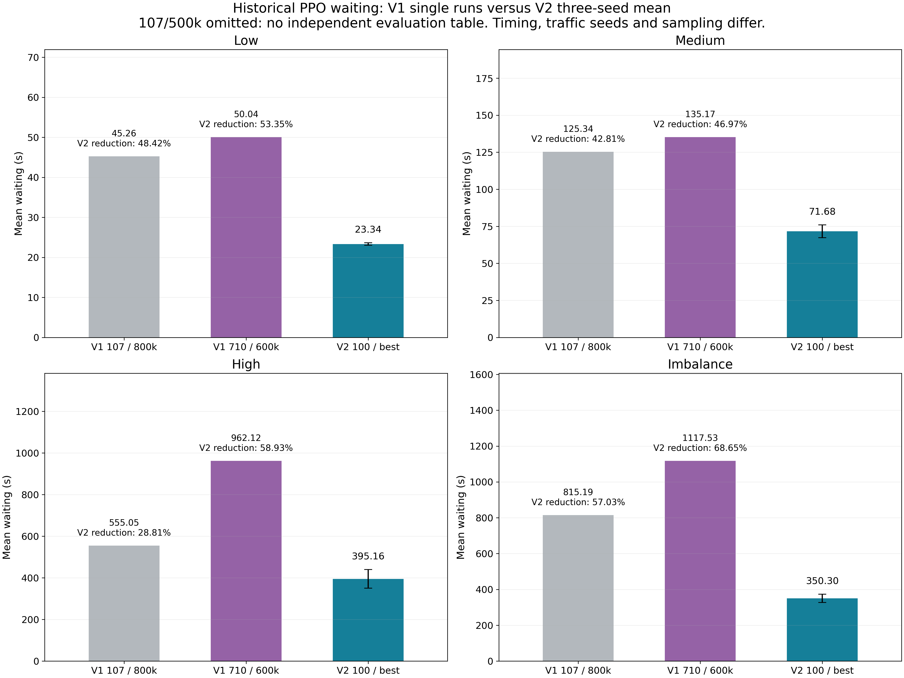

| Kịch bản | Giảm waiting V2 best so với 107/800k (%) | Giảm waiting V2 best so với 710/600k (%) |
| --- | --- | --- |
| low | 48.420003 | 53.353297 |
| medium | 42.813585 | 46.971786 |
| high | 28.806841 | 58.928496 |
| imbalance | 57.028142 | 68.653765 |

Các tỷ lệ mô tả thay đổi waiting đã ghi, không phải ước lượng có kiểm soát về lợi ích kiến trúc. Xanh tối thiểu đổi từ 30 xuống 15 s; mức tiếp xúc kịch bản, seed, cấu trúc rollout và lấy mẫu cùng thay đổi. Arrivals V1 khác cách cộng và tổng hợp; tốc độ Fixed-Time V1 đo toàn mạng. Không diễn giải tỷ số arrivals V1–V2 như cải thiện thông lượng.

Ba bước tiến kỹ thuật chủ đạo là: đầu vào định hướng được chuẩn hóa, giữ nhu cầu NS/EW; reward có scaling/shaping kết hợp rollout cân bằng và cập nhật PPO được kiểm soát; đánh giá đa seed đã sửa metric cùng chọn checkpoint độc lập. Dữ liệu ủng hộ mối liên hệ giữa gói thay đổi này với waiting High/Imbalance thấp hơn PPO lịch sử. Muốn xác định đóng góp nhân quả riêng cần ablation với cùng thời gian đèn và seed lưu lượng.

Sự đảo chiều được dữ liệu ủng hộ so với baseline cùng giao thức diễn ra ở Imbalance. V2 chưa đảo ngược ưu thế Rule-Based tại High; seed 107 V1 từng có waiting High tốt hơn theo bảng lịch sử. Không thể kết luận V1 thất bại toàn diện hoặc V2 vượt trội toàn diện.

## 6. Giới hạn thực nghiệm, kết luận và hướng phát triển

### 6.1 Giới hạn

**An toàn:** log subprocess tổng hợp hiện có cảnh báo va chạm trong nút và phanh khẩn cấp. Đây không phải tỷ lệ va chạm riêng của PPO; chưa thể so sánh an toàn khi thiếu phân loại sự kiện và mức tiếp xúc theo giai đoạn. Khóa thời gian tín hiệu không chứng minh vận hành không va chạm, tuân thủ pháp lý hoặc sẵn sàng thực địa. Reward chưa có phạt va chạm riêng.

**Biểu diễn và chân trời:** queue, số xe và waiting bão hòa trên 60, 80 và 1500 mỗi trục; reward bão hòa tại -10. CSV giao thông gộp không cho phép xác định tỷ lệ bão hòa đặc trưng theo hướng. Chân trời 3600 s có thể để lại hành trình chưa hoàn thành, xe cuối kỳ và xe chưa chèn được. Báo cáo chưa đánh giá giai đoạn giải tỏa sau nhu cầu hoặc phân bố hoàn thành hành trình.

**Phạm vi thống kê:** một seed huấn luyện V2 và ba seed lưu lượng kiểm thử cung cấp bằng chứng ghép cặp mang tính mô tả, chưa chứng minh độ vững tổng quát hoặc ý nghĩa thống kê. Std giữa seed kiểm thử không phải bất định giữa seed huấn luyện. Chọn lặp trên validation seed 999 có thể thích nghi với chính lưu lượng validation. Dữ liệu V1 bị nhiễu bởi thay đổi thời gian đèn và metric.

**Giới hạn instrumentation còn lại:** audit hành động bổ sung 12 episode đã cung cấp dữ liệu thực đo cho Hình 03, đồng thời tái lập chính xác metric giao thông gốc. Audit loại các khoảng xanh chưa kết thúc và chưa đo riêng độ trễ suy luận policy thuần. Vẫn chưa có bảng đánh giá độc lập checkpoint 500k seed 107; Hình 07 bỏ mô hình chưa được đánh giá đó. Nguyên nhân gai Critic tại 218880 vẫn chưa được chứng minh.

### 6.2 Kết luận và thực nghiệm tiếp theo

V2 cải thiện khả năng quan sát trạng thái, thang đo tối ưu và khả năng kiểm toán thực nghiệm. Checkpoint được chọn cải thiện cả năm trung bình Imbalance so với Rule-Based và giảm biến động Imbalance so với final. Rule-Based vẫn mạnh hơn trong bảng trung bình High; final tốt hơn best tại High. Nên giữ chọn bằng validation, đồng thời nhận diện đánh đổi giữa các kịch bản.

Tiếp theo: huấn luyện độc lập seed 200 và 300 với giao thức held-out giữ nguyên; mở rộng seed validation; ablation định hướng, scaling, phạt lệch tải và thời gian xanh tối thiểu; lưu sự kiện controller và đo suy luận có đồng bộ; báo cáo bất định ghép cặp, chỉ số hành trình và tồn đọng sau giải tỏa; bổ sung ràng buộc/phạt an toàn và tỷ lệ va chạm theo giai đoạn; sau đó mở rộng phối hợp nhiều giao lộ.

### 6.3 Nguồn dữ liệu và kiểm chứng

Nguồn chính: [metadata huấn luyện](../../models/seed100/training_metadata.json), [thời gian pipeline](../seed100/pipeline_timings.json), [preflight](../seed100/preflight_check.json), [bảng tổng hợp V2](../seed100/summary_final.csv), [báo cáo V2 gốc](drl_seed100_v2_report.md), [tổng kết V1](v1_baseline_drl_summary_107_710.md).

Mã nguồn đọc trực tiếp: DRL/gym_env.py, DRL/core/environment.py, DRL/train_multiscenario.py, DRL/evaluate.py, DRL/metrics.py, run_pipeline_seed100.py, DRL/configs/traci.yaml, DRL/requirements.txt. Báo cáo lịch sử: results/comparison_result/v1_baseline_drl_summary_107_710.md, results/comparison_result/drl_seed107_report.md, results/comparison_result/drl_seed710_report.md. Dữ liệu đánh giá: evaluation/seed100/{best,final}/{episodes,metrics}.csv và toàn bộ CSV baseline seed 101/102/103. Đã đọc Monitor train/validation, JSONL reset, NPZ validation và đủ 13 scalar TensorBoard yêu cầu. Đã đối chiếu event TensorBoard V1 và CSV tổng hợp theo seed.

Đã tái tính độc lập 48 episode đánh giá, mỗi episode 720 mẫu; kiểm tra 400 đẳng thức số với CSV episode/summary. Trung bình/Std, tỷ lệ cải thiện và CV dùng giá trị nguồn chưa làm tròn; bảng hiển thị sáu chữ số thập phân, riêng scalar hiển thị chín chữ số có nghĩa. Đã đối chiếu 80 episode validation, bước lưu checkpoint, 836 episode huấn luyện và chu kỳ seed cân bằng. Bảy PNG được kiểm tra dung lượng dương và metadata 300 DPI. Hai báo cáo được kiểm tra số cột bảng Markdown, sáu phần chính, tám liên kết ảnh và không có giá trị số bị thiếu. Hash mã nguồn/dữ liệu/báo cáo cũ được kiểm tra trước và sau khi tạo.

Mục 1.0 được bổ sung từ đối chiếu trực tiếp mã nguồn kiến trúc và lịch sử Git; đã kiểm tra nội dung báo cáo cũ, bảng Markdown, liên kết ảnh và mã băm SHA-256 của dữ liệu gốc giữ nguyên.

## Phụ lục — Đánh giá bổ sung trên bộ seed lưu lượng 57, 367, 1024

<!-- APPENDIX-NEW-TRAFFIC-SEEDS-57-367-1024 -->

Phụ lục đánh giá cùng checkpoint PPO best của seed huấn luyện 100 (models/seed100/best_model/best_model.zip), với deterministic=True, không huấn luyện lại. Đây là đợt đối chiếu riêng gồm 36 episode / 25.920 mẫu với Fixed-Time và Rule-Based được chạy mới; kết quả 101/102/103 và toàn bộ nội dung phía trước giữ nguyên.

Cấu hình V2: bước mô phỏng 0,1 s, quyết định mỗi 5 s, xanh tối thiểu/tối đa 15/75 s, vàng/toàn đỏ 3/3 s, mỗi episode 3600 s. PPO/Rule-Based dùng chung ràng buộc điều khiển thích nghi; Fixed-Time giữ xanh tĩnh 51 s mỗi trục trong cùng giới hạn. Metric chung lấy sau bước và trung bình toàn episode, riêng arrived_count cộng đủ arrivals từng substep 0,1 s. Waiting là tổng current waiting theo làn, không phải delay hành trình; speed có trọng số trên tám làn vào. Không đồng nhất phép đo V2 đã sửa và xanh tối thiểu 15 s với các log baseline cũ dùng 30 s.

### A. Trung bình đa seed ± độ lệch chuẩn mẫu (ddof=1)

Đơn vị: queue/network là xe, waiting là giây, speed là m/s, arrivals là xe/episode. Queue/wait/network càng thấp càng tốt; speed/arrivals càng cao càng tốt.

| Kịch bản | Chỉ số | Fixed-Time | Rule-Based | PPO best |
| --- | --- | --- | --- | --- |
| low | queue_length | 4.963426 ± 0.046592 | 2.576852 ± 0.073524 | 2.664352 ± 0.084086 |
| low | waiting_time | 97.892639 ± 1.082200 | 24.263981 ± 0.170608 | 25.635046 ± 1.137117 |
| low | average_speed | 6.609051 ± 0.070891 | 8.132315 ± 0.031724 | 8.019519 ± 0.152761 |
| low | arrived_count | 1192.333333 ± 27.061658 | 1198.666667 ± 24.440404 | 1199.000000 ± 24.879711 |
| low | vehicles_in_network | 20.278704 ± 0.273665 | 17.456481 ± 0.390350 | 17.556481 ± 0.195663 |
| medium | queue_length | 12.939352 ± 0.387060 | 7.058796 ± 0.249325 | 6.962500 ± 0.079434 |
| medium | waiting_time | 238.878333 ± 8.043524 | 68.476759 ± 2.932450 | 67.211019 ± 1.347887 |
| medium | average_speed | 6.023025 ± 0.077788 | 7.510455 ± 0.102917 | 7.554743 ± 0.015656 |
| medium | arrived_count | 2951.000000 ± 61.506097 | 2957.333333 ± 62.228075 | 2961.000000 ± 58.129167 |
| medium | vehicles_in_network | 53.402778 ± 1.320360 | 45.870370 ± 1.223669 | 45.724537 ± 0.801415 |
| high | queue_length | 45.629630 ± 2.859215 | 33.485185 ± 0.908272 | 33.249074 ± 1.292734 |
| high | waiting_time | 939.661713 ± 75.381490 | 401.980278 ± 12.695573 | 392.615880 ± 17.328119 |
| high | average_speed | 3.843322 ± 0.136998 | 4.459157 ± 0.136015 | 4.456669 ± 0.123420 |
| high | arrived_count | 5304.333333 ± 56.571489 | 5314.333333 ± 37.819748 | 5319.000000 ± 49.507575 |
| high | vehicles_in_network | 135.045833 ± 4.598682 | 121.367593 ± 2.762906 | 121.167593 ± 2.940572 |
| imbalance | queue_length | 82.909722 ± 6.982146 | 24.559259 ± 1.768458 | 19.606019 ± 0.435051 |
| imbalance | waiting_time | 1851.894537 ± 112.696974 | 333.737361 ± 9.596070 | 311.851944 ± 13.395462 |
| imbalance | average_speed | 2.123738 ± 0.079933 | 4.428855 ± 0.213498 | 5.222944 ± 0.033861 |
| imbalance | arrived_count | 3931.666667 ± 33.291641 | 4111.666667 ± 53.050291 | 4123.000000 ± 65.642974 |
| imbalance | vehicles_in_network | 188.637963 ± 17.549400 | 94.475463 ± 4.036181 | 84.681019 ± 0.841126 |

### B. Tỷ lệ cải thiện PPO best (%)

Dương là cải thiện: 100(B-P)/B cho queue/wait/network; 100(P-B)/B cho speed/arrivals. Tính trước khi làm tròn.

| Kịch bản | Chỉ số | so với Fixed-Time (%) | so với Rule-Based (%) |
| --- | --- | --- | --- |
| low | queue_length | 46.320306 | -3.395616 |
| low | waiting_time | 73.813101 | -5.650618 |
| low | average_speed | 21.341461 | -1.387010 |
| low | arrived_count | 0.559128 | 0.027809 |
| low | vehicles_in_network | 13.424045 | -0.572853 |
| medium | queue_length | 46.191277 | 1.364203 |
| medium | waiting_time | 71.863912 | 1.848424 |
| medium | average_speed | 25.431038 | 0.589693 |
| medium | arrived_count | 0.338868 | 0.123986 |
| medium | vehicles_in_network | 14.377980 | 0.317925 |
| high | queue_length | 27.132711 | 0.705121 |
| high | waiting_time | 58.217316 | 2.329567 |
| high | average_speed | 15.958772 | -0.055805 |
| high | arrived_count | 0.276503 | 0.087813 |
| high | vehicles_in_network | 10.276689 | 0.164789 |
| imbalance | queue_length | 76.352570 | 20.168527 |
| imbalance | waiting_time | 83.160383 | 6.557677 |
| imbalance | average_speed | 145.931595 | 17.929880 |
| imbalance | arrived_count | 4.866469 | 0.275638 |
| imbalance | vehicles_in_network | 55.109238 | 10.367183 |

### C. Phân rã từng seed lưu lượng

#### Seed 57

| Kịch bản | Phương pháp | Queue | Waiting (s) | Speed (m/s) | Arrivals | Xe toàn mạng |
| --- | --- | --- | --- | --- | --- | --- |
| low | Fixed-Time | 4.987500 | 96.723194 | 6.539893 | 1162.000000 | 19.990278 |
| low | Rule-Based | 2.519444 | 24.256528 | 8.129235 | 1172.000000 | 17.052778 |
| low | PPO best | 2.754167 | 26.947500 | 7.881923 | 1172.000000 | 17.330556 |
| medium | Fixed-Time | 12.544444 | 229.664167 | 6.110740 | 2917.000000 | 52.369444 |
| medium | Rule-Based | 6.856944 | 66.322778 | 7.595975 | 2926.000000 | 45.168056 |
| medium | PPO best | 7.005556 | 67.248333 | 7.537362 | 2931.000000 | 45.447222 |
| high | Fixed-Time | 42.329167 | 858.467500 | 3.990629 | 5280.000000 | 130.208333 |
| high | Rule-Based | 33.251389 | 401.499722 | 4.514158 | 5292.000000 | 120.147222 |
| high | PPO best | 34.300000 | 403.516806 | 4.392335 | 5305.000000 | 122.888889 |
| imbalance | Fixed-Time | 75.863889 | 1725.039444 | 2.211614 | 3895.000000 | 170.958333 |
| imbalance | Rule-Based | 22.538889 | 324.116389 | 4.674703 | 4060.000000 | 89.887500 |
| imbalance | PPO best | 19.837500 | 307.307361 | 5.203657 | 4060.000000 | 84.622222 |

#### Seed 367

| Kịch bản | Phương pháp | Queue | Waiting (s) | Speed (m/s) | Arrivals | Xe toàn mạng |
| --- | --- | --- | --- | --- | --- | --- |
| low | Fixed-Time | 4.909722 | 98.095972 | 6.605703 | 1201.000000 | 20.311111 |
| low | Rule-Based | 2.551389 | 24.097222 | 8.165467 | 1204.000000 | 17.484722 |
| low | PPO best | 2.651389 | 24.945139 | 7.992733 | 1204.000000 | 17.668056 |
| medium | Fixed-Time | 12.955556 | 242.474167 | 5.995919 | 2914.000000 | 52.948611 |
| medium | Rule-Based | 6.981944 | 67.291111 | 7.539155 | 2917.000000 | 45.159722 |
| medium | PPO best | 6.870833 | 65.844861 | 7.567738 | 2924.000000 | 45.098611 |
| high | Fixed-Time | 47.206944 | 1007.424861 | 3.819605 | 5264.000000 | 135.568056 |
| high | Rule-Based | 32.716667 | 389.531806 | 4.559058 | 5293.000000 | 119.425000 |
| high | PPO best | 31.805556 | 372.634722 | 4.598964 | 5278.000000 | 117.772222 |
| imbalance | Fixed-Time | 83.038889 | 1890.193472 | 2.104249 | 3960.000000 | 188.901389 |
| imbalance | Rule-Based | 25.826389 | 343.308333 | 4.290100 | 4109.000000 | 96.059722 |
| imbalance | PPO best | 19.876389 | 326.928472 | 5.203132 | 4118.000000 | 83.870833 |

#### Seed 1024

| Kịch bản | Phương pháp | Queue | Waiting (s) | Speed (m/s) | Arrivals | Xe toàn mạng |
| --- | --- | --- | --- | --- | --- | --- |
| low | Fixed-Time | 4.993056 | 98.858750 | 6.681557 | 1214.000000 | 20.534722 |
| low | Rule-Based | 2.659722 | 24.438194 | 8.102243 | 1220.000000 | 17.831944 |
| low | PPO best | 2.587500 | 25.012500 | 8.183901 | 1221.000000 | 17.670833 |
| medium | Fixed-Time | 13.318056 | 244.496667 | 5.962418 | 3022.000000 | 54.890278 |
| medium | Rule-Based | 7.337500 | 71.816389 | 7.396234 | 3029.000000 | 47.283333 |
| medium | PPO best | 7.011111 | 68.539861 | 7.559129 | 3028.000000 | 46.627778 |
| high | Fixed-Time | 47.352778 | 953.092778 | 3.719730 | 5369.000000 | 139.361111 |
| high | Rule-Based | 34.487500 | 414.909306 | 4.304254 | 5358.000000 | 124.530556 |
| high | PPO best | 33.641667 | 401.696111 | 4.378707 | 5374.000000 | 122.841667 |
| imbalance | Fixed-Time | 89.826389 | 1940.450694 | 2.055352 | 3940.000000 | 206.054167 |
| imbalance | Rule-Based | 25.312500 | 333.787361 | 4.321764 | 4166.000000 | 97.479167 |
| imbalance | PPO best | 19.104167 | 301.320000 | 5.262042 | 4191.000000 | 85.550000 |

### D. Runtime thực đo

Các phương pháp chạy đồng thời; wall time episode gồm khởi động/đóng SUMO và suy luận, không gồm lần nạp model ban đầu. Đây không phải benchmark tốc độ thuật toán chạy độc lập hoặc độ trễ suy luận thuần.

| Phương pháp | Kịch bản | Seed | Wall time (s) |
| --- | --- | --- | --- |
| Fixed-Time | low | 57 | 27.412971 |
| Fixed-Time | medium | 57 | 48.665407 |
| Fixed-Time | high | 57 | 114.948974 |
| Fixed-Time | imbalance | 57 | 189.996121 |
| Fixed-Time | low | 367 | 26.447514 |
| Fixed-Time | medium | 367 | 47.901318 |
| Fixed-Time | high | 367 | 117.285099 |
| Fixed-Time | imbalance | 367 | 236.250245 |
| Fixed-Time | low | 1024 | 23.974755 |
| Fixed-Time | medium | 1024 | 45.367533 |
| Fixed-Time | high | 1024 | 118.791654 |
| Fixed-Time | imbalance | 1024 | 248.552804 |
| Rule-Based | low | 57 | 25.692336 |
| Rule-Based | medium | 57 | 43.117105 |
| Rule-Based | high | 57 | 106.176726 |
| Rule-Based | imbalance | 57 | 83.468672 |
| Rule-Based | low | 367 | 24.898275 |
| Rule-Based | medium | 367 | 42.728806 |
| Rule-Based | high | 367 | 103.647567 |
| Rule-Based | imbalance | 367 | 87.550631 |
| Rule-Based | low | 1024 | 25.128441 |
| Rule-Based | medium | 1024 | 44.260788 |
| Rule-Based | high | 1024 | 108.475190 |
| Rule-Based | imbalance | 1024 | 96.523713 |
| PPO best | low | 57 | 28.094195 |
| PPO best | medium | 57 | 46.198486 |
| PPO best | high | 57 | 111.632526 |
| PPO best | imbalance | 57 | 80.428272 |
| PPO best | low | 367 | 27.107650 |
| PPO best | medium | 367 | 45.142903 |
| PPO best | high | 367 | 104.455256 |
| PPO best | imbalance | 367 | 77.382197 |
| PPO best | low | 1024 | 27.186475 |
| PPO best | medium | 1024 | 46.089228 |
| PPO best | high | 1024 | 111.266785 |
| PPO best | imbalance | 1024 | 85.260607 |

### E. Biểu đồ và nguồn dữ liệu

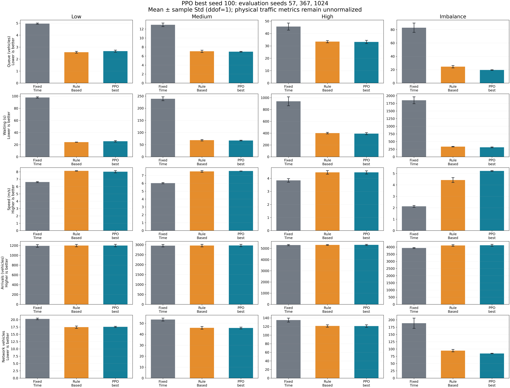

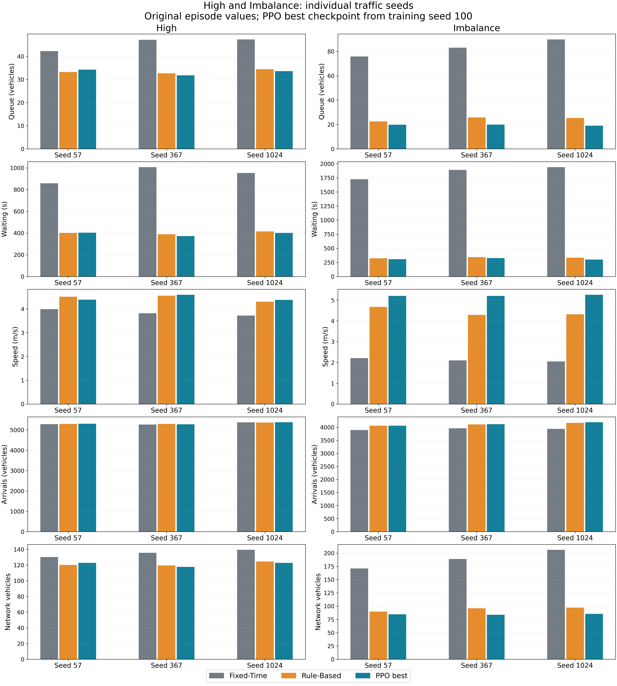

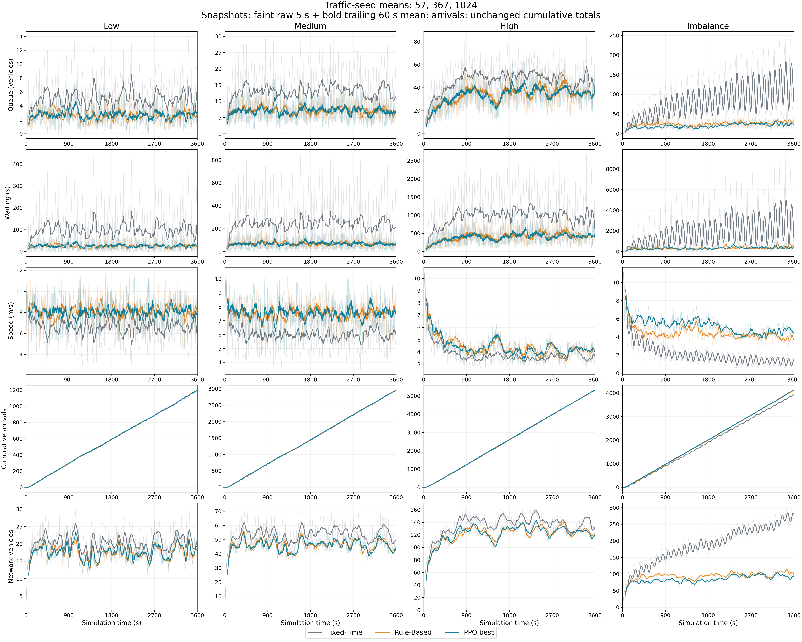

Hình 03 giữ chuỗi snapshot gốc 5 s dưới đường trung bình trượt 60 s (đủ 12 mẫu, bắt đầu tại t=60 s); arrivals tích lũy giữ nguyên. Đây chỉ là biến đổi hiển thị. Ba seed lưu lượng phản ánh biến động kiểm thử, không phải bất định giữa seed huấn luyện hoặc bằng chứng ý nghĩa thống kê.

Nguồn: [episode](../../evaluation/seed100_eval_57_367_1024/episodes.csv), [metric thô](../../evaluation/seed100_eval_57_367_1024/metrics.csv), [mean/std](../seed100_eval_57_367_1024/summary_final.csv), [cải thiện](../seed100_eval_57_367_1024/improvement.csv), [runtime](../seed100_eval_57_367_1024/runtime.csv), [báo cáo đối chiếu riêng](drl_seed100_eval_57_367_1024_comparison.md).

