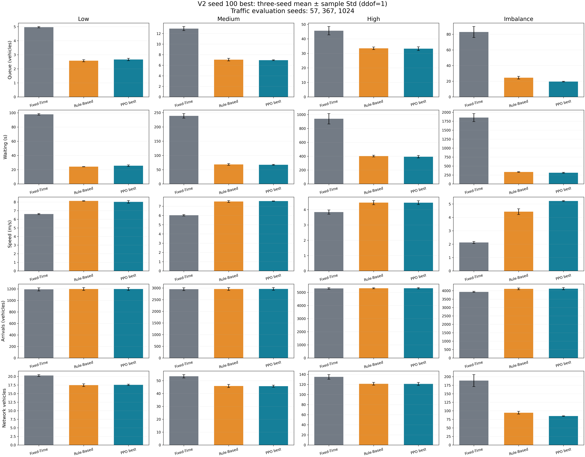
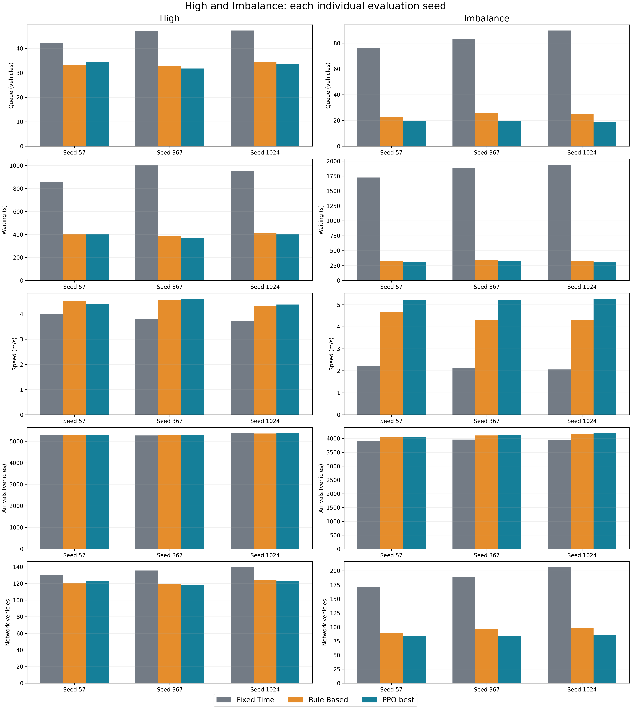
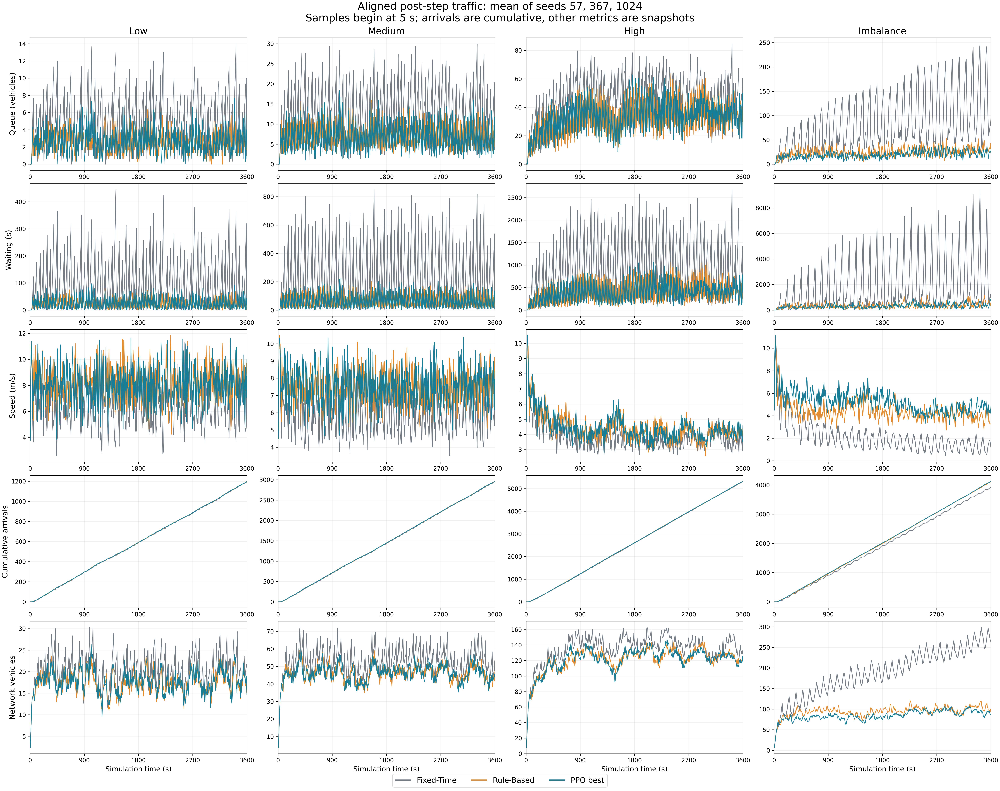

# Đối chiếu DRL V2 seed 100 trên bộ seed lưu lượng 57, 367, 1024

Ngày thực hiện: 25/11/2026. Báo cáo dùng riêng dữ liệu mới chạy; không huấn luyện lại và không thay thế kết quả bộ 101/102/103. PPO best được chọn từ thực nghiệm trước, nạp trọng số cố định và suy luận deterministic=True; hai baseline được chạy mới trên cùng bộ seed.

## 1. Cấu hình, môi trường và giao thức công bằng

| Thiết lập | Giá trị |
| --- | --- |
| simulation_step | 0.1 |
| decision_interval | 5 |
| min_green | 15 |
| max_green | 75 |
| yellow_time | 3 |
| all_red_time | 3 |
| gui | False |

Quan sát PPO: Box float32 12D trong [0,1], theo hai trục NS/EW; action Discrete(2), 0=KEEP và 1=SWITCH. Mô hình nạp thành công bằng PPO trên Quadro RTX 3000. SUMO_HOME=C:\Program Files (x86)\SUMO\.

| Thư viện | Phiên bản |
| --- | --- |
| torch | 2.5.1+cu121 |
| stable-baselines3 | 2.9.2 |
| gymnasium | 1.4.0 |
| numpy | 2.2.6 |
| PyYAML | 6.0.3 |
| matplotlib | 3.10.9 |

PPO và Rule-Based dùng chung Environment/SignalController, xanh tối thiểu 15 s và tối đa 75 s. Fixed-Time giữ chương trình SUMO tĩnh: xanh 51 s mỗi trục, chu kỳ 114 s, vàng 3 s và toàn đỏ 3 s; xanh nằm trong khoảng 15–75 s nhưng không có quyết định thích nghi KEEP/SWITCH. Cả ba dùng StateExtractor và phép đo V2 trên cùng tám làn vào.

Mỗi episode 3600 s, 720 mẫu post-step tại 5..3600 s. Queue là số xe dừng; waiting là tổng current waiting theo làn, không phải delay trung bình mỗi hành trình; speed (m/s) có trọng số số xe trên tám làn vào; vehicles_in_network là số xe toàn mạng. Bốn chỉ số này lấy trung bình snapshot. Arrivals cộng đủ mọi substep 0,1 s rồi cộng toàn episode. Cùng seed và cấu hình đồng bộ đầu vào ngẫu nhiên; quỹ đạo và chèn xe vẫn có thể phụ thuộc controller.

So với log baseline V1 cũ dùng min_green=30 s, lần đối chiếu này chạy lại baseline theo V2 15 s và thống nhất seed, arrivals, phạm vi speed, thời điểm lấy mẫu. Không trộn số liệu baseline cũ vào bảng mới. Ba seed kiểm thử không xuất hiện trong JSONL reset huấn luyện đã kiểm tra; riêng 1024 nằm trong dải RNG huấn luyện nhưng không được rút ở lần chạy đã lưu.

Ba phương pháp chạy song song bằng tiến trình riêng; từng phương pháp chạy tuần tự 12 episode. Runtime là wall time thực tế trong điều kiện chia sẻ tài nguyên, bao gồm khởi động/đóng SUMO và suy luận, không gồm nạp model một lần; không dùng để kết luận tốc độ thuật toán khi chạy độc lập hoặc độ trễ mạng thuần.

## 2. Bảng 1 — Trung bình đa seed ± độ lệch chuẩn mẫu

Std dùng ddof=1 trên ba kết quả episode. Queue, waiting, network occupancy càng thấp càng tốt; speed, arrivals càng cao càng tốt. Cột tốt nhất chỉ dựa trên trung bình mô tả; giữ các trường hợp đồng hạng.

| Kịch bản | Chỉ số | Fixed-Time | Rule-Based | PPO best | Trung bình tốt nhất |
| --- | --- | --- | --- | --- | --- |
| low | queue_length | 4.963426 ± 0.046592 | 2.576852 ± 0.073524 | 2.664352 ± 0.084086 | Rule-Based |
| low | waiting_time | 97.892639 ± 1.082200 | 24.263981 ± 0.170608 | 25.635046 ± 1.137117 | Rule-Based |
| low | average_speed | 6.609051 ± 0.070891 | 8.132315 ± 0.031724 | 8.019519 ± 0.152761 | Rule-Based |
| low | arrived_count | 1192.333333 ± 27.061658 | 1198.666667 ± 24.440404 | 1199.000000 ± 24.879711 | PPO best |
| low | vehicles_in_network | 20.278704 ± 0.273665 | 17.456481 ± 0.390350 | 17.556481 ± 0.195663 | Rule-Based |
| medium | queue_length | 12.939352 ± 0.387060 | 7.058796 ± 0.249325 | 6.962500 ± 0.079434 | PPO best |
| medium | waiting_time | 238.878333 ± 8.043524 | 68.476759 ± 2.932450 | 67.211019 ± 1.347887 | PPO best |
| medium | average_speed | 6.023025 ± 0.077788 | 7.510455 ± 0.102917 | 7.554743 ± 0.015656 | PPO best |
| medium | arrived_count | 2951.000000 ± 61.506097 | 2957.333333 ± 62.228075 | 2961.000000 ± 58.129167 | PPO best |
| medium | vehicles_in_network | 53.402778 ± 1.320360 | 45.870370 ± 1.223669 | 45.724537 ± 0.801415 | PPO best |
| high | queue_length | 45.629630 ± 2.859215 | 33.485185 ± 0.908272 | 33.249074 ± 1.292734 | PPO best |
| high | waiting_time | 939.661713 ± 75.381490 | 401.980278 ± 12.695573 | 392.615880 ± 17.328119 | PPO best |
| high | average_speed | 3.843322 ± 0.136998 | 4.459157 ± 0.136015 | 4.456669 ± 0.123420 | Rule-Based |
| high | arrived_count | 5304.333333 ± 56.571489 | 5314.333333 ± 37.819748 | 5319.000000 ± 49.507575 | PPO best |
| high | vehicles_in_network | 135.045833 ± 4.598682 | 121.367593 ± 2.762906 | 121.167593 ± 2.940572 | PPO best |
| imbalance | queue_length | 82.909722 ± 6.982146 | 24.559259 ± 1.768458 | 19.606019 ± 0.435051 | PPO best |
| imbalance | waiting_time | 1851.894537 ± 112.696974 | 333.737361 ± 9.596070 | 311.851944 ± 13.395462 | PPO best |
| imbalance | average_speed | 2.123738 ± 0.079933 | 4.428855 ± 0.213498 | 5.222944 ± 0.033861 | PPO best |
| imbalance | arrived_count | 3931.666667 ± 33.291641 | 4111.666667 ± 53.050291 | 4123.000000 ± 65.642974 | PPO best |
| imbalance | vehicles_in_network | 188.637963 ± 17.549400 | 94.475463 ± 4.036181 | 84.681019 ± 0.841126 | PPO best |

## 3. Bảng 2 — Tỷ lệ cải thiện PPO best

Mức cải thiện dương nghĩa là tốt hơn: 100(B−P)/B cho queue/wait/network; 100(P−B)/B cho speed/arrivals. P là PPO best, B là baseline. Tính trước khi làm tròn.

| Kịch bản | Chỉ số | So với Fixed-Time (%) | So với Rule-Based (%) |
| --- | --- | --- | --- |
| low | queue_length | 46.320306 | -3.395616 |
| low | waiting_time | 73.813101 | -5.650618 |
| low | average_speed | 21.341461 | -1.387010 |
| low | arrived_count | 0.559128 | 0.027809 |
| low | vehicles_in_network | 13.424045 | -0.572853 |
| medium | queue_length | 46.191277 | 1.364203 |
| medium | waiting_time | 71.863912 | 1.848424 |
| medium | average_speed | 25.431038 | 0.589693 |
| medium | arrived_count | 0.338868 | 0.123986 |
| medium | vehicles_in_network | 14.377980 | 0.317925 |
| high | queue_length | 27.132711 | 0.705121 |
| high | waiting_time | 58.217316 | 2.329567 |
| high | average_speed | 15.958772 | -0.055805 |
| high | arrived_count | 0.276503 | 0.087813 |
| high | vehicles_in_network | 10.276689 | 0.164789 |
| imbalance | queue_length | 76.352570 | 20.168527 |
| imbalance | waiting_time | 83.160383 | 6.557677 |
| imbalance | average_speed | 145.931595 | 17.929880 |
| imbalance | arrived_count | 4.866469 | 0.275638 |
| imbalance | vehicles_in_network | 55.109238 | 10.367183 |

## 4. Bảng 3 — Chi tiết từng seed

### Seed 57

| Kịch bản | Phương pháp | Queue | Waiting (s) | Speed (m/s) | Arrivals | Network vehicles |
| --- | --- | --- | --- | --- | --- | --- |
| low | Fixed-Time | 4.987500 | 96.723194 | 6.539893 | 1162.000000 | 19.990278 |
| low | Rule-Based | 2.519444 | 24.256528 | 8.129235 | 1172.000000 | 17.052778 |
| low | PPO best | 2.754167 | 26.947500 | 7.881923 | 1172.000000 | 17.330556 |
| medium | Fixed-Time | 12.544444 | 229.664167 | 6.110740 | 2917.000000 | 52.369444 |
| medium | Rule-Based | 6.856944 | 66.322778 | 7.595975 | 2926.000000 | 45.168056 |
| medium | PPO best | 7.005556 | 67.248333 | 7.537362 | 2931.000000 | 45.447222 |
| high | Fixed-Time | 42.329167 | 858.467500 | 3.990629 | 5280.000000 | 130.208333 |
| high | Rule-Based | 33.251389 | 401.499722 | 4.514158 | 5292.000000 | 120.147222 |
| high | PPO best | 34.300000 | 403.516806 | 4.392335 | 5305.000000 | 122.888889 |
| imbalance | Fixed-Time | 75.863889 | 1725.039444 | 2.211614 | 3895.000000 | 170.958333 |
| imbalance | Rule-Based | 22.538889 | 324.116389 | 4.674703 | 4060.000000 | 89.887500 |
| imbalance | PPO best | 19.837500 | 307.307361 | 5.203657 | 4060.000000 | 84.622222 |

### Seed 367

| Kịch bản | Phương pháp | Queue | Waiting (s) | Speed (m/s) | Arrivals | Network vehicles |
| --- | --- | --- | --- | --- | --- | --- |
| low | Fixed-Time | 4.909722 | 98.095972 | 6.605703 | 1201.000000 | 20.311111 |
| low | Rule-Based | 2.551389 | 24.097222 | 8.165467 | 1204.000000 | 17.484722 |
| low | PPO best | 2.651389 | 24.945139 | 7.992733 | 1204.000000 | 17.668056 |
| medium | Fixed-Time | 12.955556 | 242.474167 | 5.995919 | 2914.000000 | 52.948611 |
| medium | Rule-Based | 6.981944 | 67.291111 | 7.539155 | 2917.000000 | 45.159722 |
| medium | PPO best | 6.870833 | 65.844861 | 7.567738 | 2924.000000 | 45.098611 |
| high | Fixed-Time | 47.206944 | 1007.424861 | 3.819605 | 5264.000000 | 135.568056 |
| high | Rule-Based | 32.716667 | 389.531806 | 4.559058 | 5293.000000 | 119.425000 |
| high | PPO best | 31.805556 | 372.634722 | 4.598964 | 5278.000000 | 117.772222 |
| imbalance | Fixed-Time | 83.038889 | 1890.193472 | 2.104249 | 3960.000000 | 188.901389 |
| imbalance | Rule-Based | 25.826389 | 343.308333 | 4.290100 | 4109.000000 | 96.059722 |
| imbalance | PPO best | 19.876389 | 326.928472 | 5.203132 | 4118.000000 | 83.870833 |

### Seed 1024

| Kịch bản | Phương pháp | Queue | Waiting (s) | Speed (m/s) | Arrivals | Network vehicles |
| --- | --- | --- | --- | --- | --- | --- |
| low | Fixed-Time | 4.993056 | 98.858750 | 6.681557 | 1214.000000 | 20.534722 |
| low | Rule-Based | 2.659722 | 24.438194 | 8.102243 | 1220.000000 | 17.831944 |
| low | PPO best | 2.587500 | 25.012500 | 8.183901 | 1221.000000 | 17.670833 |
| medium | Fixed-Time | 13.318056 | 244.496667 | 5.962418 | 3022.000000 | 54.890278 |
| medium | Rule-Based | 7.337500 | 71.816389 | 7.396234 | 3029.000000 | 47.283333 |
| medium | PPO best | 7.011111 | 68.539861 | 7.559129 | 3028.000000 | 46.627778 |
| high | Fixed-Time | 47.352778 | 953.092778 | 3.719730 | 5369.000000 | 139.361111 |
| high | Rule-Based | 34.487500 | 414.909306 | 4.304254 | 5358.000000 | 124.530556 |
| high | PPO best | 33.641667 | 401.696111 | 4.378707 | 5374.000000 | 122.841667 |
| imbalance | Fixed-Time | 89.826389 | 1940.450694 | 2.055352 | 3940.000000 | 206.054167 |
| imbalance | Rule-Based | 25.312500 | 333.787361 | 4.321764 | 4166.000000 | 97.479167 |
| imbalance | PPO best | 19.104167 | 301.320000 | 5.262042 | 4191.000000 | 85.550000 |

Độ khó phụ thuộc phương pháp/kịch bản; bảng sau xếp seed theo waiting thực tế, không coi một seed luôn nặng hơn về nhu cầu đầu vào.

| Kịch bản | Phương pháp | Waiting giảm dần: seed:giá trị |
| --- | --- | --- |
| low | Fixed-Time | 1024:98.858750; 367:98.095972; 57:96.723194 |
| low | Rule-Based | 1024:24.438194; 57:24.256528; 367:24.097222 |
| low | PPO best | 57:26.947500; 1024:25.012500; 367:24.945139 |
| medium | Fixed-Time | 1024:244.496667; 367:242.474167; 57:229.664167 |
| medium | Rule-Based | 1024:71.816389; 367:67.291111; 57:66.322778 |
| medium | PPO best | 1024:68.539861; 57:67.248333; 367:65.844861 |
| high | Fixed-Time | 367:1007.424861; 1024:953.092778; 57:858.467500 |
| high | Rule-Based | 1024:414.909306; 57:401.499722; 367:389.531806 |
| high | PPO best | 57:403.516806; 1024:401.696111; 367:372.634722 |
| imbalance | Fixed-Time | 1024:1940.450694; 367:1890.193472; 57:1725.039444 |
| imbalance | Rule-Based | 367:343.308333; 1024:333.787361; 57:324.116389 |
| imbalance | PPO best | 367:326.928472; 57:307.307361; 1024:301.320000 |

## 5. Bảng 4 — Runtime thực đo

| Phương pháp | Kịch bản | Seed | Wall time (s) | Wall ms / decision |
| --- | --- | --- | --- | --- |
| Fixed-Time | low | 57 | 27.412971 | 38.073571 |
| Fixed-Time | medium | 57 | 48.665407 | 67.590842 |
| Fixed-Time | high | 57 | 114.948974 | 159.651353 |
| Fixed-Time | imbalance | 57 | 189.996121 | 263.883502 |
| Fixed-Time | low | 367 | 26.447514 | 36.732658 |
| Fixed-Time | medium | 367 | 47.901318 | 66.529609 |
| Fixed-Time | high | 367 | 117.285099 | 162.895972 |
| Fixed-Time | imbalance | 367 | 236.250245 | 328.125340 |
| Fixed-Time | low | 1024 | 23.974755 | 33.298271 |
| Fixed-Time | medium | 1024 | 45.367533 | 63.010462 |
| Fixed-Time | high | 1024 | 118.791654 | 164.988408 |
| Fixed-Time | imbalance | 1024 | 248.552804 | 345.212227 |
| Rule-Based | low | 57 | 25.692336 | 35.683800 |
| Rule-Based | medium | 57 | 43.117105 | 59.884868 |
| Rule-Based | high | 57 | 106.176726 | 147.467675 |
| Rule-Based | imbalance | 57 | 83.468672 | 115.928712 |
| Rule-Based | low | 367 | 24.898275 | 34.580937 |
| Rule-Based | medium | 367 | 42.728806 | 59.345564 |
| Rule-Based | high | 367 | 103.647567 | 143.954954 |
| Rule-Based | imbalance | 367 | 87.550631 | 121.598099 |
| Rule-Based | low | 1024 | 25.128441 | 34.900613 |
| Rule-Based | medium | 1024 | 44.260788 | 61.473317 |
| Rule-Based | high | 1024 | 108.475190 | 150.659986 |
| Rule-Based | imbalance | 1024 | 96.523713 | 134.060712 |
| PPO best | low | 57 | 28.094195 | 39.019715 |
| PPO best | medium | 57 | 46.198486 | 64.164564 |
| PPO best | high | 57 | 111.632526 | 155.045175 |
| PPO best | imbalance | 57 | 80.428272 | 111.705933 |
| PPO best | low | 367 | 27.107650 | 37.649514 |
| PPO best | medium | 367 | 45.142903 | 62.698477 |
| PPO best | high | 367 | 104.455256 | 145.076744 |
| PPO best | imbalance | 367 | 77.382197 | 107.475273 |
| PPO best | low | 1024 | 27.186475 | 37.758993 |
| PPO best | medium | 1024 | 46.089228 | 64.012817 |
| PPO best | high | 1024 | 111.266785 | 154.537201 |
| PPO best | imbalance | 1024 | 85.260607 | 118.417510 |

Thời gian từ lúc khởi chạy các worker đến hoàn tất đánh giá: 1251.284449 s. Tổng wall time các episode không bằng thời gian toàn luồng vì các phương pháp chạy đồng thời. Chỉ số ms/decision gồm cả SUMO/TraCI, không phải latency suy luận thuần.

## 6. Biểu đồ và phân tích từ dữ liệu mới

**Low:** PPO best tốt hơn Rule-Based trên 1/5 trung bình; 0 chỉ số bằng nhau. Cải thiện queue: -3.395616%; waiting: -5.650618%. Chiều biến động các chỉ số còn lại và mức phân tán được thể hiện đầy đủ trong Bảng 1–3.

**Medium:** PPO best tốt hơn Rule-Based trên 5/5 trung bình; 0 chỉ số bằng nhau. Cải thiện queue: 1.364203%; waiting: 1.848424%. Chiều biến động các chỉ số còn lại và mức phân tán được thể hiện đầy đủ trong Bảng 1–3.

**High:** PPO best tốt hơn Rule-Based trên 4/5 trung bình; 0 chỉ số bằng nhau. Cải thiện queue: 0.705121%; waiting: 2.329567%. Chiều biến động các chỉ số còn lại và mức phân tán được thể hiện đầy đủ trong Bảng 1–3.

**Imbalance:** PPO best tốt hơn Rule-Based trên 5/5 trung bình; 0 chỉ số bằng nhau. Cải thiện queue: 20.168527%; waiting: 6.557677%. Chiều biến động các chỉ số còn lại và mức phân tán được thể hiện đầy đủ trong Bảng 1–3.

Các xếp hạng là kết quả mô tả của một checkpoint và ba seed lưu lượng, không phải kiểm định ý nghĩa thống kê hoặc bằng chứng nhân quả riêng cho từng thành phần kiến trúc. Std phản ánh seed lưu lượng, chưa phản ánh seed huấn luyện. Cửa sổ 3600 s có thể còn xe chưa hoàn thành; occupancy trung bình không phải backlog cuối kỳ. Cảnh báo SUMO, nếu có, được giữ trong subprocess log; các chỉ số ùn tắc không chứng nhận an toàn giao thông.

## 7. Nguồn dữ liệu và kiểm chứng

Dữ liệu: [episodes.csv](../../evaluation/seed100_eval_57_367_1024/episodes.csv), [metrics.csv](../../evaluation/seed100_eval_57_367_1024/metrics.csv), [summary_final.csv](../seed100_eval_57_367_1024/summary_final.csv), [improvement.csv](../seed100_eval_57_367_1024/improvement.csv), [runtime.csv](../seed100_eval_57_367_1024/runtime.csv), [metadata](../seed100_eval_57_367_1024/run_metadata.json), [kiểm tra chất lượng](../seed100_eval_57_367_1024/quality_checks.json).

Script gọi lại DRL.evaluate.evaluate_scenario, DRL.baselines.fixed_episode/rule_episode và DRL.metrics; không sửa bộ ghi file hoặc các đường dẫn output mặc định của dự án. Không gọi learn và không lưu lại model. Các file cũ được đối chiếu SHA-256 trước/sau.

Đã tái tính 300 giá trị episode/trung bình/Std từ 36 nhóm dữ liệu, mỗi nhóm 720 mẫu. Các bảng dùng số liệu nguồn chưa làm tròn, hiển thị sáu chữ số thập phân; đủ 36 runtime, 20 cặp tỷ lệ cải thiện và ba biểu đồ 300 DPI.

