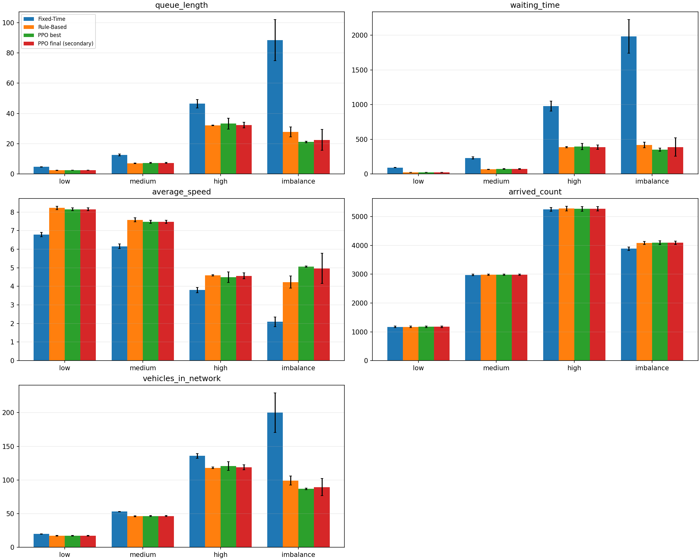
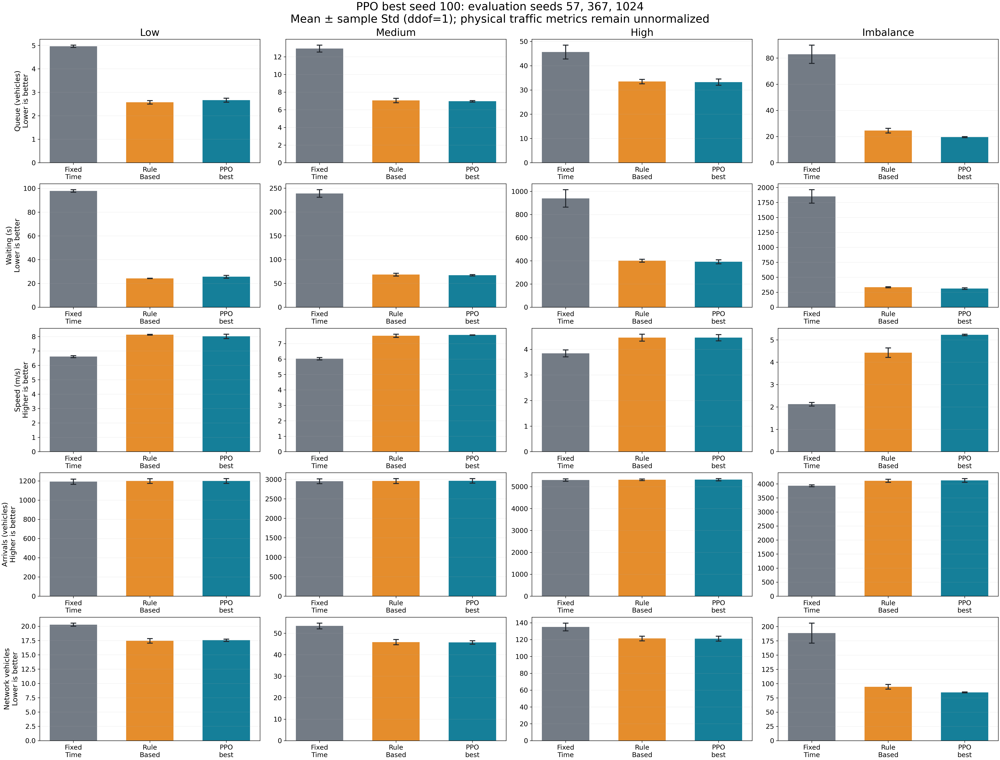
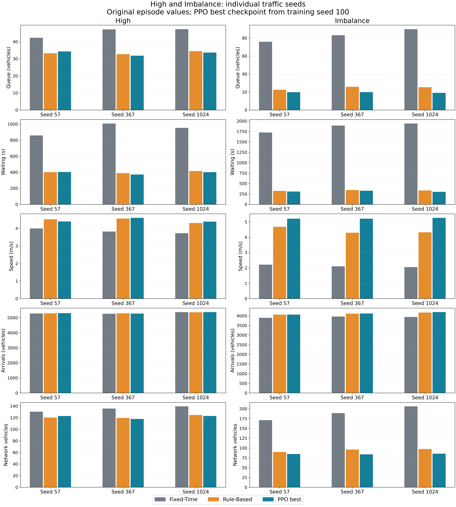
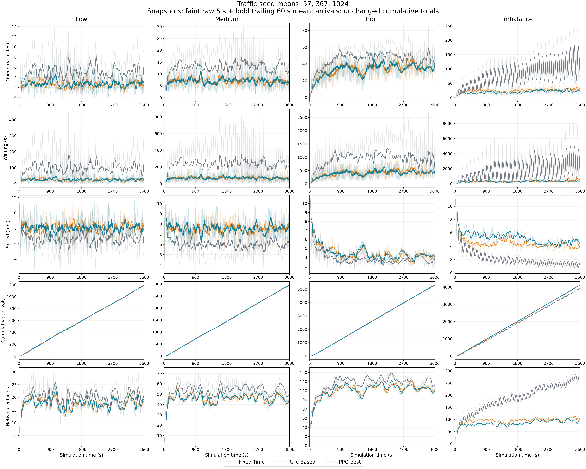

# Comprehensive Technical Report: DRL V2 Seed100 and the V1 Baselines

All results are reconstructed from existing workspace artifacts. No simulation, training or model evaluation was launched for this report.

## 1. Executive Summary and V1-to-V2 Motivation

V2 completed 601,920 steps against a requested 600,000: 209 rollouts and 836 completed episodes. Independent validation selected the checkpoint at **316,800 steps**.

The principal supported result is a favorable direction on all five Imbalance mean metrics versus the contemporary Rule-Based controller. Rule-Based still has better mean queue and waiting on the three balanced-demand scenarios. The final checkpoint improves High mean and variance relative to the selected checkpoint, whereas the selected checkpoint is more robust on Imbalance. These are descriptive three-test-seed findings, not statistical significance or causal ablation results.

V1 motivated directional observations, controlled feature/reward scales, balanced training exposure and a corrected evaluation protocol. Unmatched V1 SUMO evaluation seeds are established, but actual overlap between its training and test traffic seeds was not demonstrated. Both V1 adaptive methods used minimum green30s; the change to 15s is inter-version, not evidence that V1 Rule-Based and PPO used different bounds. V1 late over-adaptation and a superior500k model remain unproven without checkpoint-specific evaluations.

| Component | V1:107/710 | V2:100 |
| --- | --- | --- |
| Observation | 6 aggregate raw scalars | 12 directional normalized scalars |
| Feature processing | Raw counts, times, speed and phase index | Fixed scales; all features clipped to[0,1] |
| Reward | -(Q+0.1W) | Queue +0.05waiting +0.02squared axis difference; negative, /100, clip[-10,0] |
| Minimum/maximum green | 30/75s | 15/75s |
| Yellow/all-red | 3/3s actual; all-red YAML extension threshold0 | 3/3s actual and configured |
| Simulator/decision/horizon | 0.1s /5s /3600s | Same;50 substeps/decision;720 decisions/episode |
| Network | Separate actor/critic [64,64], Tanh | Separate actor/critic [128,128], Tanh; Adam |
| Rollout/batch/epochs | 2048/64/10 | 2880/96/5 |
| Learning rate | Fixed0.0003 | Linear0.0003 to0.00001 |
| Gamma/GAE/clip | 0.99/0.95/0.2 | 0.99/0.95/0.2 |
| Entropy/value/gradient coefficients | 0/0.5/0.5 | 0.01/0.5/0.5 |
| KL safeguard | No target KL threshold | target_kl0.02; normalized advantages |
| Scenario sampling | Random independent selection | Shuffled balanced four-episode cycles |
| Seed separation | Policy seeds107/710; traffic evaluation seed remapped | Policy100; train traffic1000–999999; validation999; tests101/102/103 |
| Arrivals | RB/PPO omit intermediate substeps; PPO summary averages cumulative snapshots | Sum all substeps, then sum interval counts per episode |
| Speed/sampling | FT network-wide; RB/PPO incoming; timestamps inconsistent | Same8 incoming lanes, weighted by vehicles, post-step5..3600s |
| Selection | Final model evaluated; periodic checkpoints not independently ranked | Four-scenario validation every28800steps; best and final tested separately |

Sources: archived V1 reports and prior audits; current V2 source, configuration and saved model metadata. Current V2 defaults must not be retroactively assigned to V1.

## 2. Methodology, Technology and Data Processing

### 2.1 Execution environment

SUMO1.28.0 is controlled by Python/TraCI and exposed through Gymnasium to Stable-Baselines3 PPO. The recorded CUDA GPU is **Quadro RTX 3000**.
| Package | Version recorded in run_config.json |
| --- | --- |
| torch | 2.5.1+cu121 |
| stable-baselines3 | 2.9.2 |
| gymnasium | 1.4.0 |
| numpy | 2.2.6 |
| PyYAML | 6.0.3 |
| tensorboard | 2.21.0 |
| matplotlib | 3.10.9 |

| Signal/runtime configuration | Value from traci.yaml |
| --- | --- |
| simulation_step | 0.1 |
| decision_interval | 5 |
| min_green | 15 |
| max_green | 75 |
| yellow_time | 3 |
| all_red_time | 3 |
| gui | False |

Actions are Discrete(2):0=KEEP,1=SWITCH. Premature requests are overridden; maximum green is enforced at substep boundaries, and yellow/all-red phases are preserved. Elapsed green is simulation seconds. Fixed-Time uses the unchanged51-second green per axis and 114-second cycle, within the same15–75s admissible envelope; its5-second recording interval is not an adaptive decision policy.

### 2.2 Preprocessing and directional12D state

NS=N_in_0,N_in_1,S_in_0,S_in_1; EW=E_in_0,E_in_1,W_in_0,W_in_1. Axis counts and waits are sums of lane values. Each feature below is clipped to[0,1] and converted to float32.
| Index | Feature | Transformation |
| --- | --- | --- |
| 0 | NS queue | Q_NS/60 |
| 1 | EW queue | Q_EW/60 |
| 2 | NS vehicles | N_NS/80 |
| 3 | EW vehicles | N_EW/80 |
| 4 | NS waiting | W_NS/1500; missing lane wait contributes0 |
| 5 | EW waiting | W_EW/1500; missing lane wait contributes0 |
| 6 | NS speed | sum(n_i v_i)/(13.9 sum(n_i)); empty axis=1 |
| 7 | EW speed | Same vehicle-weighted formula; empty axis=1 |
| 8 | NS green | 1 for phase0/1, else0 |
| 9 | EW green | 1 for phase4/5, else0 |
| 10 | Elapsed green | elapsed/75 |
| 11 | Can switch | 1 if outside transition and elapsed>=15s, else0 |

Queue>60, vehicles>80 and waiting>1500s per axis saturate: overloaded states above each cap cannot be distinguished by that component. Queue denotes halting vehicles, not meters. The empty-axis speed feature1 differs from reported network/incoming traffic speed: an entirely empty incoming region is recorded as0 for the traffic metric.

### 2.3 Reward shaping

$$r_t=\operatorname{clip}\left(-\frac{Q_{NS}+Q_{EW}+0.05(W_{NS}+W_{EW})+0.02(Q_{NS}-Q_{EW})^2}{100},-10,0\right).$$

Queue discourages standing vehicles; weighted waiting discourages prolonged current stops; the squared difference discourages an underserved axis. Division by100 limits target scale and clipping bounds extreme penalties. Balance is not identical to demand-proportional allocation, so the shaping may trade throughput against symmetry. No explicit safety/collision, throughput or switching reward is present. Reward is an end-of-interval snapshot, not an integral over50 substeps.

### 2.4 Seed separation and fair measurement

Actual training logs confirm836 complete720-decision episodes, traffic seeds in[1000,999999], exclusion of101/102/103/999 and full scenario coverage in every four-episode cycle. The RNG is reproducible from policy seed100, but traffic seeds may repeat within the training range.

Validation uses seed999 once per scenario every28800 steps; best selection maximizes the four-scenario mean reward. Held-out101/102/103 never select the checkpoint. Eighty validation episodes were reconciled with evaluations.npz. Reusing one validation seed can still allow validation-specific adaptation.

Each tested method/scenario/seed has720 post-step samples at 5..3600s. Queue, waiting, vehicle-weighted incoming speed and network count use snapshot means. Arrivals are summed across every0.1s substep and then across the episode; no mean of cumulative arrivals is used. Waiting is a time-mean of summed current lane waiting, not completed-trip delay. Shared seeds and input files match settings; controller-dependent trajectories and insertion constraints may differ.

## 3. Training Process and Convergence Diagnostics

| Operational quantity | Measured value |
| --- | --- |
| Requested/actual steps | 600000/601920 |
| Rollouts/completed episodes | 209/836 |
| Fixed-Time12 runs | 1234.917013s |
| Rule-Based12 runs | 709.147402s |
| drl_training | 57655.590464s; 16.015442h |
| drl_evaluation_best | 798.165308s; 0.221713h |
| drl_evaluation_final | 813.890690s; 0.226081h |
| total_pipeline | 61215.132396s; 17.004203h |
| Preflight | passed; separate5760-step diagnostic, not production results |

### 3.1 Reward curves and independent checkpoint selection

| Validation step | Mean four-scenario return | Population Std across scenarios |
| --- | --- | --- |
| 28800 | -238.182487 | 182.220993 |
| 57600 | -222.076287 | 181.084759 |
| 86400 | -206.378925 | 157.372703 |
| 115200 | -201.736925 | 155.055035 |
| 144000 | -200.748175 | 154.610903 |
| 172800 | -216.395463 | 176.294315 |
| 201600 | -202.159550 | 155.228980 |
| 230400 | -202.159550 | 155.228980 |
| 259200 | -202.159550 | 155.228980 |
| 288000 | -202.159550 | 155.228980 |
| 316800 | -194.803387 | 152.300576 |
| 345600 | -202.159550 | 155.228980 |
| 374400 | -201.078450 | 154.736330 |
| 403200 | -201.750288 | 155.040006 |
| 432000 | -201.750288 | 155.040006 |
| 460800 | -201.750288 | 155.040006 |
| 489600 | -201.750288 | 155.040006 |
| 518400 | -201.750288 | 155.040006 |
| 547200 | -201.750288 | 155.040006 |
| 576000 | -201.078450 | 154.736330 |

The peak validation mean is -194.803387 at 316800 steps, confirmed against best_model.zip. The last scheduled validation is at 576000, with mean -201.078450. There is no scheduled validation at 601920; final-model performance is measured on held-out episodes. Validation population Std describes four scenarios, not test-seed uncertainty.
| Nearest logged step | Training return mean | Explained variance | Value loss | Approx KL | Clip fraction | Entropy loss | Logged LR |
| --- | --- | --- | --- | --- | --- | --- | --- |
| 149760 | -214.176010 | 0.975784 | 11.301619 | 0.000811 | 0.016319 | -0.268676 | 0.000229 |
| 218880 | -223.570175 | 0.705051 | 318.135162 | 0.001284 | 0.009306 | -0.180354 | 0.000196 |
| 316800 | -204.030319 | 0.974247 | 12.115253 | 0.000953 | 0.011944 | -0.174401 | 0.000148 |
| 601920 | -206.924393 | 0.970996 | 12.266729 | 0.000036 | 0.000000 | -0.184609 | 0.000010 |

Training return starts at-746.923645 at 2880 steps, improves quickly before 150k and then oscillates near a plateau. Its highest moving mean is logged at 576000; this is not the validation selection rule. Windowed training means mix scenario/traffic-seed composition, so they need not peak with validation.

### 3.2 Critic, exploration and policy-update behavior

| Scalar | First step:value | Min step:value | Max step:value | Mean | Last step:value |
| --- | --- | --- | --- | --- | --- |
| rollout/ep_rew_mean | 2880:-746.923645 | 2880:-746.923645 | 576000:-199.476120 | -245.387843 | 601920:-206.924393 |
| eval/mean_reward | 28800:-238.182495 | 28800:-238.182495 | 316800:-194.803391 | -205.188901 | 576000:-201.078445 |
| time/fps | 2880:6.000000 | 2880:6.000000 | 129600:10.000000 | 9.679426 | 601920:10.000000 |
| train/explained_variance | 5760:0.003376 | 5760:0.003376 | 216000:0.981552 | 0.954770 | 601920:0.970996 |
| train/approx_kl | 5760:0.003985 | 599040:0.000036 | 23040:0.008716 | 0.001727 | 601920:0.000036 |
| train/clip_fraction | 5760:0.004722 | 547200:0.000000 | 17280:0.079653 | 0.014470 | 601920:0.000000 |
| train/entropy_loss | 5760:-0.690861 | 5760:-0.690861 | 273600:-0.126918 | -0.234442 | 601920:-0.184609 |
| train/value_loss | 5760:645.143127 | 201600:6.922018 | 5760:645.143127 | 22.312521 | 601920:12.266729 |
| train/learning_rate | 5760:0.000299 | 601920:0.000010 | 5760:0.000299 | 0.000155 | 601920:0.000010 |

Actual FPS begins at 6 at 2880; the first8-FPS observation is at 14400, and the final logged FPS is10. Thus8-to 10 omits the earlier6-FPS record. This scalar is cumulative RL interaction throughput, not rendered frames or SUMO substeps. At5 simulated seconds per decision,10 RL FPS approximately corresponds to 50 simulated seconds per wall-clock second, subject to cumulative validation overhead.

At logged step218880, value_loss=318.135162 and explained_variance=0.705051 show a transient critic deterioration. This is not the global loss peak: the initial logged loss is645.143127. Approximate KL=0.001284 and clip_fraction=0.009306 do not suggest an explosive policy update. Demand/return composition and bootstrapping are plausible contributors, but aggregate logs do not prove a particular scenario caused the spike.

Critic accuracy recovers near the selected model and ends at explained_variance=0.970996. Negative entropy_loss is negative entropy; movement toward zero means greater concentration, not greater exploration. Low late KL and clipping indicate small updates, not demonstrated optimality. Raw V1/V2 value-loss magnitudes are not directly comparable after reward scaling.

The source schedule endpoint is0.000010, whereas the final logged LR is0.000010464000. SB3 rollout logging may expose the preceding optimization value; the source endpoint must not replace the observed scalar. Validation falls below its selected peak later, consistent with late drift rather than proof of universal or monotonic overfitting.

## 4. Experimental Results and Scenario Analysis

All following traffic values are raw physical metrics, rounded to six decimals after verification. Lower queue/wait/network occupancy and higher speed/arrivals are favorable, subject to horizon and safety limitations.

### 4.1 Individual held-out seeds

#### Seed101

| Scenario | Method | Queue vehicles | Waiting seconds | Speed m/s | Episode arrivals | Mean network vehicles |
| --- | --- | --- | --- | --- | --- | --- |
| low | Fixed-Time | 4.587500 | 89.014444 | 6.921966 | 1164.000000 | 19.543056 |
| low | Rule-Based | 2.393056 | 22.517917 | 8.242868 | 1166.000000 | 16.948611 |
| low | PPO best | 2.444444 | 23.061528 | 8.220467 | 1168.000000 | 17.038889 |
| low | PPO final | 2.444444 | 23.061528 | 8.220467 | 1168.000000 | 17.038889 |
| medium | Fixed-Time | 12.173611 | 221.071528 | 6.230690 | 2990.000000 | 52.915278 |
| medium | Rule-Based | 7.252778 | 70.033333 | 7.486001 | 2997.000000 | 46.700000 |
| medium | PPO best | 7.137500 | 69.841806 | 7.506357 | 2998.000000 | 46.612500 |
| medium | PPO final | 7.137500 | 69.841806 | 7.506357 | 2998.000000 | 46.612500 |
| high | Fixed-Time | 46.143056 | 954.296111 | 3.866541 | 5326.000000 | 136.201389 |
| high | Rule-Based | 32.280556 | 392.668472 | 4.580507 | 5360.000000 | 119.416667 |
| high | PPO best | 31.805556 | 372.869583 | 4.588899 | 5354.000000 | 120.063889 |
| high | PPO final | 31.805556 | 372.869583 | 4.588899 | 5354.000000 | 120.063889 |
| imbalance | Fixed-Time | 89.973611 | 1899.593611 | 1.928822 | 3955.000000 | 205.812500 |
| imbalance | Rule-Based | 28.336111 | 432.587222 | 4.202835 | 4141.000000 | 100.377778 |
| imbalance | PPO best | 21.361111 | 362.181944 | 5.025330 | 4152.000000 | 87.968056 |
| imbalance | PPO final | 20.218056 | 352.688889 | 5.157291 | 4161.000000 | 85.863889 |

#### Seed102

| Scenario | Method | Queue vehicles | Waiting seconds | Speed m/s | Episode arrivals | Mean network vehicles |
| --- | --- | --- | --- | --- | --- | --- |
| low | Fixed-Time | 4.779167 | 93.257917 | 6.688569 | 1146.000000 | 19.456944 |
| low | Rule-Based | 2.376389 | 22.171944 | 8.306402 | 1151.000000 | 16.561111 |
| low | PPO best | 2.480556 | 23.284444 | 8.152206 | 1155.000000 | 16.720833 |
| low | PPO final | 2.480556 | 23.284444 | 8.152206 | 1155.000000 | 16.720833 |
| medium | Fixed-Time | 13.281944 | 248.773889 | 6.007569 | 2941.000000 | 53.415278 |
| medium | Rule-Based | 6.763889 | 64.627083 | 7.700282 | 2955.000000 | 45.177778 |
| medium | PPO best | 7.086111 | 68.601806 | 7.528445 | 2960.000000 | 45.569444 |
| medium | PPO final | 7.086111 | 68.601806 | 7.528445 | 2960.000000 | 45.569444 |
| high | Fixed-Time | 49.287500 | 1058.276250 | 3.631179 | 5235.000000 | 139.129167 |
| high | Rule-Based | 32.095833 | 374.491250 | 4.568910 | 5287.000000 | 118.230556 |
| high | PPO best | 37.411111 | 446.366111 | 4.168857 | 5257.000000 | 127.276389 |
| high | PPO final | 34.386111 | 420.540278 | 4.390454 | 5271.000000 | 121.629167 |
| imbalance | Fixed-Time | 101.316667 | 2258.364722 | 1.954361 | 3839.000000 | 226.265278 |
| imbalance | Rule-Based | 30.762500 | 450.986944 | 3.926102 | 4087.000000 | 105.388889 |
| imbalance | PPO best | 20.598611 | 323.593750 | 5.081507 | 4114.000000 | 86.029167 |
| imbalance | PPO final | 30.195833 | 533.089167 | 4.071666 | 4072.000000 | 103.812500 |

#### Seed103

| Scenario | Method | Queue vehicles | Waiting seconds | Speed m/s | Episode arrivals | Mean network vehicles |
| --- | --- | --- | --- | --- | --- | --- |
| low | Fixed-Time | 4.765278 | 93.576806 | 6.760530 | 1201.000000 | 20.202778 |
| low | Rule-Based | 2.488889 | 23.447361 | 8.122360 | 1203.000000 | 17.533333 |
| low | PPO best | 2.545833 | 23.685694 | 8.072254 | 1202.000000 | 17.565278 |
| low | PPO final | 2.545833 | 23.685694 | 8.072254 | 1202.000000 | 17.565278 |
| medium | Fixed-Time | 12.313889 | 225.130000 | 6.232680 | 2986.000000 | 53.108333 |
| medium | Rule-Based | 6.925000 | 66.846250 | 7.555179 | 2995.000000 | 46.362500 |
| medium | PPO best | 7.625000 | 76.593750 | 7.383552 | 2994.000000 | 47.151389 |
| medium | PPO final | 7.625000 | 76.593750 | 7.383552 | 2994.000000 | 47.151389 |
| high | Fixed-Time | 43.797222 | 920.991389 | 3.892971 | 5190.000000 | 131.997222 |
| high | Rule-Based | 31.831944 | 388.246528 | 4.627660 | 5193.000000 | 116.786111 |
| high | PPO best | 30.694444 | 366.235417 | 4.717719 | 5194.000000 | 114.443056 |
| high | PPO final | 30.694444 | 366.235417 | 4.717719 | 5194.000000 | 114.443056 |
| imbalance | Fixed-Time | 74.291667 | 1794.257083 | 2.389545 | 3864.000000 | 168.415278 |
| imbalance | Rule-Based | 24.273611 | 371.252222 | 4.563900 | 4032.000000 | 91.776389 |
| imbalance | PPO best | 21.606944 | 365.133333 | 5.080031 | 4019.000000 | 86.276389 |
| imbalance | PPO final | 17.008333 | 276.106111 | 5.675964 | 4047.000000 | 78.797222 |

Difficulty is conditional on scenario and controller, not an intrinsic ranking of seeds. Waiting-based rankings below explicitly compare102,101 and 103 without assuming one universal ordering.
| Scenario | Method | Hardest to easiest seed: waiting |
| --- | --- | --- |
| low | Fixed-Time | 103:93.576806; 102:93.257917; 101:89.014444 |
| low | Rule-Based | 103:23.447361; 101:22.517917; 102:22.171944 |
| low | PPO best | 103:23.685694; 102:23.284444; 101:23.061528 |
| low | PPO final | 103:23.685694; 102:23.284444; 101:23.061528 |
| medium | Fixed-Time | 102:248.773889; 103:225.130000; 101:221.071528 |
| medium | Rule-Based | 101:70.033333; 103:66.846250; 102:64.627083 |
| medium | PPO best | 103:76.593750; 101:69.841806; 102:68.601806 |
| medium | PPO final | 103:76.593750; 101:69.841806; 102:68.601806 |
| high | Fixed-Time | 102:1058.276250; 101:954.296111; 103:920.991389 |
| high | Rule-Based | 101:392.668472; 103:388.246528; 102:374.491250 |
| high | PPO best | 102:446.366111; 101:372.869583; 103:366.235417 |
| high | PPO final | 102:420.540278; 101:372.869583; 103:366.235417 |
| imbalance | Fixed-Time | 102:2258.364722; 101:1899.593611; 103:1794.257083 |
| imbalance | Rule-Based | 102:450.986944; 101:432.587222; 103:371.252222 |
| imbalance | PPO best | 103:365.133333; 101:362.181944; 102:323.593750 |
| imbalance | PPO final | 102:533.089167; 101:352.688889; 103:276.106111 |

### 4.2 Multi-seed mean ± sample Std and improvement

| Scenario | Metric | Fixed-Time | Rule-Based | PPO best | PPO final |
| --- | --- | --- | --- | --- | --- |
| low | queue_length | 4.710648 ± 0.106875 | 2.419444 ± 0.060715 | 2.490278 ± 0.051389 | 2.490278 ± 0.051389 |
| low | waiting_time | 91.949722 ± 2.547021 | 22.712407 ± 0.659577 | 23.343889 ± 0.316301 | 23.343889 ± 0.316301 |
| low | average_speed | 6.790355 ± 0.119523 | 8.223877 ± 0.093479 | 8.148309 ± 0.074183 | 8.148309 ± 0.074183 |
| low | arrived_count | 1170.333333 ± 28.041636 | 1173.333333 ± 26.764404 | 1175.000000 ± 24.269322 | 1175.000000 ± 24.269322 |
| low | vehicles_in_network | 19.734259 ± 0.408027 | 17.014352 ± 0.489434 | 17.108333 ± 0.426484 | 17.108333 ± 0.426484 |
| medium | queue_length | 12.589815 ± 0.603492 | 6.980556 ± 0.249134 | 7.282870 ± 0.297405 | 7.282870 ± 0.297405 |
| medium | waiting_time | 231.658472 ± 14.960646 | 67.168889 ± 2.717528 | 71.679120 ± 4.301115 | 71.679120 ± 4.301115 |
| medium | average_speed | 6.156980 ± 0.129398 | 7.580487 ± 0.109359 | 7.472785 ± 0.078063 | 7.472785 ± 0.078063 |
| medium | arrived_count | 2972.333333 ± 27.209067 | 2982.333333 ± 23.692474 | 2984.000000 ± 20.880613 | 2984.000000 ± 20.880613 |
| medium | vehicles_in_network | 53.146296 ± 0.252153 | 46.080093 ± 0.799441 | 46.444444 ± 0.804251 | 46.444444 ± 0.804251 |
| high | queue_length | 46.409259 ± 2.754802 | 32.069444 ± 0.225467 | 33.303704 ± 3.600241 | 32.295370 ± 1.893948 |
| high | waiting_time | 977.854583 ± 71.610296 | 385.135417 ± 9.479563 | 395.157037 ± 44.472238 | 386.548426 ± 29.624104 |
| high | average_speed | 3.796897 ± 0.144123 | 4.592359 ± 0.031117 | 4.491825 ± 0.287019 | 4.565691 ± 0.164862 |
| high | arrived_count | 5250.333333 ± 69.284438 | 5280.000000 ± 83.719771 | 5268.333333 ± 80.599835 | 5273.000000 ± 80.018748 |
| high | vehicles_in_network | 135.775926 ± 3.584958 | 118.144444 ± 1.317390 | 120.594444 ± 6.433096 | 118.712037 ± 3.778978 |
| imbalance | queue_length | 88.527315 ± 13.570427 | 27.790741 ± 3.278642 | 21.188889 ± 0.525766 | 22.474074 ± 6.877118 |
| imbalance | waiting_time | 1984.071806 ± 243.313376 | 418.275463 ± 41.749567 | 350.303009 ± 23.177922 | 387.294722 ± 131.940310 |
| imbalance | average_speed | 2.090909 ± 0.258941 | 4.230946 ± 0.319827 | 5.062290 ± 0.032016 | 4.968307 ± 0.818675 |
| imbalance | arrived_count | 3886.000000 ± 61.049161 | 4086.666667 ± 54.500765 | 4095.000000 ± 68.505474 | 4093.333333 ± 59.919390 |
| imbalance | vehicles_in_network | 200.164352 ± 29.335675 | 99.181019 ± 6.884709 | 86.757870 ± 1.055316 | 89.491204 ± 12.896088 |

Std uses ddof=1 across three episode-level results, not time samples. Positive improvement means better:100(B-P)/B for lower-is-better metrics and 100(P-B)/B for speed/arrivals.
| Scenario | Metric | Best vs Fixed-Time % | Best vs Rule-Based % |
| --- | --- | --- | --- |
| low | queue_length | 47.135135 | -2.927669 |
| low | waiting_time | 74.612333 | -2.780337 |
| low | average_speed | 19.998277 | -0.918880 |
| low | arrived_count | 0.398747 | 0.142045 |
| low | vehicles_in_network | 13.306433 | -0.552366 |
| medium | queue_length | 42.152681 | -4.330813 |
| medium | waiting_time | 69.058278 | -6.714763 |
| medium | average_speed | 21.370947 | -1.420786 |
| medium | arrived_count | 0.392509 | 0.055885 |
| medium | vehicles_in_network | 12.610195 | -0.790693 |
| high | queue_length | 28.239097 | -3.848708 |
| high | waiting_time | 59.589386 | -2.602103 |
| high | average_speed | 18.302519 | -2.189155 |
| high | arrived_count | 0.342835 | -0.220960 |
| high | vehicles_in_network | 11.181276 | -2.073733 |
| imbalance | queue_length | 76.065140 | 23.755581 |
| imbalance | waiting_time | 82.344237 | 16.250643 |
| imbalance | average_speed | 142.109493 | 19.649130 |
| imbalance | arrived_count | 5.378281 | 0.203915 |
| imbalance | vehicles_in_network | 56.656683 | 12.525732 |

### 4.3 Best versus final: where validation selection helps

| Scenario | Best waiting mean | Final waiting mean | Best waiting Std | Final waiting Std | Best queue Std | Final queue Std |
| --- | --- | --- | --- | --- | --- | --- |
| low | 23.343889 | 23.343889 | 0.316301 | 0.316301 | 0.051389 | 0.051389 |
| medium | 71.679120 | 71.679120 | 4.301115 | 4.301115 | 0.297405 | 0.297405 |
| high | 395.157037 | 386.548426 | 44.472238 | 29.624104 | 3.600241 | 1.893948 |
| imbalance | 350.303009 | 387.294722 | 23.177922 | 131.940310 | 0.525766 | 6.877118 |

Low and Medium agree at reported precision. Selection improves Imbalance mean and variability: waiting Std23.177922 versus131.940310 for final. On High the evidence is reversed: final waiting mean386.548426 and Std29.624104 are better than best395.157037 and 44.472238. Therefore the data support protection of Imbalance, not a claim that validation selection reduces variance on both High and Imbalance. A single validation seed selects a trade-off, not the universally best test model.

### 4.4 Scenario mechanisms and interpretation

**Low:** best-versus-Rule-Based improvement is-2.927669% for queue and-2.780337% for waiting.

**Medium:** best-versus-Rule-Based improvement is-4.330813% for queue and-6.714763% for waiting.

**High:** best-versus-Rule-Based improvement is-3.848708% for queue and-2.602103% for waiting.

**Imbalance:** best-versus-Rule-Based improvement is23.755581% for queue and 16.250643% for waiting.

Low/Medium offer limited marginal gains over a responsive queue-comparison heuristic. PPO has slightly worse queue/wait/speed means, with slightly higher arrivals. Rule-Based has better means on all five High metrics than PPO best. “Comparable” here is descriptive, not a pre-specified statistical equivalence test.

Imbalance is the main success: directional inputs expose the underserved axis and squared queue difference supplies a balancing signal absent from V1 aggregate features. Better allocation to heavy NS demand is consistent with the outcome, but not causally isolated. All five Imbalance **means** favor best over Rule-Based; the arrival gain is small, and five favorable directions do not imply five significant effects or victory on every individual seed.

## 5. Cross-Version Comparison with V1 Seeds107 and 710

V1 uses single recorded scenario runs; V2 uses three-seed means. V1 arrival and speed columns have incompatible definitions, so retain them as historical records rather than corrected comparisons. Queue/wait comparisons also remain descriptive because timing30→15s, seed matching and sampling changed.
| Scenario | Metric | V1-107500k | V1-107~800k | V1-710~600k | V2 best | V2 final |
| --- | --- | --- | --- | --- | --- | --- |
| low | queue_length | Not evaluated | 3.223611 | 3.551389 | 2.490278 ± 0.051389 | 2.490278 ± 0.051389 |
| low | waiting_time | Not evaluated | 45.257639 | 50.044028 | 23.343889 ± 0.316301 | 23.343889 ± 0.316301 |
| low | average_speed | Not evaluated | 7.500153 | 7.421042 | 8.148309 ± 0.074183 | 8.148309 ± 0.074183 |
| low | arrived_count | Not evaluated | 17.852778 | 13.225000 | 1175.000000 ± 24.269322 | 1175.000000 ± 24.269322 |
| low | vehicles_in_network | Not evaluated | 17.068056 | 18.312500 | 17.108333 ± 0.426484 | 17.108333 ± 0.426484 |
| medium | queue_length | Not evaluated | 9.011111 | 9.634722 | 7.282870 ± 0.297405 | 7.282870 ± 0.297405 |
| medium | waiting_time | Not evaluated | 125.342917 | 135.171667 | 71.679120 ± 4.301115 | 71.679120 ± 4.301115 |
| medium | average_speed | Not evaluated | 6.918249 | 6.801408 | 7.472785 ± 0.078063 | 7.472785 ± 0.078063 |
| medium | arrived_count | Not evaluated | 36.220833 | 35.859722 | 2984.000000 ± 20.880613 | 2984.000000 ± 20.880613 |
| medium | vehicles_in_network | Not evaluated | 46.923611 | 49.323611 | 46.444444 ± 0.804251 | 46.444444 ± 0.804251 |
| high | queue_length | Not evaluated | 33.986111 | 54.969444 | 33.303704 ± 3.600241 | 32.295370 ± 1.893948 |
| high | waiting_time | Not evaluated | 555.049167 | 962.119722 | 395.157037 ± 44.472238 | 386.548426 ± 29.624104 |
| high | average_speed | Not evaluated | 4.601976 | 3.395433 | 4.491825 ± 0.287019 | 4.565691 ± 0.164862 |
| high | arrived_count | Not evaluated | 72.934722 | 52.661111 | 5268.333333 ± 80.599835 | 5273.000000 ± 80.018748 |
| high | vehicles_in_network | Not evaluated | 116.127778 | 153.679167 | 120.594444 ± 6.433096 | 118.712037 ± 3.778978 |
| imbalance | queue_length | Not evaluated | 46.344444 | 65.468056 | 21.188889 ± 0.525766 | 22.474074 ± 6.877118 |
| imbalance | waiting_time | Not evaluated | 815.191667 | 1117.528194 | 350.303009 ± 23.177922 | 387.294722 ± 131.940310 |
| imbalance | average_speed | Not evaluated | 2.886562 | 2.318848 | 5.062290 ± 0.032016 | 4.968307 ± 0.818675 |
| imbalance | arrived_count | Not evaluated | 44.347222 | 46.444444 | 4095.000000 ± 68.505474 | 4093.333333 ± 59.919390 |
| imbalance | vehicles_in_network | Not evaluated | 128.204167 | 166.145833 | 86.757870 ± 1.055316 | 89.491204 ± 12.896088 |

The inspected500k checkpoint exists at models/seed107/checkpoints/ppo_seed107_500000_steps.zip. No500k scenario-evaluation table exists in the inspected evaluation/results inventory. A saved ZIP or V1 report recommendation is not evidence that500k beats800k. No checkpoint was re-evaluated for this report.

The three main engineering advances are directional normalized observations, scaled/shaped reward with balanced exposure and explicit PPO settings, and corrected multi-seed evaluation with independent validation selection. Their joint association with lower historical PPO High/Imbalance waiting is measured; their separate causal contributions require ablations. Minimum green changed30→15s, so the neural-network changes cannot receive sole credit.

V1 seed107 already beat its recorded Rule-Based High waiting. V2 reduces historical PPO High/Imbalance queue and waiting values, but does not reverse contemporary Rule-Based superiority on High. The clear supported reversal is the Imbalance mean comparison against Rule-Based under the corrected V2 protocol.

## 6. Limitations, Conclusions and Future Work

Existing SUMO collision/emergency-braking warnings remain; no claim of collision-free or real-world-safe operation follows from better queue metrics. The reward has no explicit safety term. Clipped features hide severity beyond queue60, vehicles80 and waiting1500 per axis; reward clipping also suppresses distinctions among extreme penalties.

The 3600s horizon leaves unresolved trips and potentially waiting-to-insert demand. Mean network occupancy is not terminal backlog, and snapshot waiting is not total trip delay. Three held-out seeds and one V2 training seed do not establish broad statistical robustness. Between-test-seed Std does not quantify training-seed uncertainty.

Seed999 is reused across 20 selections and can induce validation-specific adaptation. Late validation drift is observed, but V1 over-adaptation,500k superiority and the exact cause of the 218880 loss spike are not established. Logged scalar averages mix traffic regimes; do not assign a critic event to High or Imbalance without additional transition-level analysis.

Next steps: repeat independent training seeds200/300 under the same held-out protocol; ablate directionality, normalization, reward shaping and timing separately; broaden validation seeds; report paired uncertainty and clearance/trip metrics; measure saturation and collision exposure; add safety constraints/penalties; then extend to multiple coordinated intersections.

**Conclusion:** V2 is better observed, better scaled and scientifically more auditable than V1. Its selected checkpoint improves all five Imbalance mean metrics and stabilizes that scenario relative to final. Rule-Based remains a strong balanced-demand reference, and final is better than selected on High. Keep independent selection while avoiding claims of universal superiority or proven causality.

### Evidence provenance and automatic verification

Primary files: [metadata](../../models/seed100/training_metadata.json), [runtime](../seed100/pipeline_timings.json), [preflight](../seed100/preflight_check.json), [summary](../seed100/summary_final.csv), [original V2 report](drl_seed100_v2_report.md).

Detailed sources: evaluation/seed100/best and final episodes.csv/metrics.csv; every baseline CSV under evaluation/seed100/baselines; validation NPZ/Monitor; training Monitor/reset log; TensorBoard event runs/ppo_seed100/PPO_1/events.out.tfevents.1795297802.DESKTOP-JOM6VM1.35152.0.

Source files read directly: DRL/gym_env.py, DRL/core/environment.py, DRL/train_multiscenario.py, DRL/evaluate.py, DRL/metrics.py, run_pipeline_seed100.py, DRL/configs/traci.yaml, DRL/requirements.txt. Historical reports: results/comparison_result/v1_baseline_drl_summary_107_710.md, results/comparison_result/drl_seed107_report.md, results/comparison_result/drl_seed710_report.md. Existing V1 seed107/710 summary CSVs were also read. No old artifact was edited.

Automatic checks independently reconstructed 48 episode results from 720 samples each and verified 400 episode/aggregate numeric equalities against source CSVs. Validation NPZ agrees with 80 Monitor episodes and TensorBoard means; saved best/final step identities,836 completed training episodes, seed exclusion and balanced cycles were checked. Tables are structurally validated; displayed numbers are verified values rounded to six decimals. “Not evaluated” is a missing-evidence label, not an imputed number.

Source/data/report SHA-256 hashes are compared before and after writing. This Markdown file is the only new persistent output.

## Appendix — Additional traffic-seed evaluation: 57, 367, 1024

<!-- APPENDIX-NEW-TRAFFIC-SEEDS-57-367-1024 -->

This appendix evaluates the same PPO best checkpoint from training seed 100 (models/seed100/best_model/best_model.zip), with deterministic=True and no retraining. It is a separate 36-episode / 25,920-sample comparison against newly executed Fixed-Time and Rule-Based baselines; the earlier 101/102/103 results and all preceding text remain unchanged.

V2 settings: simulation step 0.1 s, decision interval 5 s, min/max green 15/75 s, yellow/all-red 3/3 s, 3600 s per episode. PPO/Rule-Based share adaptive signal constraints; Fixed-Time retains its static 51 s green per axis inside the same bounds. Shared post-step metrics use episode means, except arrived_count, which sums all 0.1 s substeps. Waiting is summed current lane waiting, not completed-trip delay; speed is vehicle-weighted on eight incoming lanes. These corrected V2 measurements and 15 s minimum green must not be conflated with older 30 s baseline logs.

### A. Multi-seed mean ± sample Std (ddof=1)

Units: queue/network in vehicles, waiting in seconds, speed in m/s, arrivals in vehicles per episode. Lower queue/wait/network and higher speed/arrivals are favorable.

| Scenario | Metric | Fixed-Time | Rule-Based | PPO best |
| --- | --- | --- | --- | --- |
| low | queue_length | 4.963426 ± 0.046592 | 2.576852 ± 0.073524 | 2.664352 ± 0.084086 |
| low | waiting_time | 97.892639 ± 1.082200 | 24.263981 ± 0.170608 | 25.635046 ± 1.137117 |
| low | average_speed | 6.609051 ± 0.070891 | 8.132315 ± 0.031724 | 8.019519 ± 0.152761 |
| low | arrived_count | 1192.333333 ± 27.061658 | 1198.666667 ± 24.440404 | 1199.000000 ± 24.879711 |
| low | vehicles_in_network | 20.278704 ± 0.273665 | 17.456481 ± 0.390350 | 17.556481 ± 0.195663 |
| medium | queue_length | 12.939352 ± 0.387060 | 7.058796 ± 0.249325 | 6.962500 ± 0.079434 |
| medium | waiting_time | 238.878333 ± 8.043524 | 68.476759 ± 2.932450 | 67.211019 ± 1.347887 |
| medium | average_speed | 6.023025 ± 0.077788 | 7.510455 ± 0.102917 | 7.554743 ± 0.015656 |
| medium | arrived_count | 2951.000000 ± 61.506097 | 2957.333333 ± 62.228075 | 2961.000000 ± 58.129167 |
| medium | vehicles_in_network | 53.402778 ± 1.320360 | 45.870370 ± 1.223669 | 45.724537 ± 0.801415 |
| high | queue_length | 45.629630 ± 2.859215 | 33.485185 ± 0.908272 | 33.249074 ± 1.292734 |
| high | waiting_time | 939.661713 ± 75.381490 | 401.980278 ± 12.695573 | 392.615880 ± 17.328119 |
| high | average_speed | 3.843322 ± 0.136998 | 4.459157 ± 0.136015 | 4.456669 ± 0.123420 |
| high | arrived_count | 5304.333333 ± 56.571489 | 5314.333333 ± 37.819748 | 5319.000000 ± 49.507575 |
| high | vehicles_in_network | 135.045833 ± 4.598682 | 121.367593 ± 2.762906 | 121.167593 ± 2.940572 |
| imbalance | queue_length | 82.909722 ± 6.982146 | 24.559259 ± 1.768458 | 19.606019 ± 0.435051 |
| imbalance | waiting_time | 1851.894537 ± 112.696974 | 333.737361 ± 9.596070 | 311.851944 ± 13.395462 |
| imbalance | average_speed | 2.123738 ± 0.079933 | 4.428855 ± 0.213498 | 5.222944 ± 0.033861 |
| imbalance | arrived_count | 3931.666667 ± 33.291641 | 4111.666667 ± 53.050291 | 4123.000000 ± 65.642974 |
| imbalance | vehicles_in_network | 188.637963 ± 17.549400 | 94.475463 ± 4.036181 | 84.681019 ± 0.841126 |

### B. PPO best improvement (%)

Positive is favorable: 100(B-P)/B for queue/wait/network; 100(P-B)/B for speed/arrivals. Calculated before rounding.

| Scenario | Metric | vs Fixed-Time (%) | vs Rule-Based (%) |
| --- | --- | --- | --- |
| low | queue_length | 46.320306 | -3.395616 |
| low | waiting_time | 73.813101 | -5.650618 |
| low | average_speed | 21.341461 | -1.387010 |
| low | arrived_count | 0.559128 | 0.027809 |
| low | vehicles_in_network | 13.424045 | -0.572853 |
| medium | queue_length | 46.191277 | 1.364203 |
| medium | waiting_time | 71.863912 | 1.848424 |
| medium | average_speed | 25.431038 | 0.589693 |
| medium | arrived_count | 0.338868 | 0.123986 |
| medium | vehicles_in_network | 14.377980 | 0.317925 |
| high | queue_length | 27.132711 | 0.705121 |
| high | waiting_time | 58.217316 | 2.329567 |
| high | average_speed | 15.958772 | -0.055805 |
| high | arrived_count | 0.276503 | 0.087813 |
| high | vehicles_in_network | 10.276689 | 0.164789 |
| imbalance | queue_length | 76.352570 | 20.168527 |
| imbalance | waiting_time | 83.160383 | 6.557677 |
| imbalance | average_speed | 145.931595 | 17.929880 |
| imbalance | arrived_count | 4.866469 | 0.275638 |
| imbalance | vehicles_in_network | 55.109238 | 10.367183 |

### C. Individual traffic seeds

#### Seed 57

| Scenario | Method | Queue | Waiting (s) | Speed (m/s) | Arrivals | Network vehicles |
| --- | --- | --- | --- | --- | --- | --- |
| low | Fixed-Time | 4.987500 | 96.723194 | 6.539893 | 1162.000000 | 19.990278 |
| low | Rule-Based | 2.519444 | 24.256528 | 8.129235 | 1172.000000 | 17.052778 |
| low | PPO best | 2.754167 | 26.947500 | 7.881923 | 1172.000000 | 17.330556 |
| medium | Fixed-Time | 12.544444 | 229.664167 | 6.110740 | 2917.000000 | 52.369444 |
| medium | Rule-Based | 6.856944 | 66.322778 | 7.595975 | 2926.000000 | 45.168056 |
| medium | PPO best | 7.005556 | 67.248333 | 7.537362 | 2931.000000 | 45.447222 |
| high | Fixed-Time | 42.329167 | 858.467500 | 3.990629 | 5280.000000 | 130.208333 |
| high | Rule-Based | 33.251389 | 401.499722 | 4.514158 | 5292.000000 | 120.147222 |
| high | PPO best | 34.300000 | 403.516806 | 4.392335 | 5305.000000 | 122.888889 |
| imbalance | Fixed-Time | 75.863889 | 1725.039444 | 2.211614 | 3895.000000 | 170.958333 |
| imbalance | Rule-Based | 22.538889 | 324.116389 | 4.674703 | 4060.000000 | 89.887500 |
| imbalance | PPO best | 19.837500 | 307.307361 | 5.203657 | 4060.000000 | 84.622222 |

#### Seed 367

| Scenario | Method | Queue | Waiting (s) | Speed (m/s) | Arrivals | Network vehicles |
| --- | --- | --- | --- | --- | --- | --- |
| low | Fixed-Time | 4.909722 | 98.095972 | 6.605703 | 1201.000000 | 20.311111 |
| low | Rule-Based | 2.551389 | 24.097222 | 8.165467 | 1204.000000 | 17.484722 |
| low | PPO best | 2.651389 | 24.945139 | 7.992733 | 1204.000000 | 17.668056 |
| medium | Fixed-Time | 12.955556 | 242.474167 | 5.995919 | 2914.000000 | 52.948611 |
| medium | Rule-Based | 6.981944 | 67.291111 | 7.539155 | 2917.000000 | 45.159722 |
| medium | PPO best | 6.870833 | 65.844861 | 7.567738 | 2924.000000 | 45.098611 |
| high | Fixed-Time | 47.206944 | 1007.424861 | 3.819605 | 5264.000000 | 135.568056 |
| high | Rule-Based | 32.716667 | 389.531806 | 4.559058 | 5293.000000 | 119.425000 |
| high | PPO best | 31.805556 | 372.634722 | 4.598964 | 5278.000000 | 117.772222 |
| imbalance | Fixed-Time | 83.038889 | 1890.193472 | 2.104249 | 3960.000000 | 188.901389 |
| imbalance | Rule-Based | 25.826389 | 343.308333 | 4.290100 | 4109.000000 | 96.059722 |
| imbalance | PPO best | 19.876389 | 326.928472 | 5.203132 | 4118.000000 | 83.870833 |

#### Seed 1024

| Scenario | Method | Queue | Waiting (s) | Speed (m/s) | Arrivals | Network vehicles |
| --- | --- | --- | --- | --- | --- | --- |
| low | Fixed-Time | 4.993056 | 98.858750 | 6.681557 | 1214.000000 | 20.534722 |
| low | Rule-Based | 2.659722 | 24.438194 | 8.102243 | 1220.000000 | 17.831944 |
| low | PPO best | 2.587500 | 25.012500 | 8.183901 | 1221.000000 | 17.670833 |
| medium | Fixed-Time | 13.318056 | 244.496667 | 5.962418 | 3022.000000 | 54.890278 |
| medium | Rule-Based | 7.337500 | 71.816389 | 7.396234 | 3029.000000 | 47.283333 |
| medium | PPO best | 7.011111 | 68.539861 | 7.559129 | 3028.000000 | 46.627778 |
| high | Fixed-Time | 47.352778 | 953.092778 | 3.719730 | 5369.000000 | 139.361111 |
| high | Rule-Based | 34.487500 | 414.909306 | 4.304254 | 5358.000000 | 124.530556 |
| high | PPO best | 33.641667 | 401.696111 | 4.378707 | 5374.000000 | 122.841667 |
| imbalance | Fixed-Time | 89.826389 | 1940.450694 | 2.055352 | 3940.000000 | 206.054167 |
| imbalance | Rule-Based | 25.312500 | 333.787361 | 4.321764 | 4166.000000 | 97.479167 |
| imbalance | PPO best | 19.104167 | 301.320000 | 5.262042 | 4191.000000 | 85.550000 |

### D. Measured runtime

Methods ran concurrently; episode wall time includes SUMO startup/close and inference but excludes the one-time model load. These shared-resource measurements are not isolated algorithm-speed benchmarks or pure inference latency.

| Method | Scenario | Seed | Wall seconds |
| --- | --- | --- | --- |
| Fixed-Time | low | 57 | 27.412971 |
| Fixed-Time | medium | 57 | 48.665407 |
| Fixed-Time | high | 57 | 114.948974 |
| Fixed-Time | imbalance | 57 | 189.996121 |
| Fixed-Time | low | 367 | 26.447514 |
| Fixed-Time | medium | 367 | 47.901318 |
| Fixed-Time | high | 367 | 117.285099 |
| Fixed-Time | imbalance | 367 | 236.250245 |
| Fixed-Time | low | 1024 | 23.974755 |
| Fixed-Time | medium | 1024 | 45.367533 |
| Fixed-Time | high | 1024 | 118.791654 |
| Fixed-Time | imbalance | 1024 | 248.552804 |
| Rule-Based | low | 57 | 25.692336 |
| Rule-Based | medium | 57 | 43.117105 |
| Rule-Based | high | 57 | 106.176726 |
| Rule-Based | imbalance | 57 | 83.468672 |
| Rule-Based | low | 367 | 24.898275 |
| Rule-Based | medium | 367 | 42.728806 |
| Rule-Based | high | 367 | 103.647567 |
| Rule-Based | imbalance | 367 | 87.550631 |
| Rule-Based | low | 1024 | 25.128441 |
| Rule-Based | medium | 1024 | 44.260788 |
| Rule-Based | high | 1024 | 108.475190 |
| Rule-Based | imbalance | 1024 | 96.523713 |
| PPO best | low | 57 | 28.094195 |
| PPO best | medium | 57 | 46.198486 |
| PPO best | high | 57 | 111.632526 |
| PPO best | imbalance | 57 | 80.428272 |
| PPO best | low | 367 | 27.107650 |
| PPO best | medium | 367 | 45.142903 |
| PPO best | high | 367 | 104.455256 |
| PPO best | imbalance | 367 | 77.382197 |
| PPO best | low | 1024 | 27.186475 |
| PPO best | medium | 1024 | 46.089228 |
| PPO best | high | 1024 | 111.266785 |
| PPO best | imbalance | 1024 | 85.260607 |

### E. Figures and source provenance

Figure 03 retains raw 5 s snapshot samples beneath trailing 60 s means (12 full samples, starting at t=60 s); cumulative arrivals are unchanged. This is a display transformation only. Three traffic seeds describe test variability, not training-seed uncertainty or statistical significance.

Sources: [episodes](../../evaluation/seed100_eval_57_367_1024/episodes.csv), [raw metrics](../../evaluation/seed100_eval_57_367_1024/metrics.csv), [mean/std](../seed100_eval_57_367_1024/summary_final.csv), [improvement](../seed100_eval_57_367_1024/improvement.csv), [runtime](../seed100_eval_57_367_1024/runtime.csv), [separate comparison report](drl_seed100_eval_57_367_1024_comparison.md).

