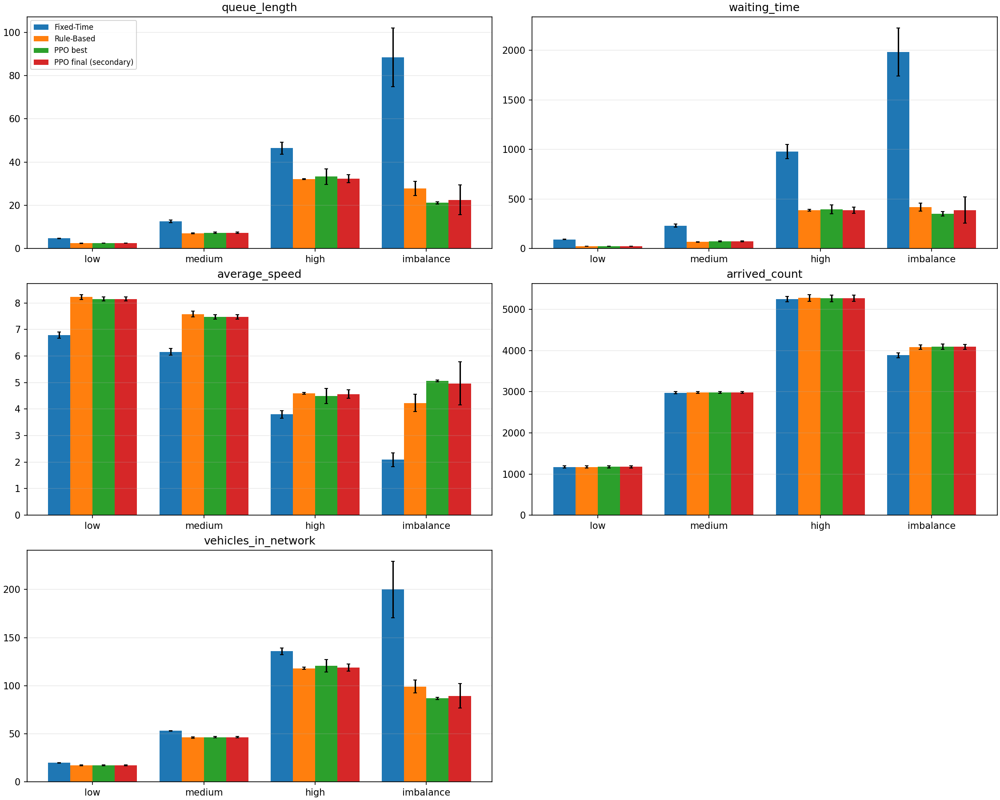

# DRL Seed100 — V2 experimental report

**Completed V2 seed100 experiment; results below are measured artifacts.**

## Configuration and execution

- Training seed: 100; requested/actual steps: 600,000 / 601,920.
- GPU: Quadro RTX 3000; fixed validation seed999; held-out evaluation seeds: [101, 102, 103].
- Training seeds sampled only from [1000,999999]; shuffled cycles cover all four scenarios.
- 12D directional observations clipped to [0,1]; MLP actor/critic [128,128].
- Reward = clip(-[Q_NS+Q_EW+0.05(W_NS+W_EW)+0.02(Q_NS-Q_EW)^2]/100,-10,0).
- SUMO step0.1s; decision5s; min/max green15/75s; yellow/all-red3/3s.
- PPO: n_steps2880, batch96, epochs5, gamma0.99, GAE0.95, clip0.2, entropy0.01, vf0.5, grad_norm0.5, target_KL0.02.
- LR linearly decreases 3e-4→1e-5; CUDA; advantage normalization enabled.
- Best model selected ONLY by mean reward on four seed999 validation episodes; held-out seeds never select the model.
- Timings in seconds: {"fixed_time_low_seed101": 26.83239609998418, "fixed_time_medium_seed101": 47.49392189999344, "fixed_time_high_seed101": 117.79104829998687, "fixed_time_imbalance_seed101": 232.1293944999925, "fixed_time_low_seed102": 24.05379550001817, "fixed_time_medium_seed102": 44.80832840001676, "fixed_time_high_seed102": 110.47892720001983, "fixed_time_imbalance_seed102": 281.24485299998196, "fixed_time_low_seed103": 23.954957699985243, "fixed_time_medium_seed103": 44.33473629999207, "fixed_time_high_seed103": 104.7506793999928, "fixed_time_imbalance_seed103": 177.04397429997334, "rule_based_low_seed101": 22.125246500014327, "rule_based_medium_seed101": 39.81055529997684, "rule_based_high_seed101": 93.06016490003094, "rule_based_imbalance_seed101": 83.40195109997876, "rule_based_low_seed102": 22.64193919999525, "rule_based_medium_seed102": 39.09121360001154, "rule_based_high_seed102": 91.5829398999922, "rule_based_imbalance_seed102": 88.34391930000857, "rule_based_low_seed103": 22.603232299967203, "rule_based_medium_seed103": 39.64554269996006, "rule_based_high_seed103": 90.65050029999111, "rule_based_imbalance_seed103": 76.19019679998746, "drl_training": 57655.59046400001, "drl_evaluation_best": 798.1653076999937, "drl_evaluation_final": 813.890689599968, "pipeline_through_evaluation": 61211.735251000035}

## Fair multi-seed traffic results

Mean ± sample Std (ddof=1) over evaluation seeds; single-seed preflight reports Std=0, not an uncertainty estimate.
Queue/wait/speed/network count: means of 720 post-step snapshots at t=5..3600s.
Arrivals: SUM of incremental arrivals over every 0.1s substep for the full episode.
Speed: vehicle-count-weighted over the same eight incoming lanes for all methods.
Same SUMO seeds and input files are passed directly to all methods; controlled trajectories may differ.

| Scenario | Metric | Fixed-Time | Rule-Based | PPO best | PPO final (secondary) |
|---|---|---:|---:|---:|---:|
| low | queue_length | 4.71 ± 0.11 | 2.42 ± 0.06 | 2.49 ± 0.05 | 2.49 ± 0.05 |
| low | waiting_time | 91.95 ± 2.55 | 22.71 ± 0.66 | 23.34 ± 0.32 | 23.34 ± 0.32 |
| low | average_speed | 6.79 ± 0.12 | 8.22 ± 0.09 | 8.15 ± 0.07 | 8.15 ± 0.07 |
| low | arrived_count | 1170.33 ± 28.04 | 1173.33 ± 26.76 | 1175.00 ± 24.27 | 1175.00 ± 24.27 |
| low | vehicles_in_network | 19.73 ± 0.41 | 17.01 ± 0.49 | 17.11 ± 0.43 | 17.11 ± 0.43 |
| medium | queue_length | 12.59 ± 0.60 | 6.98 ± 0.25 | 7.28 ± 0.30 | 7.28 ± 0.30 |
| medium | waiting_time | 231.66 ± 14.96 | 67.17 ± 2.72 | 71.68 ± 4.30 | 71.68 ± 4.30 |
| medium | average_speed | 6.16 ± 0.13 | 7.58 ± 0.11 | 7.47 ± 0.08 | 7.47 ± 0.08 |
| medium | arrived_count | 2972.33 ± 27.21 | 2982.33 ± 23.69 | 2984.00 ± 20.88 | 2984.00 ± 20.88 |
| medium | vehicles_in_network | 53.15 ± 0.25 | 46.08 ± 0.80 | 46.44 ± 0.80 | 46.44 ± 0.80 |
| high | queue_length | 46.41 ± 2.75 | 32.07 ± 0.23 | 33.30 ± 3.60 | 32.30 ± 1.89 |
| high | waiting_time | 977.85 ± 71.61 | 385.14 ± 9.48 | 395.16 ± 44.47 | 386.55 ± 29.62 |
| high | average_speed | 3.80 ± 0.14 | 4.59 ± 0.03 | 4.49 ± 0.29 | 4.57 ± 0.16 |
| high | arrived_count | 5250.33 ± 69.28 | 5280.00 ± 83.72 | 5268.33 ± 80.60 | 5273.00 ± 80.02 |
| high | vehicles_in_network | 135.78 ± 3.58 | 118.14 ± 1.32 | 120.59 ± 6.43 | 118.71 ± 3.78 |
| imbalance | queue_length | 88.53 ± 13.57 | 27.79 ± 3.28 | 21.19 ± 0.53 | 22.47 ± 6.88 |
| imbalance | waiting_time | 1984.07 ± 243.31 | 418.28 ± 41.75 | 350.30 ± 23.18 | 387.29 ± 131.94 |
| imbalance | average_speed | 2.09 ± 0.26 | 4.23 ± 0.32 | 5.06 ± 0.03 | 4.97 ± 0.82 |
| imbalance | arrived_count | 3886.00 ± 61.05 | 4086.67 ± 54.50 | 4095.00 ± 68.51 | 4093.33 ± 59.92 |
| imbalance | vehicles_in_network | 200.16 ± 29.34 | 99.18 ± 6.88 | 86.76 ± 1.06 | 89.49 ± 12.90 |

## Historical V1 → V2 context

Descriptive comparison only: V1 used different timing (min green30s), unmatched traffic seeds,
and faulty arrivals/speed definitions. Do not attribute changes solely to the neural network.

| Scenario | V1 PPO107 waiting | V1 PPO710 waiting | V2 PPO best waiting |
|---|---:|---:|---:|
| low | 45.26 | 50.04 | 23.34 ± 0.32 |
| medium | 125.34 | 135.17 | 71.68 ± 4.30 |
| high | 555.05 | 962.12 | 395.16 ± 44.47 |
| imbalance | 815.19 | 1117.53 | 350.30 ± 23.18 |

## Interpretation and limitations

Waiting is the time-mean of the sum of current lane waiting times, not mean trip delay.
Evaluation stops at3600s; remaining vehicles are reported; completed-trip delay is not inferred.
Collision warnings are retained in subprocess.log; low queue/wait does not establish collision-free operation.
Normalization clips queue>60, vehicles>80 and waiting>1500 per axis; saturation and imbalance penalty can trade throughput against balance.
Only three held-out seeds support this comparison; no guarantee of superiority or convergence is implied.
V1 models, evaluations, results, event logs and existing comparison Markdown files were preserved.

Sources: per-step metrics.csv, per-episode episodes.csv, summary_final.csv, pipeline_timings.json,
training_metadata.json and the preserved V1 seed107/seed710 summaries.
